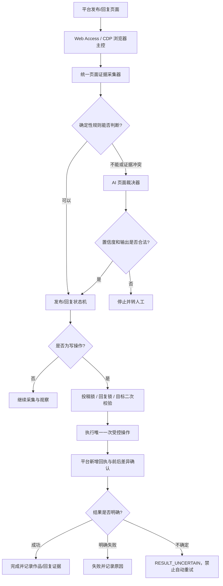

# Web Access 与 AI 发布/自主回复增强执行方案 V0.1

- **适用项目**：AI 数字员工 MVP（最新版正式项目）
- **项目目录**：`D:\code\Codex项目交接包-2026-07-31\06_MVP\ai-digital-employee-mvp`
- **管理平台**：`http://127.0.0.1:3216/`
- **方案日期**：2026-08-14
- **方案状态**：待确认后实施
- **实施原则**：在现有正式代码上增量增强，不推倒重写，不改旧版管理平台

---

## 1. 执行摘要

本次改造的核心不是“让 AI 无限制接管浏览器”，而是建立一套可审计、可回滚、不会重复误操作的新浏览器控制体系：

> **Web Access 负责连接真实浏览器、采集页面证据并执行受控操作；AI 负责理解复杂或变化后的页面；确定性状态机负责流程推进；投稿锁、回复锁和证据回执负责防止误发布、重复发布和回错对象。**

现有项目已经具备 Web Access CDP、Playwright 兼容执行层、平台适配器、AI 内容审核、知识库、发布回执、投稿锁和问题诊断能力。因此本方案不替换整套业务，而是在现有基础上补齐以下短板：

1. Web Access 主控启动失败时的可靠诊断和写操作降级策略；
2. 大视频上传、转码、封面生成等长耗时阶段的状态识别；
3. 平台页面改版后，固定选择器失效时的 AI 辅助识别；
4. 草稿、上传完成、提交成功、审核中、已发布之间的证据区分；
5. 自主回复时对评论/私信目标的精确定位和发送后回显确认；
6. 所有 AI 判断、浏览器操作和状态变化的全链路审计；
7. 控制 AI 调用频率、延迟和费用，只在规则无法确定时调用 AI。

实施顺序建议为：

```text
P0 Web Access 主控可靠性
→ P1 统一页面证据
→ P2 AI 页面裁决器
→ P3 发布闭环
→ P4 自主回复闭环
→ P5 灰度上线与观测
```

预计工作量：**约 15～24 个开发日**。平台临时改版、登录验证和验证码处理可能影响实际工期。

---

## 2. 当前正式项目基线

### 2.1 当前浏览器控制链路

现有正式代码已经形成以下链路：

```text
BusinessBrowserRouter
→ Web Access CDP 主控
→ Playwright CDP 兼容执行平台业务逻辑
→ Web Access 启动失败时按策略回退 Playwright
```

关键文件：

- `D:\code\Codex项目交接包-2026-07-31\06_MVP\ai-digital-employee-mvp\agent\browser-control\business-router.js`
- `D:\code\Codex项目交接包-2026-07-31\06_MVP\ai-digital-employee-mvp\agent\browser-control\controller.js`
- `D:\code\Codex项目交接包-2026-07-31\06_MVP\ai-digital-employee-mvp\agent\browser-control\platform-web-access-manager.js`
- `D:\code\Codex项目交接包-2026-07-31\06_MVP\ai-digital-employee-mvp\agent\browser-control\providers\web-access-cdp-provider.js`
- `D:\code\Codex项目交接包-2026-07-31\06_MVP\ai-digital-employee-mvp\agent\browser-control\providers\playwright-provider.js`
- `D:\code\Codex项目交接包-2026-07-31\06_MVP\ai-digital-employee-mvp\agent\browser-control\vendor\web-access\cdp-proxy.mjs`

当前运行记录已包含：

```json
{
  "providerRequested": "web_access_cdp",
  "providerUsed": "web_access_cdp 或 playwright",
  "fallbackUsed": false,
  "fallbackReason": null
}
```

这意味着 Web Access 已经进入正式代码，但目前还需要从“能接入”提升到“稳定作为主控、失败可解释、写操作不静默降级”。

### 2.2 当前已有安全和 AI 能力

现有可复用能力包括：

- AI 素材与内容审核：`D:\code\Codex项目交接包-2026-07-31\06_MVP\ai-digital-employee-mvp\agent\material-ai-review.js`
- AI 问题诊断：`D:\code\Codex项目交接包-2026-07-31\06_MVP\ai-digital-employee-mvp\src\services\issue-diagnosis.js`
- 发布回执判定：`D:\code\Codex项目交接包-2026-07-31\06_MVP\ai-digital-employee-mvp\src\services\publish-attestation.js`
- 浏览器控制策略：`D:\code\Codex项目交接包-2026-07-31\06_MVP\ai-digital-employee-mvp\src\services\browser-control-policy.js`
- 投稿安全锁：`D:\code\Codex项目交接包-2026-07-31\06_MVP\ai-digital-employee-mvp\agent\rpa-adapters\publish-guard.js`
- 知识库服务：`D:\code\Codex项目交接包-2026-07-31\06_MVP\ai-digital-employee-mvp\src\services\knowledge.js`
- 动态上传等待：`D:\code\Codex项目交接包-2026-07-31\06_MVP\ai-digital-employee-mvp\agent\publish-upload-timeout.js`

本次方案必须复用这些能力，不再额外建立一套彼此冲突的审核、知识库或锁机制。

### 2.3 已确认的典型问题

以任务 #65 的 146.3MB、2 分 41 秒 HEVC Main10 视频为例：

- 素材预检通过；
- AI 合规审核通过；
- 小红书失败时页面仍显示上传约 71%，并非真正上传失败；
- 多个平台原有固定 3 分钟等待不足，导致上传中被误判失败；
- B 站存在无法确认归属的历史草稿，被安全规则拦截；
- 当次 Web Access 启动失败，实际回退 Playwright，但这不是四个平台上传超时的直接根因。

当前已将上传等待改为基于文件大小的动态等待，范围为 10～30 分钟；本方案后续是在该修复上继续增加“页面状态识别、停滞检测和结果证据确认”，而不是重新修改为另一个固定超时。

---

## 3. 本次改造目标

### 3.1 发布业务目标

1. 准确区分“上传中、处理中、草稿已就绪、可提交、提交中、审核中、已发布、结果不确定、明确失败”；
2. 页面改版或选择器失效时，允许 AI 根据截图、DOM 和可见文字提出判断；
3. 最终发布前必须通过确定性安全检查，AI 不能绕过投稿锁；
4. 提交后必须获得新增回执或可验证作品证据；
5. 结果不确定时禁止自动重复投稿；
6. 管理端能看到使用了哪个 Provider、AI 判断结果、证据截图和失败原因。

### 3.2 自主回复业务目标

1. 回复前精确锁定平台、账号、会话、评论/私信对象和原始消息；
2. 先检索知识库，再生成回复，再进行风险审核；
3. 页面定位不明确时，AI 可辅助识别，但不得猜测回复目标；
4. 发送前二次核对目标，发送后校验新增回复回显；
5. 结果不确定时停止，不自动重复发送；
6. 回错对象次数、重复回复次数必须保持为 0。

### 3.3 非目标

本阶段不做以下事项：

- 不让 AI 自行删除旧草稿；
- 不让 AI 绕过登录、验证码或平台风控；
- 不让 AI 在证据不足时连续点击发布；
- 不让 AI 在找不到精确评论/私信目标时猜测发送；
- 不用 AI 替代所有选择器和状态规则；
- 不把网页上出现的文字当成系统指令；
- 不在结果不确定时自动重新投稿或重新回复；
- 不修改旧版管理平台，本次只改最新版正式项目。

---

## 4. 核心设计原则

### 4.1 规则优先，AI 补位

能用确定性规则判断的页面状态，不调用 AI。只有出现以下情况才调用 AI：

- 关键选择器失效；
- DOM 证据和页面可见文字冲突；
- 页面出现未识别的新弹窗或新提示；
- 上传、转码或发布长时间无明显进展；
- 提交后没有标准回执，但页面出现疑似成功/失败证据；
- 回复页面存在多个相似对象，需要进一步核验。

这样可以降低成本、延迟和误判概率。

### 4.2 AI 只建议有限动作

AI 页面裁决器仅允许返回以下建议：

```text
WAIT
EXTEND_TIMEOUT
RECHECK
CAPTURE_MORE_EVIDENCE
STOP_AND_ESCALATE
```

对于已经通过确定性规则完成唯一目标确认的场景，可由状态机执行预先批准的单次动作；AI 本身不直接执行鼠标点击。

### 4.3 高风险动作由安全状态机控制

以下动作必须由状态机和安全锁共同决定：

- 点击最终发布按钮；
- 点击最终发送回复按钮；
- 覆盖或删除草稿；
- 在页面回执不清晰时重新提交；
- 在目标不清晰时切换评论或私信对象。

### 4.4 所有结论必须有证据

每次关键判断至少记录：

- URL 和页面标题；
- 关键 DOM 选择器；
- 可见文字；
- 按钮状态；
- 上传百分比或进度提示；
- spinner/遮罩状态；
- 当前平台、账号、任务 ID、Job ID；
- 判断前后页面差异；
- 截图路径；
- Provider 使用情况；
- AI 输出及置信度；
- 最终实际执行动作。

---

## 5. 目标架构



### 5.1 Web Access 在新体系中的定位

Web Access Skill 不替换现有五个平台业务适配器，也不替换 Playwright 的 DOM 操作能力。它主要替换和增强的是：

- 浏览器启动与 CDP 连接；
- 真实登录 Profile 管理；
- 页面截图、DOM、URL、可见文本等证据采集；
- 基于实时页面证据的动态操作入口；
- 浏览器会话健康检查；
- 页面变化后的重新观察机制。

平台发布字段、封面设置、声明选项、评论回复业务规则仍然保留在现有适配器中。

### 5.2 Provider 策略

建议将策略分为两类：

| 操作类型 | Web Access 失败时策略 |
|---|---|
| 只读观察、截图、诊断 | 可按配置降级到 Playwright，并明确记录回退原因 |
| 发布、回复等写操作 | 默认停止并转人工；只有经过专项验证的平台才允许受控回退 |

写操作不能在 Provider 未知或连接状态异常时静默回退。

---

## 6. 统一业务状态机

### 6.1 发布状态

建议统一为：

```text
WAITING_FOR_UPLOAD
UPLOADING
PROCESSING
DRAFT_READY
READY_TO_SUBMIT
SUBMITTING
SUBMITTED
REVIEWING
PUBLISHED
UPLOAD_FAILED
VERIFY_REQUIRED
OLD_DRAFT_BLOCKED
RESULT_UNCERTAIN
MANUAL_REQUIRED
```

关键规则：

- `UPLOADING`：有明确百分比、上传速度、进度条或持续变化证据；
- `PROCESSING`：上传完成但平台仍在转码、审核素材、生成封面；
- `DRAFT_READY`：字段和素材已就绪，但尚未满足最终提交条件；
- `READY_TO_SUBMIT`：最终按钮唯一、可用，所有必填项和声明均通过；
- `SUBMITTING`：只允许从 `READY_TO_SUBMIT` 进入一次；
- `SUBMITTED`：平台明确收到投稿，但不代表已经公开；
- `REVIEWING`：平台显示审核中；
- `PUBLISHED`：存在新作品 ID、作品 URL、发布列表新增项或其他强证据；
- `RESULT_UNCERTAIN`：点击后页面无明确新增回执，必须禁止自动重发；
- `OLD_DRAFT_BLOCKED`：发现无法确认归属的旧草稿，不允许自动覆盖或删除。

### 6.2 回复状态

建议统一为：

```text
TARGET_DISCOVERED
TARGET_VERIFIED
KNOWLEDGE_RETRIEVED
REPLY_GENERATED
RISK_REVIEWED
READY_TO_SEND
SENDING
SENT
ECHO_CONFIRMED
TARGET_AMBIGUOUS
RESULT_UNCERTAIN
MANUAL_REQUIRED
```

关键规则：

- `TARGET_VERIFIED` 必须由平台 ID、会话 ID、评论 ID、用户标识和原文摘要中的至少两类证据组成；
- 未达到 `TARGET_VERIFIED` 不得生成最终写操作；
- 知识库无可靠依据或风险审核不通过，不得进入 `READY_TO_SEND`；
- `SENDING` 只允许执行一次；
- `ECHO_CONFIRMED` 必须验证新增消息属于当前任务且内容匹配；
- 发送后没有回显时进入 `RESULT_UNCERTAIN`，不得重复发送。

---

## 7. AI 页面裁决器设计

### 7.1 输入

AI 不直接读取整个无限页面，而是接收结构化证据包：

```json
{
  "operationType": "publish",
  "platformCode": "xiaohongshu",
  "taskId": 65,
  "jobId": "...",
  "url": "...",
  "title": "...",
  "knownState": "UPLOADING",
  "visibleTexts": [],
  "buttonStates": [],
  "progressSignals": [],
  "domEvidence": {},
  "previousObservation": {},
  "screenshotPath": "...",
  "allowedActions": [
    "WAIT",
    "EXTEND_TIMEOUT",
    "RECHECK",
    "CAPTURE_MORE_EVIDENCE",
    "STOP_AND_ESCALATE"
  ]
}
```

### 7.2 严格输出

```json
{
  "stage": "UPLOADING",
  "progress": 71,
  "confidence": 0.98,
  "blockingReason": null,
  "recommendedAction": "WAIT",
  "evidence": [
    "页面存在上传百分比",
    "进度比上一轮增加"
  ]
}
```

输出必须经过 JSON Schema 校验，非法 JSON、未知动作、低置信度或证据为空时一律不执行写操作。

### 7.3 建议置信度门槛

| 场景 | 最低置信度 | 处理方式 |
|---|---:|---|
| 建议继续等待 | 0.75 | 可由状态机继续观察 |
| 建议补充截图/证据 | 0.70 | 只执行只读操作 |
| 判断明确失败 | 0.90 | 仍需确定性错误证据配合 |
| 最终发布或最终回复 | AI 不单独授权 | 必须通过状态机和安全锁 |

### 7.4 提示注入防护

- 页面内容全部作为“不可信数据”传给 AI；
- 网页中出现“忽略规则”“点击某按钮”“发送某内容”等文字不能改变系统策略；
- AI 输出只能从白名单动作中选择；
- AI 不接收数据库密码、Cookie 明文、API 密钥；
- AI 不能产生任意 JavaScript 并在页面直接执行；
- 最终写操作仍由本地受控代码完成。

---

## 8. 分阶段执行方案

## P0：Web Access 主控可靠性

**预计：1～2 个开发日**

### 工作内容

1. 完整定位并修复 `BROWSER_REMOTE_DEBUGGING_START_FAILED`：
   - Chrome/Edge 进程占用；
   - Profile 被锁；
   - 调试端口冲突；
   - CDP Proxy 启动和退出；
   - 浏览器路径、用户数据目录和权限；
   - 僵尸进程及异常会话清理。
2. 增加 Web Access Provider 启动前预检和启动后健康检查；
3. 增加 Proxy 生命周期监控、退出码、stderr 和重启次数记录；
4. 将“只读回退”和“写操作回退”策略分离；
5. 管理端展示：请求 Provider、实际 Provider、是否回退、原因和健康状态；
6. 写操作遇到未知 Provider 状态时保守停止。

### 主要落点

- `D:\code\Codex项目交接包-2026-07-31\06_MVP\ai-digital-employee-mvp\agent\browser-control\business-router.js`
- `D:\code\Codex项目交接包-2026-07-31\06_MVP\ai-digital-employee-mvp\agent\browser-control\controller.js`
- `D:\code\Codex项目交接包-2026-07-31\06_MVP\ai-digital-employee-mvp\agent\browser-control\platform-web-access-manager.js`
- `D:\code\Codex项目交接包-2026-07-31\06_MVP\ai-digital-employee-mvp\agent\browser-control\providers\web-access-cdp-provider.js`
- `D:\code\Codex项目交接包-2026-07-31\06_MVP\ai-digital-employee-mvp\agent\browser-control\vendor\web-access\cdp-proxy.mjs`
- `D:\code\Codex项目交接包-2026-07-31\06_MVP\ai-digital-employee-mvp\src\services\browser-control-policy.js`
- `D:\code\Codex项目交接包-2026-07-31\06_MVP\ai-digital-employee-mvp\src\server.js`

### 验收标准

正式写操作的审计记录必须明确出现：

```json
{
  "providerRequested": "web_access_cdp",
  "providerUsed": "web_access_cdp",
  "fallbackUsed": false,
  "fallbackReason": null
}
```

并完成以下故障演练：Profile 占用、端口占用、浏览器启动失败、Proxy 异常退出、登录态失效。

---

## P1：统一页面证据采集

**预计：2～3 个开发日**

### 工作内容

1. 建立统一 `BrowserObservation` 数据结构；
2. 每个平台适配器在关键节点输出相同格式的页面快照；
3. 支持截图、DOM 摘要、可见文本、按钮状态、上传进度、错误提示和验证码识别；
4. 保存前后两轮观察差异，用于判断上传是否还在推进；
5. 将证据关联到 task/job/platform/account；
6. 对截图和 DOM 证据设置保留周期，避免无限占用磁盘。

### 建议新增文件

- `D:\code\Codex项目交接包-2026-07-31\06_MVP\ai-digital-employee-mvp\agent\browser-control\browser-observation.js`
- `D:\code\Codex项目交接包-2026-07-31\06_MVP\ai-digital-employee-mvp\agent\browser-control\observation-diff.js`
- `D:\code\Codex项目交接包-2026-07-31\06_MVP\ai-digital-employee-mvp\src\services\operation-evidence.js`

### 验收标准

- 五个平台均能产生统一观察记录；
- 能区分上传进度“持续增长”和“停滞”；
- 页面报错、验证码、登录失效能被记录并显示到管理端；
- 不调用 AI 也能解释大多数正常流程状态。

---

## P2：AI 页面裁决器

**预计：2～4 个开发日**

### 工作内容

1. 新增 AI 页面裁决服务，只处理规则不确定的情况；
2. 建立严格 JSON Schema、动作白名单和置信度门槛；
3. 支持截图 + DOM 摘要的多模态判断；
4. 增加模型超时、无效 JSON、低置信度和服务不可用的保守降级；
5. 增加提示注入防护；
6. 保存 AI 输入摘要、输出、耗时、模型和估算 Token；
7. 管理端展示“规则判断”和“AI 辅助判断”的区别。

### 建议新增文件

- `D:\code\Codex项目交接包-2026-07-31\06_MVP\ai-digital-employee-mvp\src\services\ai-page-adjudicator.js`
- `D:\code\Codex项目交接包-2026-07-31\06_MVP\ai-digital-employee-mvp\src\services\ai-page-decision-schema.js`
- `D:\code\Codex项目交接包-2026-07-31\06_MVP\ai-digital-employee-mvp\src\services\untrusted-page-content.js`

### 成本控制

- 正常流程不调用 AI；
- 同一页面未发生变化时不重复调用；
- 先使用裁剪后的 DOM 和关键区域截图；
- 设置每个任务、每个平台的最大 AI 裁决次数；
- 低风险分类可用低成本模型，复杂视觉冲突再升级模型；
- 记录单任务 AI 成本，后续按真实数据制定预算。

### 验收标准

- AI 输出 100% 经过 Schema 校验；
- AI 返回未知动作时不会执行；
- AI 超时或不可用时，写操作自动停止而不是盲点；
- 页面提示注入文本不能改变允许动作集合；
- 管理端可查看 AI 判定依据、置信度和实际采取的动作。

---

## P3：五平台发布闭环

**预计：4～6 个开发日**

### 平台实施顺序

```text
小红书 → 微博 → 抖音 → 视频号 → B站
```

理由：先用已积累较多调试证据的小红书、微博完成通用闭环，再迁移至其他平台；B 站旧草稿归属问题继续保留人工确认，不自动删除。

### 工作内容

1. 接入现有动态上传超时，不再使用固定 3 分钟判断失败；
2. 增加上传停滞检测：进度、文字、网络活动和截图连续多轮不变化才判定异常；
3. 增加上传完成后的转码、审核、封面生成阶段识别；
4. 建立草稿就绪验证，区分当前任务草稿和历史草稿；
5. 最终发布按钮必须唯一、可见、可用，且所有必填项通过；
6. 点击前获取投稿锁并保存提交前证据；
7. 只点击一次最终发布按钮；
8. 点击后捕获新增 Toast、页面跳转、作品列表新增项、作品 ID/URL；
9. `审核中` 记录为 `REVIEWING`，不能直接当作 `PUBLISHED`；
10. 无法确定时进入 `RESULT_UNCERTAIN`，禁止自动重投；
11. 管理端显示当前状态、进度、证据、作品 ID/URL 和人工处理建议。

### 主要落点

- `D:\code\Codex项目交接包-2026-07-31\06_MVP\ai-digital-employee-mvp\agent\local-agent.js`
- `D:\code\Codex项目交接包-2026-07-31\06_MVP\ai-digital-employee-mvp\agent\publish-upload-timeout.js`
- `D:\code\Codex项目交接包-2026-07-31\06_MVP\ai-digital-employee-mvp\agent\rpa-adapters\assisted-platform.js`
- `D:\code\Codex项目交接包-2026-07-31\06_MVP\ai-digital-employee-mvp\agent\rpa-adapters\xiaohongshu-assisted.js`
- `D:\code\Codex项目交接包-2026-07-31\06_MVP\ai-digital-employee-mvp\agent\rpa-adapters\weibo-assisted.js`
- 其余抖音、视频号和 B 站现有平台适配器
- `D:\code\Codex项目交接包-2026-07-31\06_MVP\ai-digital-employee-mvp\agent\rpa-adapters\publish-guard.js`
- `D:\code\Codex项目交接包-2026-07-31\06_MVP\ai-digital-employee-mvp\src\services\publish-attestation.js`

### 验收标准

- 大视频上传过程中不再被固定短超时误判失败；
- 上传停滞与正常慢速上传能够被区分；
- 每次最终发布最多点击一次；
- 重复投稿次数必须为 0；
- 结果不确定自动重投次数必须为 0；
- 每个成功结论都有平台新增回执证据；
- B 站不明旧草稿仍会安全阻断并提示人工确认。

---

## P4：自主回复闭环

**预计：4～6 个开发日**

### 工作内容

1. 为评论和私信建立统一 `ReplyTarget`；
2. 从平台页面获取目标 ID、用户名、原文、时间、会话/帖子信息；
3. 将目标与任务中心记录进行精确匹配；
4. 调用现有知识库检索，并记录引用知识；
5. AI 生成回复，经过敏感信息、承诺、价格、政策和人工接管规则审核；
6. Web Access 打开精确目标；
7. 发送前再次核对目标 ID、原文摘要和输入框归属；
8. 获取回复锁，只执行一次发送；
9. 发送后验证新增局部回显和内容匹配；
10. 目标不清晰、知识不足、页面异常、验证码或无回显时转人工；
11. 建立去重键，防止同一条评论/私信被重复回复。

### 建议新增数据结构

```json
{
  "platformCode": "...",
  "accountId": "...",
  "conversationId": "...",
  "messageId": "...",
  "commentId": "...",
  "authorId": "...",
  "authorName": "...",
  "sourceTextHash": "...",
  "sourceTextPreview": "...",
  "sourceTimestamp": "..."
}
```

### 验收标准

- 无精确目标时自动回复次数必须为 0；
- 回错对象次数必须为 0；
- 同一目标重复回复次数必须为 0；
- 无知识依据且需要事实回答时自动回复次数必须为 0；
- 发送成功必须有新增回显或明确平台回执；
- AI 生成内容和页面控制权限完全分离。

---

## P5：灰度上线与观测

**预计：2～3 个开发日**

### 灰度顺序

1. **只读观测模式**：采集证据，不改变现有动作；
2. **AI 建议模式**：AI 给出判断，但不影响状态机；
3. **安全动作模式**：仅允许等待、补充截图、重新检查；
4. **单平台写操作**：先开放小红书单账号；
5. **逐平台扩展**：微博、抖音、视频号、B 站；
6. **自主回复灰度**：先内部测试账号，再小流量正式账号；
7. **全量前复盘**：按 KPI 决定是否扩大。

### 管理端应新增展示

- Web Access 健康状态；
- 当前平台 Browser Profile；
- 当前 Provider 与回退情况；
- 当前业务状态；
- 最近页面证据和截图；
- AI 是否参与、判定结果和置信度；
- 写操作是否执行；
- 投稿锁/回复锁状态；
- 人工接管原因；
- 单任务 AI 调用次数和估算成本。

---

## 9. 数据库与接口建议

数据库调整应沿用当前项目的 SQLite/迁移方式，所有字段保持向后兼容。生产云端是否升级 PostgreSQL，另在部署方案中确认。

### 9.1 建议新增表

#### `browser_observations`

记录每轮页面观察：

```text
id
task_id
job_id
platform_code
account_id
operation_type
provider_requested
provider_used
url
page_title
screenshot_path
dom_evidence_json
visible_text_json
button_state_json
progress_json
created_at
```

#### `ai_page_decisions`

```text
id
observation_id
model
prompt_version
decision_json
confidence
recommended_action
validation_passed
latency_ms
input_tokens
output_tokens
estimated_cost
created_at
```

#### `operation_state_transitions`

```text
id
task_id
job_id
platform_code
operation_type
stage_before
stage_after
reason_code
action_taken
created_at
```

#### `operation_evidence`

```text
id
task_id
job_id
platform_code
evidence_type
evidence_value
evidence_hash
is_new_evidence
created_at
```

### 9.2 建议接口

```text
GET  /api/browser-control/health
GET  /api/browser-control/providers
GET  /api/tasks/:id/observations
GET  /api/tasks/:id/state-transitions
GET  /api/tasks/:id/ai-decisions
POST /api/tasks/:id/manual-confirmation
POST /api/tasks/:id/recheck
```

人工确认接口必须带操作者、原因和时间，且不能直接绕过投稿锁或回复锁。

---

## 10. 配置开关建议

所有新增能力必须可单独关闭：

```text
WEB_ACCESS_PRIMARY_ENABLED=true
WEB_ACCESS_READONLY_FALLBACK_ENABLED=true
WEB_ACCESS_WRITE_FALLBACK_ENABLED=false
AI_PAGE_DECISION_ENABLED=false
AI_PAGE_DECISION_SHADOW_MODE=true
AI_PAGE_DECISION_MIN_CONFIDENCE=0.75
AI_PAGE_DECISION_MAX_PER_PLATFORM=5
PUBLISH_STATE_MACHINE_V2_ENABLED=false
REPLY_STATE_MACHINE_V2_ENABLED=false
OPERATION_EVIDENCE_RETENTION_DAYS=30
```

上线时先开启 `AI_PAGE_DECISION_SHADOW_MODE`，确认 AI 与人工判断一致后，再允许其影响等待、重新观察等低风险动作。

---

## 11. 测试矩阵

### 11.1 发布测试

- 小、中、大三档视频；
- H.264、HEVC、不同分辨率和时长；
- 正常网络、慢速网络、短暂断网；
- 上传百分比持续变化；
- 上传百分比长时间不变；
- 上传完成后的转码；
- 自动封面和手动封面；
- 平台登录过期；
- 验证码和安全验证；
- 历史旧草稿；
- 当前任务草稿；
- 最终按钮不唯一、不可见、不可用；
- 点击后有 Toast；
- 点击后跳转作品列表；
- 点击后无回执；
- 审核中和已发布区分；
- Web Access 启动失败；
- Profile 占用；
- CDP Proxy 异常退出；
- AI 超时、低置信度、非法 JSON。

### 11.2 回复测试

- 评论和私信；
- 相同用户名的多条评论；
- 相同文案的不同评论；
- 历史消息和新消息混排；
- 页面滚动后目标重定位；
- 输入框归属不清晰；
- 发送后回显延迟；
- 发送后无回显；
- 知识库有答案、低置信度、无答案；
- 敏感话题和需要人工审批的回复；
- 登录过期、验证码、页面改版；
- AI 输出非法内容或未知动作；
- 同一任务重复触发。

### 11.3 回归测试

每阶段必须执行：

1. 单元测试；
2. Provider 合约测试；
3. 状态机状态迁移测试；
4. 投稿锁和回复锁并发测试；
5. API 回归测试；
6. 最新管理端 UI 测试；
7. 五平台只读实机测试；
8. 获得授权后的小流量写操作测试。

当前项目已有完整测试基线，上一轮为 **336 项通过、0 项失败**；每阶段改造后不得降低基线通过率。

---

## 12. 验收指标

### 12.1 发布 KPI

- Web Access 实际使用率；
- 非预期 Provider 回退率；
- 上传中被误判失败的次数；
- 草稿准备成功率；
- 提交回执确认率；
- AI 判断与人工复核一致率；
- 人工接管率；
- 平均单平台发布时间；
- 重复投稿次数：**必须为 0**；
- 结果不确定时自动重投次数：**必须为 0**。

### 12.2 回复 KPI

- 精确目标命中率；
- 知识库命中和引用率；
- 回复发送回显确认率；
- AI 判断与人工复核一致率；
- 人工接管率；
- 平均回复处理时间；
- 回错对象次数：**必须为 0**；
- 重复回复次数：**必须为 0**；
- 无知识依据的事实型自动回复次数：**必须为 0**。

本方案不预先承诺固定的成功率提升百分比。最终提升幅度必须通过灰度数据与现有基线对比后确定。

---

## 13. 风险与处理策略

| 风险 | 处理策略 |
|---|---|
| 平台页面频繁改版 | 统一证据层 + 规则优先 + AI 补位，不完全依赖固定选择器 |
| 平台检测自动化或账号风控 | 控制频率、复用正常登录 Profile、遇验证码立即转人工，不尝试绕过 |
| AI 视觉误判 | 动作白名单、置信度门槛、状态机复核、最终写操作不由 AI 单独授权 |
| 网页提示注入 | 网页内容视为不可信数据，禁止改变系统规则或执行任意脚本 |
| 上传速度极慢 | 动态超时 + 进度差异 + 停滞窗口，而不是无限等待 |
| 点击后结果不明确 | `RESULT_UNCERTAIN`，保存证据并禁止重复操作 |
| 历史草稿干扰 | 草稿归属校验，无法确认则 `OLD_DRAFT_BLOCKED` |
| AI 成本失控 | 规则优先、页面无变化不重调、次数上限、Token/成本审计 |
| 截图和日志占用空间 | 设置保留周期、压缩、脱敏和定时清理 |
| 隐私或密钥泄露 | 截图脱敏、日志不记录 Cookie/密码/API Key，最小化 AI 输入 |

---

## 14. 回滚方案

1. 每个阶段实施前单独备份正式代码和数据库；
2. 新能力全部由配置开关控制；
3. 保留现有确定性流程，AI 裁决器可随时关闭；
4. 新状态和新表保持向后兼容；
5. Web Access 失败时，只读操作可降级，写操作默认停止；
6. 禁止通过回滚机制自动重试已有投稿锁或结果不确定的写操作；
7. 每个平台可单独关闭 V2 发布/回复状态机；
8. 管理端保留人工确认和证据下载入口；
9. 出现回错对象、重复发布或重复回复任一事件时，立即关闭对应平台写操作开关。

---

## 15. 工期与里程碑

| 阶段 | 内容 | 初步工期 | 交付物 |
|---|---|---:|---|
| P0 | Web Access 主控可靠性 | 1～2 天 | 健康检查、回退策略、管理端状态 |
| P1 | 统一页面证据 | 2～3 天 | Observation、截图/DOM证据、差异检测 |
| P2 | AI 页面裁决器 | 2～4 天 | 结构化裁决、Schema、成本审计 |
| P3 | 五平台发布闭环 | 4～6 天 | 发布状态机、回执、五平台适配 |
| P4 | 自主回复闭环 | 4～6 天 | 精确目标、知识库、回复锁、回显确认 |
| P5 | 灰度与观测 | 2～3 天 | 灰度开关、指标面板、验收报告 |
| **合计** |  | **15～24 个开发日** | 可灰度上线的新控制体系 |

该工期基于当前正式项目已有代码能力估算，不包含平台要求人工实名、安全验证等待、账号申诉或大规模基础设施迁移时间。

---

## 16. 建议的实际开工顺序

确认方案后，建议按以下顺序执行：

1. 先完整备份最新版正式代码、数据库和关键浏览器 Profile 配置；
2. 完成 P0，先保证 Web Access 在正式写操作中真正作为主控；
3. 完成 P1，但先以只读方式记录，不影响现有发布；
4. 完成 P2，使用 Shadow Mode 对比 AI 与现有规则/人工判断；
5. 先在小红书单账号接入 P3 状态机；
6. 验证大视频、慢速上传、草稿和无回执场景；
7. 依次扩展微博、抖音、视频号和 B 站；
8. 发布闭环稳定后再接 P4 自主回复，避免同时改两条高风险写链路；
9. 小流量灰度，按 KPI 决定是否扩大；
10. 最后形成云端部署容量和 AI 实际费用报告。

---

## 17. 本方案确认点

开始实施前需要确认以下原则：

- Web Access 作为正式业务浏览器主控；
- Playwright 保留为 CDP 执行兼容层，不完全删除；
- 写操作默认不允许静默回退；
- AI 只在证据不足时参与，不直接拥有发布/发送权限；
- 最终发布和回复仍受投稿锁/回复锁约束；
- 结果不确定时不自动重试；
- B 站无法确认归属的旧草稿继续人工处理；
- 先完成发布闭环，再开放自主回复闭环；
- 所有改动只进入最新版正式项目。

确认后即可从 **P0：Web Access 主控可靠性** 开始实施。
