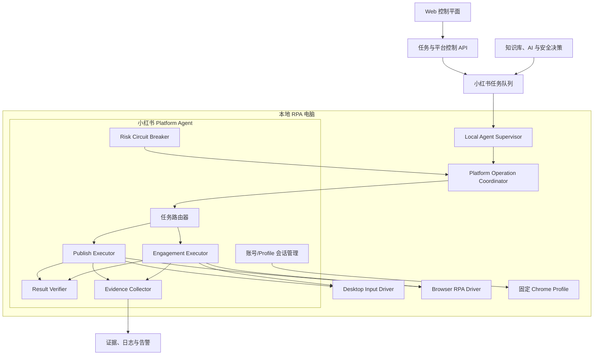
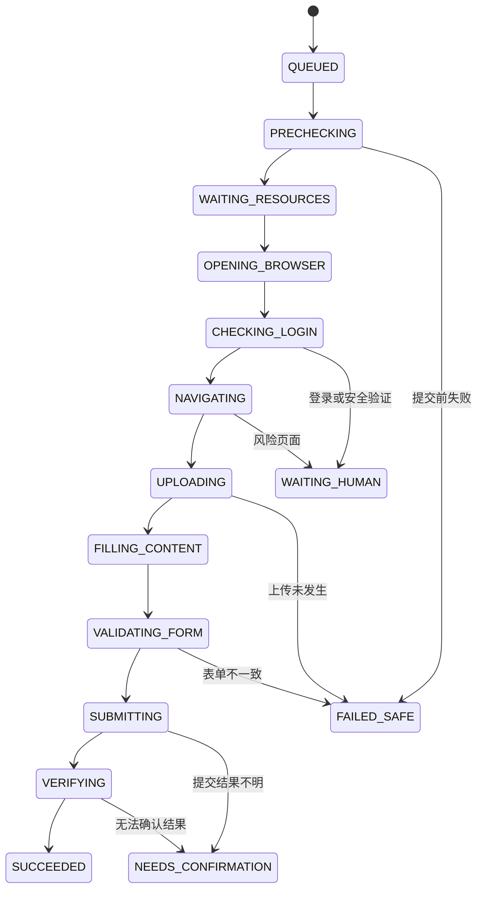
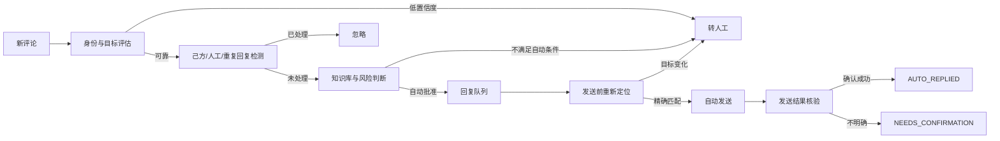

# 小红书平台全自动运营设计方案 V1.0

- 文档日期：2026-08-10
- 适用工程：天河港澳社区 AI 数字员工运营平台 MVP
- 目标平台：小红书
- 核心场景：每日约 1 篇内容自动发布；围绕已发布内容增量采集评论和私信；对高可信、低风险、可精确定位的问题进行自动回复
- 设计原则：平台显式开启后才运行；关闭的平台绝不被任务反向唤醒；正常登录和已适配页面范围内全自动；验证、风控或结果不明确时熔断，不绕过平台安全机制

---

## 1. 设计结论

小红书作为独立 Platform Agent，由 Local Agent Supervisor 统一管理，但平台内部按能力拆成发布、互动、核验和风险控制四条执行链路。

第一版采用以下硬性策略：

1. 一个小红书账号绑定一个固定 Browser Profile。
2. 同一个账号的发布、评论采集、评论回复、私信采集和私信回复全部串行。
3. 小红书平台 `desired_state=STOPPED` 时，不领取任务、不打开浏览器、不检查登录、不访问 Profile、不执行采集或写操作。
4. 平台开启后，浏览器按任务启动；无任务时不持续刷新页面。
5. 正常状态允许自动点击发布、自动回复评论和私信。
6. 扫码、验证码、人脸、设备验证、操作限制和未知安全页面必须进入 `WAITING_HUMAN` 或 `SUSPENDED`。
7. 发布和回复属于非幂等写操作；进入最终提交阶段后，任何不确定结果都不得自动重试。
8. 评论和私信只响应用户主动产生的真实咨询，不主动批量私信陌生用户，不建设导流和批量营销能力。
9. 高频是“高频采集、精准筛选、必要问题回复”，不是“所有消息无差别回复”。
10. 不建设浏览器指纹伪造、WebDriver 隐藏、验证码绕过、代理轮换或其他规避平台检测的模块。

---

## 2. 业务范围

### 2.1 包含范围

- 小红书平台独立启停；
- 固定账号与 Browser Profile 映射；
- 图文或视频内容自动发布；
- 发布结果自动核验；
- 评论增量采集；
- 私信增量采集；
- 消息去重、己方消息识别和人工回复检测；
- 知识库检索和 AI 回复组织；
- 高可信问题自动回复；
- 敏感、不确定或知识不足内容转人工；
- 回复发送前精确目标核验；
- 回复发送后结果核验；
- 风险熔断、截图、日志和企业微信通知；
- Web 端任务、账号、队列、风险和证据查看。

### 2.2 不包含范围

- 绕过验证码、扫码、人脸、设备验证或平台风控；
- 隐藏或伪造浏览器、设备和自动化特征；
- 自动注册、自动养号、自动切换账号规避限制；
- 主动抓取其他账号评论区用户并批量私信；
- 批量发送二维码、微信号、电话或站外引流内容；
- 保证绝不限流、绝不验证、绝不封号；
- 页面未知时基于相似坐标盲目点击；
- 发布或回复结果不明确时自动重发。

---

## 3. 总体架构



### 3.1 Web 控制平面职责

- 保存平台期望状态；
- 保存账号、设备、Profile 绑定；
- 创建发布、采集、回复和核验任务；
- 判断消息是否允许自动回复；
- 只向 `RUNNING` 平台派发任务；
- 保存任务状态、证据和问题记录；
- 控制平台启停、智能回复开关和能力子开关；
- 展示熔断原因及人工恢复入口。

### 3.2 Local Agent Supervisor 职责

- 始终轻量运行并向 Web 心跳；
- 获取平台运行状态；
- 阻止关闭平台领取任务；
- 控制平台浏览器和 Profile 生命周期；
- 管理全局桌面锁和平台操作锁；
- 在平台停止时终止新的操作入口；
- 非幂等操作进入不确定区后，停止时转人工核验而非重试。

### 3.3 小红书 Platform Agent 职责

- 只理解小红书页面、任务和证据；
- 拥有小红书账号 Browser Profile 的唯一运行所有权；
- 在发布、评论和私信任务间做串行调度；
- 识别登录、风险、页面结构和提交结果；
- 不承担知识事实决策；AI 和知识判断在 Web 业务层完成。

---

## 4. 平台与能力开关

平台总开关优先级最高：

```text
平台 STOPPED
  └─ 发布、采集、评论回复、私信回复全部停止
```

平台开启后，再根据能力子开关决定允许执行的任务：

```json
{
  "platform": "xiaohongshu",
  "desiredState": "RUNNING",
  "capabilities": {
    "publishEnabled": true,
    "commentCollectEnabled": true,
    "commentReplyEnabled": true,
    "privateMessageCollectEnabled": true,
    "privateMessageReplyEnabled": true
  }
}
```

### 4.1 推荐状态

平台期望状态：

- `RUNNING`：允许运行；
- `STOPPED`：完全关闭；
- 后续可扩展 `DRAINING`：停止领取新任务，完成当前安全操作后关闭。

平台实际状态：

- `STOPPED`
- `STARTING`
- `CHECKING_LOGIN`
- `READY`
- `BUSY`
- `WAITING_HUMAN`
- `SUSPENDED`
- `STOPPING`
- `ERROR`

### 4.2 不唤醒不变量

以下不变量必须由自动化测试保护：

```text
platform.desired_state == STOPPED
=> Web claim 不返回该平台任务
=> Local Agent 不调用 adapter.execute
=> 不调用 adapter.checkLogin/openLogin
=> 不创建 Browser Context
=> 不打开 Profile
=> 不执行定时采集
=> 排队任务保持等待
```

---

## 5. 本地资源与并发模型

### 5.1 Profile 独占锁

同一个 Profile 同一时间只能被一个小红书 Agent 实例持有。

锁内容：

- `platformCode`
- `accountId`
- `profileName`
- `deviceId`
- `ownerPid`
- `jobId`
- `acquiredAt`
- `leaseExpiresAt`

Profile 锁失效或被其他 Chrome 占用时，不强行复制 Cookie 或清理锁文件，应停止并提示人工检查。

### 5.2 全局桌面锁

只要任务需要真实鼠标、键盘或前台窗口，就必须取得整台电脑级别的桌面锁。锁定期间其他平台不得抢焦点或发送键盘事件。

### 5.3 账号串行队列

第一版每个小红书账号并发度固定为 1：

```text
accountConcurrency = 1
```

优先级：

1. 已提交写操作的结果核验；
2. 到期发布任务；
3. 已批准的评论或私信回复；
4. 私信增量采集；
5. 评论增量采集；
6. 登录检查和普通诊断。

采集任务不得打断发布，低优先级任务不得抢占结果核验。

---

## 6. 浏览器和桌面操作策略

执行定位顺序：

```text
DOM/可访问性定位
→ 元素边界定位
→ 真实鼠标键盘执行
→ 截图/OCR/视觉定位兜底
→ 无法确认则停止
```

禁止将固定屏幕绝对坐标作为唯一依据。允许在已经确认的元素边界内进行相对点击。

浏览器运行要求：

- 使用固定、持久化 Browser Profile；
- 可见浏览器运行；
- 页面结构未知时不盲目操作；
- 浏览器按任务启动，无任务时进入空闲或关闭；
- Windows 锁屏、RDP 断开或桌面不可交互时，不执行桌面写任务；
- 用户抢占鼠标键盘时，应暂停当前尚未提交的操作；
- 最终提交阶段一旦开始，不再将异常视为可安全重试。

---

## 7. 自动发布设计

### 7.1 发布任务输入

```json
{
  "platformCode": "xiaohongshu",
  "accountId": 1,
  "profileName": "profile-xiaohongshu-main",
  "contentType": "IMAGE_TEXT",
  "title": "内容标题",
  "body": "内容正文",
  "materialPaths": ["D:\\materials\\note-001.jpg"],
  "topics": [],
  "scheduledAt": "2026-08-10T09:00:00+08:00",
  "expiresAt": "2026-08-10T11:00:00+08:00",
  "publishMode": "AUTO",
  "idempotencyKey": "xhs:publish:account-1:content-001"
}
```

平台规格、素材数量和格式限制应配置化，不把易变化规则散落在页面脚本中。

### 7.2 发布状态机



### 7.3 发布前预检

- 平台和能力开关仍为开启；
- 账号启用且绑定设备、Profile 正确；
- 任务未取消、未过期、租约有效；
- 素材存在、可读、类型和大小满足当前配置；
- 标题和正文通过内容检查；
- 幂等键没有成功记录；
- 没有相同内容正在执行；
- 当前 Windows 桌面可交互；
- Browser Profile 未被占用。

### 7.4 自动上传与填写

1. 进入已配置的小红书发布页面；
2. 判断页面为发布页、登录页、风控页或未知页；
3. 优先使用可确认的文件输入控件；必要时使用 Windows 文件选择器；
4. 等待缩略图、视频预览或上传完成信号；
5. 定位标题和正文输入框；
6. 输入后重新读取并与任务内容比对；
7. 保存提交前截图和表单摘要。

### 7.5 自动提交与不可重试区

点击最终发布按钮前记录提交准备证据；开始最终点击时立即记录：

```json
{
  "submissionStarted": true,
  "submissionStartedAt": "...",
  "retrySafe": false
}
```

此后任何超时、进程退出、平台停止或网络异常均不得自动创建重复发布；应创建 `VERIFY_PUBLISH` 核验任务。

### 7.6 发布结果核验

至少组合以下信号：

- 发布成功提示；
- 页面 URL 或页面状态变化；
- 作品管理列表出现目标标题；
- 发布、审核中、未通过或仅自己可见状态；
- 作品详情链接或内容 ID；
- 发布时间与任务时间窗口匹配；
- 必要时比较缩略图或素材摘要。

结果：

- `SUCCESS`：可靠证据确认成功；
- `FAILED`：确认提交前失败，允许按策略重新创建任务；
- `NEEDS_CONFIRMATION`：已进入提交区但不能确认结果，禁止自动重发。

---

## 8. 评论与私信采集设计

### 8.1 采集策略

采用增量、合并采集，不持续无意义刷新：

```text
平台开启
→ 到达业务采集计划
→ 创建一个 COLLECT_MESSAGES 任务
→ 一次采集评论和私信增量
→ 保存游标与最后成功时间
→ 完成后浏览器空闲或关闭
```

关闭期间不积累大量重复采集任务。重新开启后只保留一个补偿采集任务。

### 8.2 评论消息模型

至少记录：

- 平台、账号和作品标识；
- 评论平台 ID；
- 父评论 ID；
- 用户名及可获得的稳定用户特征；
- 评论正文；
- 平台时间和采集时间；
- 作品地址或定位上下文；
- 是否疑似己方回复；
- 身份和目标定位置信度；
- 页面证据。

### 8.3 私信消息模型

至少记录：

- 会话标识；
- 对方身份信息；
- 消息平台 ID；
- 消息方向；
- 消息正文和时间；
- 最近上下文；
- 上下文版本；
- 是否存在人工回复；
- 是否在采集后出现新消息；
- 页面证据。

### 8.4 去重键

优先使用平台稳定 ID；平台 ID 不可靠时使用组合键并降低置信度：

```text
平台 + 账号 + 作品/会话 + 用户 + 内容 + 平台时间
```

低置信度身份不得直接进入自动发送。

---

## 9. 自动回复决策设计

### 9.1 回复分级

#### A 类：允许自动回复

- 活动时间、地点、报名条件；
- 服务时间、材料清单；
- 已审核知识库中明确且稳定的事实问题；
- 无敏感内容、无承诺风险、可精确定位。

#### B 类：生成建议但不自动发送

- 投诉、退费、赔偿；
- 身份或资格争议；
- 涉及隐私、未成年人；
- 政策解释不确定；
- 需要工作人员作出承诺。

#### C 类：直接转人工

- 法律、医疗、财务建议；
- 人身安全和严重舆情；
- 知识库无答案或置信度不足；
- 会话、评论或用户身份无法精确定位；
- 页面异常或平台安全验证。

### 9.2 自动回复硬条件

全部满足才可创建 `REPLY` 任务：

```text
平台 RUNNING
能力子开关开启
账号 READY
消息来自外部用户
知识库高可信命中
回复通过敏感和边界检查
消息目标身份置信度足够
未发现人工回复
未发现系统已回复
消息未过期
任务具备幂等键
```

### 9.3 AI 使用边界

- AI 负责组织语言，不负责发明事实；
- 事实必须来自已发布且有效的知识库；
- 不允许 AI 自行增加费用、名额、结果保证和联系方式；
- 禁止模型在知识不足时自由补充；
- 输出必须经过发送前规则校验。

---

## 10. 评论自动回复流程



发送前必须重新确认：

- 作品、用户、评论正文和时间一致；
- 评论仍存在；
- 没有人工或系统回复；
- 回复任务仍有效；
- 页面没有安全警告；
- 平台没有在任务期间被关闭。

---

## 11. 私信自动回复流程

私信只响应用户主动发起或持续中的业务咨询，不主动批量创建新会话。

发送前重新读取会话最后上下文：

```text
conversationVersionAtCollect == conversationVersionBeforeSend
```

如果用户在采集后发来新消息：

```text
取消旧回复任务
→ 重新采集上下文
→ 重新分类和知识检索
→ 生成新的候选回复
```

私信发送前必须确认：

- 会话用户精确一致；
- 最后一条外部消息与任务一致；
- 没有人工回复；
- 没有系统成功回复；
- 没有新的上下文变化；
- 不包含隐私泄露、站外导流和未经审核承诺。

---

## 12. 高频场景的队列策略

项目中的“高频”不设置所谓平台安全阈值，也不通过随机操作伪装真人。采用业务可靠性队列：

1. 同一账号所有写操作串行；
2. 只回复具有真实业务意图的消息；
3. 无意义表情、简单点赞、用户间讨论默认不回复；
4. 多次采集到相同消息只保留一条；
5. 关闭期间积压消息重新开启后必须重新核验；
6. 过期回复不自动发送；
7. 相同用户短时间多条消息按会话合并判断；
8. 回复失败不立即连续重试；
9. 进入最终发送区但结果不明确时转核验；
10. Web 展示排队量、等待时间和转人工量。

推荐配置项：

```json
{
  "accountConcurrency": 1,
  "collectionMode": "INCREMENTAL_BATCH",
  "replyMode": "AUTO_FOR_APPROVED_KNOWLEDGE",
  "unknownMessagePolicy": "MANUAL",
  "staleReplyPolicy": "REVALIDATE",
  "uncertainWritePolicy": "NEEDS_CONFIRMATION"
}
```

---

## 13. 风险熔断器

### 13.1 熔断触发条件

- 验证码、扫码、人脸、设备验证；
- 操作限制、账号功能受限；
- 登录突然失效；
- 页面结构不能归类；
- 发布或回复连续出现不确定结果；
- 评论或私信目标无法唯一定位；
- 已发送内容无法核验；
- Profile 被其他进程占用；
- 重复任务或重复发送疑似发生；
- 浏览器或桌面环境不可控。

### 13.2 熔断动作

```text
停止领取新的小红书写任务
→ 取消尚未进入提交区的当前操作
→ 已进入提交区的任务标记 NEEDS_CONFIRMATION
→ 保存截图、URL、页面文本和任务上下文
→ 小红书 actualState=SUSPENDED
→ 通知 Web 和企业微信
→ 只允许人工恢复，不自动循环重试
```

采集和发送可分离熔断：发送受限时允许保留已采集消息，但默认停止进一步页面访问，直到人工确认安全恢复范围。

---

## 14. 建议数据模型

在复用现有 `platforms`、`accounts`、`publish_tasks`、`publish_targets`、`messages`、`agent_jobs` 的基础上，建议补充或确认以下字段。

### 14.1 平台策略

```text
platform_operation_policies
- platform_code
- publish_enabled
- comment_collect_enabled
- comment_reply_enabled
- private_collect_enabled
- private_reply_enabled
- runtime_mode
- browser_idle_policy
- risk_state
- risk_reason
- suspended_at
- updated_at
```

### 14.2 Agent Job

```text
- idempotency_key
- available_at
- expires_at
- lease_id
- lease_expires_at
- operation_stage
- non_idempotent
- retry_safe
- deferred_reason
- priority
```

### 14.3 发布记录

```text
- submission_started_at
- platform_content_id
- platform_url
- review_status
- evidence_before_submit
- evidence_after_submit
- verification_status
- verification_attempted_at
```

### 14.4 消息与回复

```text
- parent_external_id
- conversation_id
- sender_identity
- identity_confidence
- context_json
- context_version
- reply_job_id
- reply_idempotency_key
- manual_reply_detected_at
- reply_verified_at
- risk_category
- rule_version
```

---

## 15. API 设计建议

### 平台控制

```text
GET  /api/platforms/runtime
POST /api/platforms/xiaohongshu/runtime
GET  /api/platforms/xiaohongshu/capabilities
POST /api/platforms/xiaohongshu/capabilities
POST /api/platforms/xiaohongshu/resume
```

### 发布

```text
POST /api/publish-tasks
GET  /api/publish-tasks/:id
POST /api/publish-targets/:id/verify
POST /api/publish-targets/:id/cancel
```

### 互动

```text
POST /api/platforms/xiaohongshu/collect
GET  /api/messages
POST /api/messages/:id/re-evaluate
POST /api/messages/:id/approve-auto-reply
POST /api/messages/:id/mark-manual
```

### Agent

```text
GET  /api/agent/platform-runtime
POST /api/agent/heartbeat
POST /api/agent/jobs/claim
POST /api/agent/jobs/:id/defer
POST /api/agent/jobs/:id/complete
```

服务器 claim 必须将平台运行状态和账号启用状态作为 SQL 硬过滤条件；Local Agent 执行前再做一次运行状态刷新和拦截。

---

## 16. Web 管理界面

### 16.1 小红书平台卡片

显示：

- 平台总开关；
- Worker 实际状态；
- 浏览器是否运行；
- 登录状态；
- 当前账号和 Profile；
- 当前任务及阶段；
- 排队发布、评论和私信数量；
- 上次成功发布和采集时间；
- 智能回复开关；
- 熔断状态和原因。

### 16.2 能力开关

```text
自动发布
评论采集
评论自动回复
私信采集
私信自动回复
```

总开关关闭时，所有子开关只能显示配置值，不产生运行效果。

### 16.3 风险中心

展示：

- WAITING_HUMAN；
- NEEDS_CONFIRMATION；
- SUSPENDED；
- 重复任务疑似；
- 登录失效；
- 页面结构未知；
- 发布、评论或私信结果不明确；
- 恢复按钮和恢复前检查清单。

---

## 17. 证据与可观测性

每个写操作至少记录四个检查点：

1. 操作前目标页面；
2. 输入或回复内容完成；
3. 最终提交动作前；
4. 提交后结果页面。

证据内容：

- 截图路径；
- 当前 URL；
- 页面状态分类；
- 关键元素和文本摘要；
- 账号、Profile、设备；
- Job ID、幂等键、任务阶段；
- 错误代码和重试安全性；
- 操作时间。

不得在日志中保存账号密码、验证码、人脸信息或不必要的完整隐私数据。

---

## 18. 测试方案

### 18.1 单元测试

- 平台停止时 claim 不返回小红书任务；
- 平台停止时适配器不执行、不检查登录；
- 平台停止时浏览器 Context 不创建；
- 账号停用时任务保持排队；
- 开启平台后合法任务才可领取；
- 相同幂等键只创建一个写任务；
- 己方回复和人工回复不进入自动回复；
- 低身份置信度消息转人工；
- 新私信导致旧回复失效；
- 最终提交后的异常为不可安全重试。

### 18.2 页面适配测试

对每个已知页面保存脱敏 Fixture：

- 登录页；
- 发布页；
- 上传中；
- 发布成功；
- 审核中；
- 评论通知；
- 评论回复编辑器；
- 私信会话；
- 验证和限制页面；
- 未知页面。

### 18.3 集成测试

- 自动图文发布闭环；
- 自动视频发布闭环；
- 发布后核验；
- 评论采集、决策、发送、核验；
- 私信上下文变化和重新决策；
- 关闭平台后有排队任务仍不唤醒；
- 执行中安全停止；
- 写操作提交后断网，任务进入 `NEEDS_CONFIRMATION`；
- 风控页面触发熔断。

### 18.4 验收标准

不能只验收“按钮被点击”，必须验收：

- 目标正确；
- 输入正确；
- 结果有可靠证据；
- 失败状态可解释；
- 关闭平台不能被唤醒；
- 不确定写操作不会自动重试；
- 人工回复不会被重复回复；
- 敏感和知识不足内容不自动发送。

---

## 19. 分阶段实施

### 阶段 0：冻结边界和样本

- 明确账号数量、内容类型和真实页面；
- 保存发布、评论和私信页面的脱敏样本；
- 确认自动回复知识范围；
- 建立风险页面分类。

### 阶段 1：平台生命周期和 Profile 所有权

- 复用并强化现有平台 `RUNNING/STOPPED` 控制；
- 小红书停止时不 claim、不检查登录、不启动浏览器；
- 建立 Profile 和桌面锁；
- 完成启停测试。

### 阶段 2：每日一篇自动发布

- 素材预检；
- 图文发布；
- 视频发布；
- 自动最终提交；
- 发布核验；
- 非幂等和重复发布保护。

### 阶段 3：评论采集与精准自动回复

- 增量采集；
- 身份、己方消息和人工回复识别；
- 知识库决策；
- 精确定位和发送；
- 回复核验与熔断。

### 阶段 4：私信采集与上下文自动回复

- 会话身份；
- 上下文版本；
- 用户新消息使旧任务失效；
- 自动回复和结果核验；
- 隐私、投诉和敏感内容转人工。

### 阶段 5：试运行与逐步放量

- 使用客户自有测试账号和真实业务内容；
- 先观察任务正确率、重复率和人工转接率；
- 任何安全验证、限制或未知页面立即熔断；
- 不把试运行未触发限制解释为长期无风险。

---

## 20. 与当前 MVP 的映射

当前工程已经具备部分基础：

- `platforms.desired_state`：平台运行总开关；
- Web claim SQL：可按平台和账号状态过滤任务；
- `PlatformOperationCoordinator` 和 runtime guard：本地执行前保护；
- `xiaohongshu-assisted.js`：已经包含 `PUBLISH`、`VERIFY_PUBLISH`、`COLLECT_MESSAGES`、`REPLY`、`DETECT_MANUAL_REPLY`；
- 小红书发布已有 `publishMode=AUTO` 路径；
- 已有发布结果核验、证据和 `NEEDS_CONFIRMATION` 基础；
- 已有消息知识决策和自动回复任务基础。

主要重构点：

1. 将当前小红书大适配器拆成 Session、Publish、Engagement、Verify 和 Risk 模块；
2. 增加能力子开关和发送熔断状态；
3. 强化 Profile、桌面和账号级串行锁；
4. 将 Agent Job 扩展为带租约、幂等键、阶段和不可重试标志的任务；
5. 强化私信上下文版本和回复发送前重新核验；
6. 把采集任务改成可合并的增量任务；
7. 补齐页面 Fixture、风险分类和端到端验收。

建议目标目录：

```text
agent/platforms/xiaohongshu/
├─ xhs-agent.js
├─ xhs-session.js
├─ xhs-publisher.js
├─ xhs-engagement.js
├─ xhs-verifier.js
├─ xhs-risk-breaker.js
├─ xhs-page-classifier.js
├─ xhs-selectors.js
└─ xhs-evidence.js
```

迁移期间保留原适配器作为门面，逐步把方法委托给新模块，避免一次性推倒重写。

---

## 21. 最终验收口径

在以下前置条件成立时：

- Web 明确开启小红书平台及对应能力；
- 账号启用并处于正常登录状态；
- Browser Profile 可用；
- Windows 桌面可交互；
- 页面处于已适配范围；
- 未出现验证码、设备验证或平台功能限制；

系统应能够：

1. 按发布任务自动上传、填写、点击发布并核验结果；
2. 增量采集评论和私信；
3. 对高可信、低风险且可精确定位的问题自动回复；
4. 对知识不足、敏感、上下文变化或身份不可靠的问题转人工；
5. 对发布和回复不确定结果停止重试并进入人工核验；
6. 小红书关闭时，即使存在排队任务也绝不启动浏览器或执行任务；
7. 出现安全验证或限制时自动熔断并保存证据。

本方案不承诺规避平台识别，而是通过最小必要操作、精确任务、幂等控制、熔断和人工异常接管，控制全自动运营的业务与账号风险。

---

## 22. 当前实现核验结果与上线前缺口

截至 2026-08-10，已对现有实现完成静态检查并运行完整自动化测试。

### 22.1 已验证成立的保护链路

当前工程已经形成四层“停止平台不唤醒”保护：

1. 服务端 `/api/agent/jobs/claim` 只返回 `desired_state=RUNNING`、存在启用账号且账号本身启用的平台任务；
2. Local Agent 只把 `effective_state=RUNNING` 的平台代码提交给 claim；没有运行平台时不调用 claim；
3. Job 被领取后、解析适配器之前再次读取平台运行状态，停止时将任务退回队列；
4. 浏览器 `launchPersistentContext` 前后均执行 runtime guard，平台关闭或控制不可用时不保留 Browser Context，并关闭已经启动中的 Context。

自动采集建单查询也会排除 `desired_state=STOPPED` 的平台。现有测试已覆盖：停止时排队任务不被领取、不调用适配器、不创建 Profile、不启动浏览器，以及总开关停止时的同类行为。

完整测试命令：

```powershell
npm.cmd test
```

结果：`234 passed, 0 failed`。

### 22.2 重构前必须补齐的缺口

1. **运行状态必须拒绝式默认**：`normalizePlatformDesiredState` 当前对未知值默认解释为 `RUNNING`。应只接受明确的 `RUNNING`，其他未知、空值或损坏状态在运行时一律按 `STOPPED` 处理；数据库迁移可单独把历史空值初始化为 `RUNNING`。
2. **自动采集活动判断必须按平台/账号隔离**：当前 `hasActiveAutomaticMessageCollection()` 是全局判断。停止平台遗留的一条自动采集排队任务可能阻塞其他已开启平台安排下一轮采集。它不会唤醒停止平台，但会造成运行平台采集饥饿，需改为按 `platformCode + accountId` 判断和调度。
3. **执行队列不能无条件全平台串行**：当前 `PlatformOperationCoordinator.operationTail` 是全局单链。目标架构应改成每个平台独立队列；只有需要真实前台鼠标键盘时才竞争全局桌面锁。小红书账号内部仍保持并发度 1。
4. **补充真正的 Profile 独占租约**：现有代码能关闭 Context，但还缺少跨进程的 Profile Owner/Lease，无法完全防止另一个 Agent 或人工 Chrome 同时占用同一 Profile。
5. **能力子开关仍需落库**：当前主要有平台总开关和智能回复开关，还没有发布、评论采集、评论回复、私信采集、私信回复五个独立能力开关。
6. **熔断状态需持久化**：安全验证、操作限制和未知页面目前主要依赖单任务返回状态，后续需增加账号/平台级 `SUSPENDED`，确保后续写任务持续停止，直到人工恢复。
7. **小红书模块拆分尚未实施**：继续保留 `xiaohongshu-assisted.js` 作为兼容门面，再分阶段委托到 Session、Publish、Engagement、Verify、Risk 模块，避免一次性替换带来回归。

以上缺口中，第 1～4 项应在小红书全自动发布和高频回复放量前完成。
