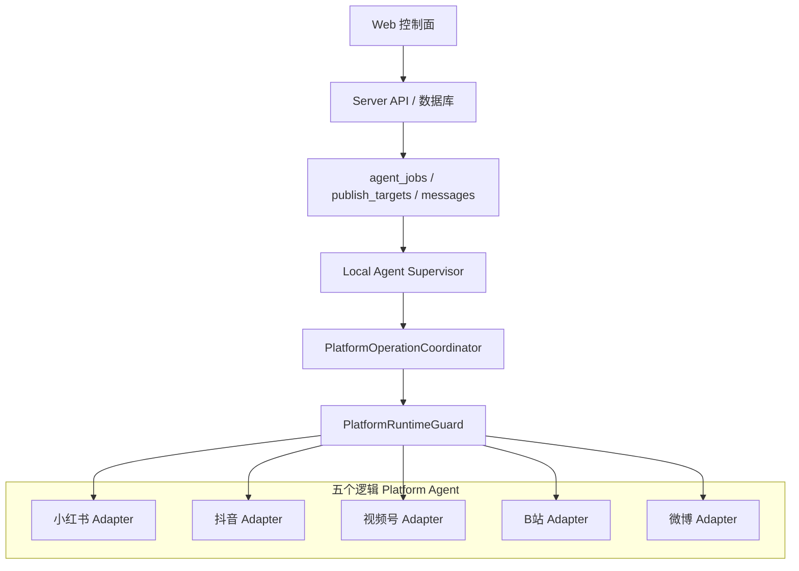
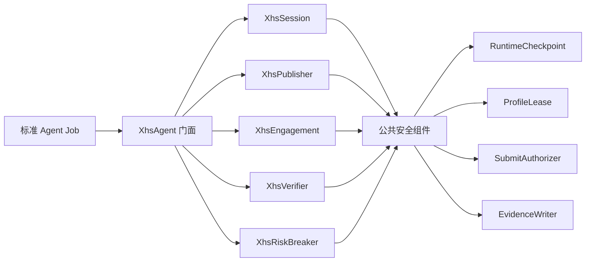
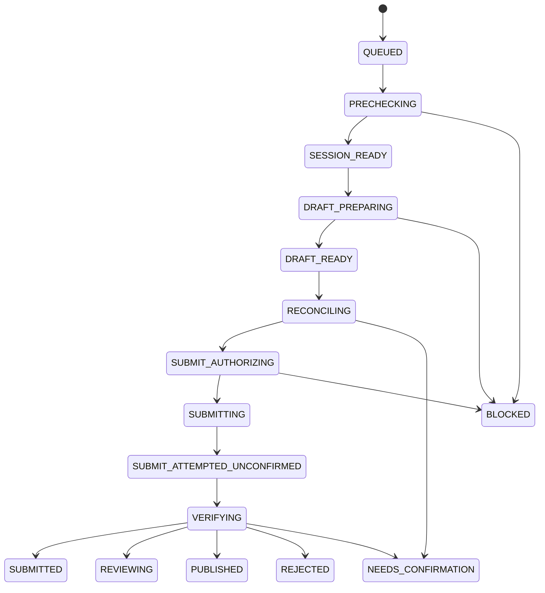
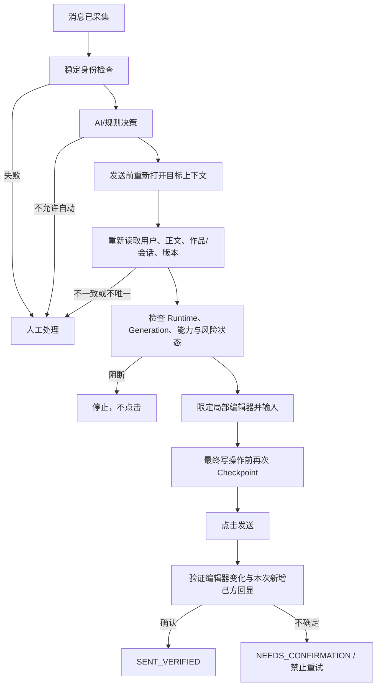

# 小红书平台架构与自动化风险控制设计报告 V2.0

- 文档日期：2026-08-12
- 适用工程：天河港澳社区 AI 数字员工运营平台 MVP
- 工程目录：`D:\code\Codex项目交接包-2026-07-31\06_MVP\ai-digital-employee-mvp`
- 设计对象：小红书 Platform Agent、Web 控制面、Local Agent 执行面
- 业务目标：每日约 1 篇内容自动发布；增量采集评论和私信；对符合规则、目标可唯一确认的业务咨询自动回复
- 核心约束：**平台没有打开时，不领取任务、不启动浏览器、不访问 Profile、不被定时器或排队任务唤醒**
- 风险边界：本方案不承诺规避平台检测，也不建设指纹伪造、自动化隐藏、验证码绕过、代理轮换或其他规避平台安全机制的能力

---

## 1. 报告目的与结论

本报告基于当前代码中抖音、视频号、B站、微博和小红书五个平台的实际实现进行架构审计，并结合小红书“自动发布 + 评论/私信增量采集与自动回复”的目标，给出可逐步落地的设计方案。

### 1.1 核心结论

1. **五个平台应作为五个逻辑 Platform Agent，由一个 Local Agent Supervisor 和 Web 控制面统一管理。** 不建议把发布、评论、私信再拆成额外的小红书 Local Agent；它们应是小红书 Platform Agent 内部的能力模块。
2. **小红书当前不是从零开始。** 现有 `xiaohongshu-assisted.js` 已具备发布、核验、采集、回复、运行时停止和部分证据能力，但与其他四个平台相比，提交锁、精准回复、Smoke Test、草稿对账和熔断能力仍不完整。
3. **小红书不宜直接继续继承或复制 2658 行的 `AssistedPlatformRpaAdapter`。** 应抽取小型公共安全组件，小红书通过组合复用；迁移期保留现有 Adapter 作为兼容门面。
4. **“关闭不唤醒”必须是系统不变量，而不是 UI 约定。** 服务端入队、任务 Claim、Job 执行前、浏览器创建前后、最终写操作前均要检查平台有效状态和 Generation。
5. **自动发布和自动回复可以在正常状态下无人值守，但写操作一旦发出而结果不明确，必须进入 `NEEDS_CONFIRMATION`，不得自动重试。**
6. **降低风险的重点不是伪装成人，而是减少不必要操作。** 固定账号与 Profile、无任务不刷新、增量采集、精准目标、串行写入、内容合规、频控、异常熔断和完整审计，才是可维护的风险控制措施。
7. **每日一篇发布本身不是主要风险源。** 风险更多来自高频页面访问、无差别评论回复、重复私信、错误目标发送、页面变化后的盲点操作，以及验证或限制出现后继续执行。
8. **建议先完成 P0 安全底座，再放开小红书自动提交。** 在永久提交锁、唯一目标验证、写后核验、平台停止闸门、Profile 租约和专项测试完成前，不建议将小红书从规划态直接切为全面自动运行。

---

## 2. 当前五平台总体架构审计

### 2.1 当前注册关系

`agent/rpa-adapters/registry.js` 当前注册五个平台：

```text
xiaohongshu
├─ XiaohongshuAssistedRpaAdapter
│  └─ 直接继承 RpaAdapter
│
douyin
wechat_channels
bilibili
weibo
└─ 各自专项 Adapter
   └─ 继承 AssistedPlatformRpaAdapter
```

这说明当前系统已经形成“五平台统一注册、分平台适配”的基本框架，但小红书走的是一条较早期、独立演化的实现路径，尚未完整复用后来在其他四个平台形成的安全机制。

### 2.2 当前运行架构



系统的控制面和执行面已经基本分离：

- Web/Server 负责平台状态、任务、账号、审核、消息和结果管理；
- Local Agent 负责领取允许执行的任务；
- Coordinator 负责平台运行时状态和停止传播；
- Adapter 负责具体页面操作；
- 数据库负责持久化幂等、状态、证据和恢复信息。

### 2.3 当前“关闭不唤醒”已有的四层保护

从 `agent/local-agent.js`、`agent/platform-operation-coordinator.js`、`agent/platform-runtime-guard.js` 和 `src/server.js` 可以看到以下保护：

1. **服务端 Claim 过滤**：停止平台和停用账号不能被正常 Claim；
2. **Local Agent 允许列表**：只把 `effective_state=RUNNING` 的平台传入 Claim；
3. **Job 执行前复检**：领取后、创建或解析 Adapter 前再次检查平台状态；
4. **Browser Launch Guard**：`launchPersistentContext` 前后再次检查 Runtime，停止发生时关闭 Context。

该方向正确，但在小红书正式启用前还需要把它升级为可测试的不变量，尤其要覆盖：

- 定时器不为关闭平台创建新任务；
- 已排队任务不能唤醒关闭平台；
- 平台关闭后，等待中的执行链在最终发布/发送前必须失败退出；
- 旧 Generation 的任务不能在平台重新打开后“借尸还魂”；
- 已打开的 Browser Context 必须在停止传播后及时关闭。

---

## 3. 其他四个平台形成的成熟设计模式

## 3.1 公共 AssistedPlatformRpaAdapter

`agent/rpa-adapters/assisted-platform.js` 当前约 2658 行，已经沉淀出以下公共能力：

- 固定 Browser Profile 与 Persistent Context；
- 浏览器启动前后 Runtime Guard；
- 平台停止时调用 Adapter `stop()` 并关闭 Context；
- 登录、验证、安全限制、错误页和未知页分类；
- 发布素材上传及上传完成证据；
- 发布按钮唯一性检查；
- 最终提交前授权；
- 发布后信号核验；
- 评论与私信增量采集；
- 精确消息定位和局部编辑器约束；
- 回复发送前复检；
- 发送后编辑器清空及新增回显核验；
- Evidence 截图和 JSON 日志；
- `RUN_SMOKE_TEST` 只读页面巡检。

这些能力不是“小红书页面选择器”本身，而是跨平台安全执行能力，应抽取后复用。

## 3.2 抖音：精准定位与不确定结果禁重试

`agent/rpa-adapters/douyin-assisted.js` 的可复用原则：

- 评论使用用户、正文、时间和指纹组合定位；
- 只容忍有限的相对时间变化，不能无限模糊匹配；
- 找不到唯一目标或存在多个候选时直接阻断；
- 回复编辑器和发送按钮必须位于目标评论的局部 Scope；
- 私信存在多个未读预览时不自动进入回复；
- 最终发送前重新检查 Runtime；
- 发送后必须同时验证编辑器变化和新增精确回显；
- 结果不确定进入 `NEEDS_CONFIRMATION`，禁止自动重试。

## 3.3 视频号：作品上下文与 incoming bubble

`agent/rpa-adapters/wechat-channels-assisted.js` 的可复用原则：

- 评论必须绑定具体作品上下文，不能只依赖评论文字；
- 私信正文必须在打开会话的 incoming bubble 中重新确认，不能只看左侧会话预览；
- 手机号绑定等平台限制进入人工确认；
- 账号身份写入消息上下文，降低回复错账号风险；
- 发布/回复结果不确定时标记为非幂等，不自动重试。

## 3.4 B站：稳定 ID、草稿对账与永久提交锁

`agent/rpa-adapters/bilibili-assisted.js` 的可复用原则：

- 评论优先依赖 `rpid`，私信依赖 `talkerId/msgKey` 等稳定标识；
- 只有平台成功回执才能直接判定成功；
- 发布前检查既有草稿，避免重复创建；
- 使用草稿指纹、账号所有权和历史状态进行对账；
- 最终提交前获取永久提交锁；
- 管理页无法唯一找到对应记录时不能判成功；
- 不删除未知草稿或已尝试提交的草稿。

## 3.5 微博：载荷硬门槛与系统会话排除

`agent/rpa-adapters/weibo-assisted.js` 的可复用原则：

- 缺历史评论、仅有预览私信、没有稳定 ID 的回复载荷直接阻断；
- 排除高置信官方/系统会话；
- 只采集打开会话中的 incoming bubble；
- 评论使用局部回复区，私信使用明确的聊天编辑器；
- 发布/发送成功必须有本次动作产生的新信号；
- 最终发送前若平台停止，必须向上抛错，不能继续点击；
- 提交后不确定不重试。

---

## 4. 当前小红书实现审计

### 4.1 已有能力

`agent/rpa-adapters/xiaohongshu-assisted.js` 当前已经支持：

- `PUBLISH`；
- `VERIFY_PUBLISH`；
- `COLLECT_MESSAGES`；
- `REPLY`；
- `DETECT_MANUAL_REPLY`；
- `publishMode=AUTO`；
- 固定 Profile 的 Persistent Context；
- Runtime Guard 和停止 Context；
- 评论/私信基础去重；
- 部分目标定位；
- 发布或回复不明确时进入 `NEEDS_CONFIRMATION`；
- 基础 Evidence；
- 避免通过固定坐标盲点发布按钮。

因此，小红书不需要推倒重写全部页面逻辑；应以“保留已验证页面流程、替换安全底座”为主。

### 4.2 关键缺口

| 领域 | 当前小红书 | 其他成熟平台 | 优先级 |
|---|---|---|---|
| 公共安全能力 | 独立实现，复用不足 | 公共基类统一能力 | P0 |
| 最终提交锁 | 未接入 `setSubmitAuthorizer` | 已接入永久提交锁 | P0 |
| 草稿指纹 | 缺失 | B站有草稿指纹和对账 | P0 |
| 提交前最终授权 | 不完整 | 最终点击前重新授权 | P0 |
| 发布成功判断 | 文案/URL 信号偏宽松 | 本次动作信号 + 管理页对账 | P0 |
| 评论唯一定位 | 组合条件不足 | ID/用户/正文/时间/作品唯一 Scope | P0 |
| 私信上下文 | 会话 ID 和回显为主 | incoming bubble + 会话版本 | P0 |
| 发送前 Runtime 复检 | 检查点不足 | 最终写操作前强制复检 | P0 |
| 写后不确定区 | 部分支持 | 明确非幂等且禁重试 | P0 |
| Profile 跨进程租约 | 缺失 | 仍应补全为公共能力 | P0 |
| Risk Breaker | 缺持久化 SUSPENDED | 安全/验证/未知页应熔断 | P1 |
| Smoke Test | 不支持 | 其他四平台支持 | P1 |
| Evidence 脱敏 | 不完整 | 需统一规范 | P1 |
| 能力子开关 | 无五项独立开关 | 建议平台内细分 | P1 |
| 专项 Flow Test | 基本缺失 | 四平台已有专项测试 | P0 |

### 4.3 发布成功判断的具体问题

当前小红书发布流程可能根据以下较宽泛信号判断结果：

- 页面出现“发布成功 / 发布完成 / 已发布”；
- URL 出现 `publish/success`、`published` 或 `content/manage`；
- 验证页面按标题搜索。

这些信号可能是历史页面、通用文案或管理页入口，不一定能证明“本次目标内容由本次动作成功发布”。目标设计必须加入：

- 本次任务 ID 和草稿指纹；
- 提交前页面基线；
- 提交后的新增状态信号；
- 管理页账号、标题、时间窗口、素材摘要联合对账；
- 唯一匹配要求；
- 无法唯一对账时进入人工确认，而不是再次发布。

### 4.4 消息回复的具体问题

评论和私信回复是更容易产生业务事故的部分。当前实现需要强化：

- 评论必须绑定作品、评论者、正文、父评论或稳定 ID；
- 目标评论必须唯一；
- 编辑器和发送按钮必须在目标局部范围；
- 私信必须打开正确会话，并重新读取 incoming bubble；
- 用户在 AI 生成回复后又发送新消息时，旧回复必须失效；
- 必须区分 incoming/outgoing，不能把自己的历史回复当作用户问题；
- 发送后必须找到本次新增的己方气泡；
- 结果不确定禁止自动再发。

---

## 5. 业务目标、非目标与运行边界

### 5.1 业务目标

小红书第一阶段目标：

1. 每个启用账号每日约 1 篇内容自动发布；
2. 只对自己账号的作品评论进行增量采集；
3. 增量采集用户主动发起的私信；
4. 识别真实业务咨询、知识库可回答问题和需要人工处理的问题；
5. 对高可信、低敏感、目标唯一的问题自动回复；
6. 对验证、风控、未知页面、歧义目标和不确定提交自动熔断；
7. Web 端可独立控制平台和五项能力；
8. 保留任务、页面、截图、选择器命中、提交锁和结果核验的完整证据链。

### 5.2 明确非目标

本系统不建设：

- 浏览器指纹伪造或修改；
- WebDriver 特征隐藏；
- 验证码、扫码、人脸或设备验证绕过；
- 代理/IP 轮换以规避平台限制；
- 随机鼠标轨迹、随机延迟等以逃避检测为目的的机制；
- 自动注册、自动养号或批量切号；
- 批量抓取陌生用户并主动私信；
- 无差别回复所有评论；
- 页面未知时通过坐标或图像相似度盲目点击最终发送按钮；
- 对“不确定是否已经发布/回复”的写操作自动重试。

RPA 的定位是受控的页面执行通道，不是规避平台安全机制的工具。

---

## 6. 小红书目标架构

### 6.1 总体原则

- 小红书是五个平台中的一个逻辑 Platform Agent；
- 发布、评论和私信是内部模块，不新增第六、第七个 Local Agent；
- Web 控制面统一管理平台开关、能力开关、账号、任务、风险和证据；
- Local Agent Supervisor 只负责调度和生命周期；
- 小红书内部每个账号默认串行；
- 系统鼠标键盘只在页面确实无法通过稳定 DOM 操作时使用，并受全局 Desktop Lock 保护；
- 不以“模拟真人”作为设计目标，而以“最少操作、正确目标、可审计、可停止”为目标。

### 6.2 模块结构

建议逐步形成以下目录：

```text
agent/platforms/xiaohongshu/
├─ xhs-agent.js                 # Platform Agent 入口与任务路由
├─ xhs-session.js               # 登录、Profile、Context 和账号身份
├─ xhs-publisher.js             # 草稿准备、上传、提交、发布流程
├─ xhs-engagement.js            # 评论/私信采集与回复
├─ xhs-verifier.js              # 发布与回复结果对账
├─ xhs-risk-breaker.js          # 验证、限制、未知页和异常率熔断
├─ xhs-page-classifier.js       # 页面状态分类
├─ xhs-selectors.js             # 选择器及版本
├─ xhs-evidence.js              # 截图、快照、脱敏和审计
├─ xhs-profile-lease.js         # Profile 跨进程独占租约
└─ xhs-smoke-test.js            # 只读页面巡检
```

迁移期间保留：

```text
agent/rpa-adapters/xiaohongshu-assisted.js
```

它作为兼容门面接收现有 Job，再委托到上述模块，避免一次性改动 Local Agent 和服务端协议。

### 6.3 组合式公共组件

不建议直接让小红书继续继承巨大公共基类，而应从现有成熟实现中抽取：

```text
BrowserSession
RuntimeCheckpoint
ProfileLease
SubmitAuthorizer
EvidenceWriter
PageClassifier
ExactTargetVerifier
WriteResultVerifier
SmokeTestRunner
```



---

## 7. 平台关闭绝不唤醒设计

### 7.1 必须成立的系统不变量

对 `effective_state != RUNNING` 的小红书平台，必须同时满足：

```text
不创建新的周期任务
不 Claim 已排队任务
不实例化或调用平台 Adapter
不检查登录
不获取 Profile Lease
不创建 Browser Context
不访问任何小红书页面
不执行采集
不执行发布或回复
不因恢复扫描而自动运行
```

排队任务可以保留，但只能处于 `BLOCKED_PLATFORM_STOPPED` 或继续排队，不能靠轮询反复唤醒浏览器。

### 7.2 五道闸门

| 闸门 | 位置 | 行为 |
|---|---|---|
| Gate 1 | Server 入队/定时器 | 关闭平台不新建周期任务；人工任务可记录但标记阻塞 |
| Gate 2 | Claim SQL/API | 只返回有效运行平台且账号启用的 Job |
| Gate 3 | Local Agent 执行前 | 刷新平台状态、账号状态和 Generation |
| Gate 4 | Browser 启动前后 | 获取 Profile Lease 前、Context 创建后分别复检 |
| Gate 5 | 最终写操作前 | 点击发布/发送前重新检查 Runtime、Generation 和能力开关 |

### 7.3 Generation 防止旧任务复活

平台每次停止或重新开启都更新 `runtime_generation`。Job Claim 时记录 Generation：

```text
job.claimed_generation == current_platform_generation
```

任何不一致都视为过期执行上下文，必须退出。这样可以防止：

- 平台关闭前已领取的任务继续执行；
- 平台关闭后又重新打开时，旧页面上的任务继续点击；
- 长时间 AI 生成回复后使用过期上下文发送。

### 7.4 停止传播

关闭平台时：

1. Server 更新 `desired_state=STOPPED`；
2. Coordinator 增加 Generation 并调用 `adapter.stop()`；
3. Adapter 中止等待、关闭页面和 Context；
4. 正在执行的任务在下一个 Checkpoint 抛出平台停止错误；
5. 若最终写动作尚未发生，任务返回可恢复阻塞；
6. 若写动作已经发生但结果未知，任务进入 `NEEDS_CONFIRMATION`，禁止重试。

---

## 8. 队列、账号串行、Profile 租约与桌面锁

### 8.1 队列模型

当前 `PlatformOperationCoordinator` 的 `operationTail` 更接近全局单链。建议改为：

- **每个平台独立执行队列**；
- **每个账号独立串行队列**；
- 小红书同账号并发固定为 1；
- 读任务可以合并，但不能与同账号写任务并发操作同一 Context；
- 不让小红书长任务无条件阻塞抖音、视频号、B站和微博。

### 8.2 Profile Lease

每个小红书账号绑定唯一 `profile_dir`，并使用跨进程租约：

```text
lease_key = platform_code + account_id + normalized_profile_dir
```

租约字段建议包括：

- owner_device_id；
- owner_agent_instance_id；
- process_id；
- acquired_at；
- heartbeat_at；
- expires_at；
- release_reason。

规则：

- 未获得租约，禁止启动 Persistent Context；
- 进程异常退出后只能在租约过期且确认无活跃浏览器时接管；
- 不允许两个进程同时打开同一个 Profile；
- 平台停止时释放租约；
- 安全熔断时关闭 Context，但保留必要的诊断证据。

### 8.3 Desktop Lock

当必须使用系统级鼠标/键盘时获取全局 Desktop Lock：

- 锁只覆盖实际输入和点击的最短临界区；
- 锁外完成页面解析、AI 生成和证据整理；
- 获取锁后重新检查窗口标题、URL、账号身份、Runtime 和目标元素；
- 失去焦点或出现弹窗立即中止；
- 不允许用固定屏幕坐标执行最终发布或发送；
- 其他只使用独立浏览器 DOM 的平台不应被长时间全局阻塞。

---

## 9. 自动发布设计

### 9.1 发布状态机



关键规则：

- 进入 `SUBMITTING` 之前可以安全失败并重建草稿；
- 最终提交动作发出后，`submit_lock` 永久锁定本次目标；
- 进入 `SUBMIT_ATTEMPTED_UNCONFIRMED` 后只能核验或人工处置，不能重新发布；
- 新一次正式发布必须创建新的 publish target，而不能重置旧锁。

### 9.2 发布前置检查

必须检查：

- 平台及发布能力处于 RUNNING；
- 账号启用且 Profile 租约有效；
- 当前登录账号与任务账号一致；
- 标题、正文、标签和素材符合平台及业务规则；
- 素材文件存在、可读、类型和大小正确；
- 当前页面没有验证、限制、登录失效或未知弹窗；
- publish target 尚未提交；
- 没有同指纹已提交或待核验记录；
- 当日发布额度和冷却策略允许；
- Smoke Gate 为 CLEAR。

### 9.3 草稿指纹

建议指纹：

```text
SHA-256(
  platform_code +
  account_id +
  normalized_title +
  normalized_body +
  ordered_media_hashes +
  normalized_tags
)
```

草稿指纹用于：

- 判断本次草稿是否与任务一致；
- 检测重复草稿；
- 发布前对账；
- 重启恢复；
- 管理页核验时缩小候选范围。

### 9.4 永久提交锁

现有 `publish_targets` 已具备：

- `publish_attempt_state`；
- `submit_lock`；
- `submit_authorized_at`；
- `submit_attempted_at`；
- `submit_attempt_count`；
- `submit_lock_reason`；
- `draft_fingerprint`。

小红书必须接入 Local Agent 已有的 `acquireSubmitLock()` 和服务端 `/api/agent/publish-targets/:id/acquire-submit-lock`。

最终点击前执行：

1. 再次确认账号、页面、草稿指纹和发布按钮唯一；
2. 再次检查平台、能力、Generation 和 Smoke Gate；
3. 调用提交授权 API；
4. 服务端原子地把 `submit_lock` 改为 LOCKED；
5. 只有获得授权的执行实例可以进行最终点击；
6. 点击动作开始即记录 `submit_attempted_at`，不以页面成功提示为记录时点。

### 9.5 发布按钮与确认弹窗

- 发布按钮必须唯一、可见、可用且处于预期发布区域；
- 若存在多个可见候选，禁止点击；
- 二次确认弹窗按钮必须通过语义、所在对话框和唯一性共同确认；
- 页面出现验证、账号异常、安全提醒或未知对话框，立即熔断；
- 不通过屏幕坐标猜测按钮；
- 页面版本不匹配时不得降级为“相似文本即点击”。

### 9.6 发布后核验

发布后按照以下证据层级判断：

| 级别 | 证据 | 结论 |
|---|---|---|
| A | 本次新增平台 Post ID/URL + 账号一致 | 可判提交成功 |
| B | 管理页唯一记录 + 标题/时间/素材摘要一致 | 可判提交或审核中 |
| C | 本次页面成功回执 + 编辑器状态变化 + 管理页候选唯一 | 可判成功，保留核验任务 |
| D | 仅 URL 跳转或通用“已发布”文案 | 不能单独判成功 |
| E | 超时、页面关闭、网络断开、结果歧义 | `NEEDS_CONFIRMATION`，禁止重发 |

管理页对账必须限制：

- 正确账号；
- 本次提交后的时间窗口；
- 标题或正文摘要；
- 素材数量/类型摘要；
- 唯一候选；
- 发布、审核中、驳回等真实状态。

---

## 10. 评论增量采集设计

### 10.1 采集原则

- 只采集自己账号、自己作品的评论；
- 采用增量游标，不反复全量滚动；
- 无新增时尽快结束，不为了维持在线而刷新；
- 同一轮读取尽量合并多个作品的检查；
- 页面不可识别时停止，不盲目滚动或点击；
- 采集和回复分成两个 Job，避免边采边发导致上下文漂移。

### 10.2 评论身份

优先级：

1. 平台稳定 comment ID；
2. comment URL 或 DOM 中稳定属性；
3. 作品 ID + 用户 ID + 规范化正文 + 父评论 ID；
4. 最后才使用时间作为辅助条件。

现有小红书 ID 稳定性测试已经证明“相对时间文本不应成为主 ID”的方向正确，应继续保留。

### 10.3 去重与更新

数据库 `messages.external_id` 用于幂等，`context_json` 保存：

- platform_post_id；
- post_url；
- post_title；
- comment_id；
- parent_comment_id；
- author_id/author_name；
- normalized_text_hash；
- observed_at；
- selector_version；
- source_page_fingerprint。

评论内容被编辑、删除或折叠时记录状态变化，不生成一个新的自动回复任务。

---

## 11. 私信增量采集设计

### 11.1 采集边界

- 只处理用户主动发起或继续的会话；
- 不主动批量私信陌生用户；
- 排除官方通知、系统消息、活动通知和高置信机器人会话；
- 左侧会话预览只用于发现候选，不能作为可回复正文；
- 必须打开会话并读取 incoming bubble；
- 多个未读候选无法唯一确认时，只采集不回复或转人工。

### 11.2 会话版本

每次打开会话计算 `conversation_version`：

```text
hash(conversation_id + latest_incoming_message_id + latest_incoming_text_hash + latest_incoming_time)
```

AI 生成回复时记录该版本。最终发送前必须重新读取会话：

```text
current_conversation_version == decided_conversation_version
```

不一致表示用户又发了新消息，旧回复自动失效，重新排队生成，不能直接发送。

### 11.3 incoming/outgoing 判定

己方和用户气泡必须通过多信号判断：

- DOM 方向或消息角色；
- 头像/账号标识；
- 会话布局；
- 已知自身账号身份；
- 消息 ID 或平台结构。

仅凭“位于左边/右边”或文本相同不足以作为唯一判断依据。

---

## 12. 自动回复资格与决策

### 12.1 回复资格硬门槛

只有同时满足以下条件才允许自动回复：

- 平台和对应回复能力已打开；
- 账号、作品或会话身份确认；
- 消息来自用户而非己方、系统或官方账号；
- 稳定 ID 或高可信唯一指纹存在；
- 目标在页面中唯一；
- 用户问题属于允许自动处理的业务范围；
- 知识库有足够依据；
- 回复不包含敏感、承诺、交易、隐私或平台禁止内容；
- 没有检测到人工已回复；
- 消息上下文版本未变化；
- 没有触发频控、风险熔断和 Smoke Gate；
- Runtime 和 Generation 仍有效。

任一条件不满足，进入人工队列或继续观察，不自动发送。

### 12.2 建议决策结果

```text
AUTO_REPLY       可自动发送
HUMAN_REVIEW     需要人工审核回复内容
HUMAN_HANDLE     需要人工直接处理会话
IGNORE           无需回复，如表情、感谢、系统通知
DEFER            信息不足，等待用户补充或稍后重算
BLOCKED_RISK     风控、验证或平台状态阻断
```

### 12.3 不应自动回复的内容

- 投诉、纠纷、退款、赔偿、法律或重大承诺；
- 涉及个人敏感信息；
- 要求发送站外联系方式或违规导流；
- 事实依据不足、知识库冲突；
- 用户情绪激烈或意图不清；
- 同一用户短时间连续多条，尚未形成完整问题；
- 疑似系统、营销、诱导或攻击内容；
- 目标消息无法唯一定位。

---

## 13. 评论和私信精准发送流程



### 13.1 评论回复

必须组合验证：

- 正确作品；
- comment ID 或唯一评论指纹；
- 评论者；
- 规范化正文；
- 父评论关系；
- 局部回复编辑器；
- 局部发送按钮。

不允许使用页面级通用编辑器回复某条具体评论。

### 13.2 私信回复

必须组合验证：

- conversation ID；
- 当前会话标题或用户身份；
- 最新 incoming bubble ID/正文；
- conversation version；
- 特定聊天编辑器；
- 发送后新增 outgoing bubble。

### 13.3 写后不确定区

一旦点击发送：

- 立即把消息记录为 `SEND_ATTEMPTED`；
- 即使网络报错或页面无回显，也不能自动再次点击；
- 后续只能通过会话历史核验；
- 找不到唯一结果时进入 `NEEDS_CONFIRMATION`；
- 人工确认后才能标记成功或创建一个新的回复任务。

---

## 14. 风险熔断与 SUSPENDED

### 14.1 风险状态

建议平台和账号都支持：

```text
NORMAL
DEGRADED
WAITING_HUMAN
SUSPENDED
RECOVERING
```

含义：

- `NORMAL`：允许正常读写；
- `DEGRADED`：只允许低频只读核验，暂停自动写入；
- `WAITING_HUMAN`：等待扫码、身份确认或业务人工处理；
- `SUSPENDED`：安全限制、未知页面或连续异常触发全面熔断；
- `RECOVERING`：完成 Smoke Test 和人工确认后的观察期。

### 14.2 立即熔断条件

- 验证码、人脸、设备验证、异常登录；
- 账号限制、操作频繁、安全风险提示；
- 页面结构无法识别或关键选择器多目标；
- 当前账号身份与任务账号不一致；
- Profile 被其他进程占用；
- 发布/发送按钮语义不唯一；
- 连续出现提交后不确定结果；
- Smoke Test 检测到关键页面变化；
- 人工在页面中接管并改变目标上下文；
- 平台或能力开关被关闭。

### 14.3 不建议固定“开 8 小时”

持续打开浏览器 8 小时不会自动降低风险，反而可能增加无意义会话、刷新和页面异常的暴露面。建议：

- 按任务启动或保持短期受控会话；
- 无任务不刷新；
- 采集采用增量批次；
- 登录状态可复用，但不为“看起来像真人”而空转；
- 会话运行时长只作为资源策略，不作为规避检测手段。

---

## 15. Smoke Test 与页面变化 Gate

### 15.1 当前差距

当前 `src/server.js` 明确把 Smoke Test 限定为抖音、视频号、B站和微博，小红书尚不支持 `RUN_SMOKE_TEST`。小红书正式上线前应补齐。

### 15.2 小红书 Smoke 页面

建议只读巡检：

- 创作/发布入口；
- 发布编辑器；
- 内容管理页；
- 评论管理页；
- 私信会话列表页；
- 打开会话后的消息区。

Smoke Test 禁止：

- 上传真实业务素材；
- 点击最终发布；
- 点击发送；
- 改变草稿或消息状态。

### 15.3 Gate 规则

Smoke Test 保存：

- URL 和标题；
- 页面分类；
- 关键元素数量与可见性；
- 脱敏 DOM 摘要；
- 截图；
- selector version；
- fingerprint hash。

关键页面变化时：

```text
smoke_gate_state = BLOCKED
```

并暂停小红书写任务。人工确认并更新 Baseline 后才能解除。

---

## 16. Evidence、日志与隐私

### 16.1 每个写任务的证据链

发布和回复至少记录：

- job_id / target_id / message_id；
- platform_code / account_id / agent_instance_id；
- Runtime Generation；
- Profile Lease ID；
- 页面 URL、页面分类和 selector version；
- 写操作前截图；
- 目标唯一性检查结果；
- 提交锁或发送授权结果；
- 写操作发生时间；
- 写后截图；
- 回显或管理页对账结果；
- 最终状态和阻断原因。

### 16.2 脱敏要求

- 私信正文默认不完整写入普通日志；
- 手机号、证件号、地址、微信号等敏感信息脱敏；
- Cookie、Token、localStorage、请求头不得写入 Evidence；
- 截图目录按账号和任务做访问控制；
- 日志保留期和截图保留期可配置；
- Web 端只向有权限的运营/管理员展示私信证据。

---

## 17. 数据模型建议

### 17.1 复用现有表

不建议重新创建一套小红书专用业务表，优先复用：

- `platforms`：平台启停、生命周期和 Smoke Gate；
- `accounts`：账号、Profile、登录和启用状态；
- `publish_targets`：发布状态、提交锁和草稿指纹；
- `messages`：评论/私信、external ID 和 context_json；
- `agent_jobs`：幂等键、租约和调度。

### 17.2 建议补充字段或表

#### platform_capabilities

```text
platform_code
account_id nullable
publish_enabled
verify_publish_enabled
collect_comments_enabled
reply_comments_enabled
collect_dm_enabled
reply_dm_enabled
updated_at
updated_by
```

说明：采集和回复建议分别控制，因此实际可设六项；若产品界面坚持五项，可将 `verify_publish` 并入发布能力。

#### platform_risk_state

```text
platform_code
account_id nullable
risk_state
risk_reason
triggered_at
last_safe_at
recovery_required
metadata_json
```

#### profile_leases

```text
lease_key
platform_code
account_id
profile_dir_hash
owner_agent_instance_id
heartbeat_at
expires_at
state
```

#### messages.context_json 补充

```json
{
  "postId": "...",
  "commentId": "...",
  "conversationId": "...",
  "latestIncomingId": "...",
  "conversationVersion": "...",
  "selectorVersion": "...",
  "sourceFingerprint": "...",
  "accountIdentity": "..."
}
```

---

## 18. API 与 Web 控制台建议

### 18.1 平台控制

Web 控制台显示：

- 平台总开关；
- effective state；
- Generation；
- 当前风险状态；
- Smoke Gate；
- 当前 Browser/Profile 占用；
- 队列中任务数量；
- 正在执行的任务和最后 Checkpoint。

### 18.2 能力控制

小红书建议提供：

- 自动发布；
- 评论采集；
- 评论自动回复；
- 私信采集；
- 私信自动回复。

关闭某项写能力后：

- 不影响其他允许的只读能力；
- 已生成但未发送的回复不再发送；
- 最终点击前 Gate 5 必须检查最新能力状态。

### 18.3 人工处置

控制台应提供：

- 查看 `NEEDS_CONFIRMATION` 证据；
- 标记“已成功 / 未成功 / 忽略”；
- 解除或保持 SUSPENDED；
- 执行并审批 Smoke Baseline；
- 查看提交锁但不能直接解锁旧 target；
- 创建新的目标任务替代旧的不确定写任务；
- 查看人工已回复检测结果。

---

## 19. 风险评估矩阵

无法可靠给出“被检测概率百分比”，因为平台不会公开完整检测规则，账号历史、内容、访问模式、页面变化和人工操作都会影响结果。可用相对风险评估管理工程决策。

| 场景 | 原始风险 | 主要问题 | 采用本方案后的剩余风险 |
|---|---:|---|---:|
| 每日 1 篇合规内容发布 | 中 | 页面自动操作、重复提交 | 中低至中，不能保证 |
| 定时全量刷新评论 | 中高 | 无意义高频访问 | 改增量后中 |
| 无差别回复所有评论 | 高 | 重复、营销化、错目标 | 本方案禁止 |
| 只回复业务咨询 | 中 | AI 误判、目标漂移 | 中低至中 |
| 高频私信自动回复 | 高 | 会话漂移、重复发送、敏感内容 | 限定主动咨询和精确上下文后中 |
| 平台验证后继续自动操作 | 很高 | 安全机制冲突 | 本方案立即熔断 |
| 发布/回复不确定后自动重试 | 很高 | 重复内容和重复消息 | 本方案禁止 |
| 固定账号、固定 Profile、单账号串行 | 中 | 仍存在网页自动化本身风险 | 较可控但非零 |
| 浏览器无任务空转 8 小时 | 中 | 暴露面增加且无直接收益 | 本方案不采用 |

对当前“每天一篇 + 高频采集 + 选择性回复”业务模型，整体残余风险应按**中等**管理；如果变成高频无差别回复或大量私信，则应按**高风险**管理。

---

## 20. 频率与运行策略

本方案不通过随机轨迹或随机延迟规避检测，而通过业务限额和最小必要访问降低错误与滥用风险。

建议策略：

- 每账号发布串行，默认每日不超过业务计划；
- 评论/私信采集由新增量和未处理量驱动；
- 同一作品、同一会话设置最短再次检查间隔；
- 多个待回复消息合并为一轮会话处理；
- 同一用户连续发言时等待短暂会话稳定窗口，再生成一次完整回复；
- 连续出现目标不唯一、页面异常或发送不确定时降低为只读或熔断；
- 所有限额为业务安全阈值，可在控制台配置和审计，不应伪装成人类行为。

---

## 21. 测试设计与验收标准

### 21.1 当前测试基线

项目已有：

- 核心测试；
- 服务端集成测试；
- 抖音专项 Flow Test；
- 视频号专项 Flow Test；
- B站专项 Flow Test；
- 微博专项 Flow Test；
- Smart Reply、Smoke Test、安全运行时和恢复测试；
- 小红书目前只有少量 ID 稳定性相关测试，缺少完整专项 Flow Test。

本报告完成时的最新完整测试结果见文末“测试执行记录”。

### 21.2 必须新增的小红书专项测试

建议新增：

```text
test/platform-xiaohongshu-flow.test.js
```

至少覆盖：

#### 平台生命周期

1. 平台停止时不 Claim；
2. 停止时不实例化 Adapter；
3. 停止时不创建 Context；
4. Context 创建过程中停止会立即关闭；
5. 最终点击前停止会阻断；
6. 旧 Generation 不能在重新开启后继续执行；
7. 关闭平台的周期任务不入队。

#### 发布

8. 草稿指纹稳定；
9. 同指纹已提交时阻断；
10. 最终提交锁只能成功获取一次；
11. 发布按钮多目标时阻断；
12. 二次确认按钮多目标时阻断；
13. 点击后超时进入 `NEEDS_CONFIRMATION`；
14. 写后不确定不会创建自动重试；
15. 管理页唯一匹配才可确认；
16. 仅 URL 跳转不能单独判成功；
17. 登录账号不一致时阻断。

#### 评论

18. comment ID 优先；
19. 相对时间变化不改变 external ID；
20. 同正文不同用户不混淆；
21. 同用户同正文不同作品不混淆；
22. 多目标评论阻断；
23. 回复编辑器必须在目标 Scope；
24. 人工已回复时取消自动发送。

#### 私信

25. 只使用 incoming bubble；
26. 排除系统和官方会话；
27. 左侧预览不能直接回复；
28. conversation version 改变时旧回复失效；
29. outgoing bubble 不能作为用户问题；
30. 发送后必须出现本次新增回显；
31. 发送不确定时不重试。

#### 风险和 Smoke

32. 验证页面触发 SUSPENDED；
33. 安全限制触发 SUSPENDED；
34. 未知页面触发 Gate；
35. Smoke Test 只读不写；
36. Baseline 变化阻断写任务；
37. Evidence 不包含 Cookie/Token；
38. Profile Lease 冲突阻断浏览器启动。

### 21.3 上线验收硬指标

- 关闭平台 100% 不创建 Browser Context；
- 最终写操作前 Runtime Checkpoint 覆盖率 100%；
- 发布提交锁并发测试只能有一个成功者；
- 提交后不确定场景自动重试数为 0；
- 评论/私信多目标场景自动发送数为 0；
- 安全验证场景绕过尝试数为 0；
- 关键 Evidence 完整率 100%；
- 小红书专项自动化测试全部通过；
- Shadow 期无真实写入；
- 小流量试运行期每一笔写操作均可在 Web 端追溯。

---

## 22. 分阶段实施路线

### P0：允许小红书安全试运行的前置条件

1. 将小红书接入永久提交锁和 `authorizeFinalSubmit()`；
2. 增加草稿指纹、发布前对账和写后禁重试；
3. 收紧发布成功判断，增加管理页唯一对账；
4. 完成评论“作品 + 用户 + 正文 + ID/父评论”的唯一 Scope；
5. 完成私信 incoming bubble、conversation version 和 outgoing 回显；
6. 在发布和回复最终点击前增加 Runtime/Generation/能力 Checkpoint；
7. 实现 Profile 跨进程独占租约；
8. 把平台关闭不唤醒写成端到端测试；
9. 新增 `platform-xiaohongshu-flow.test.js`；
10. 为小红书 Adapter 增加结构化 Evidence 和敏感信息脱敏。

### P1：稳定运行与页面变化保护

1. 拆分 `xiaohongshu-assisted.js` 为内部模块；
2. 从公共大基类抽取小型安全组件；
3. 实现 Risk Breaker 和持久化 `SUSPENDED`；
4. 实现小红书 Smoke Test 和 Baseline Gate；
5. 增加五项能力子开关；
6. 改造为平台独立队列、账号串行队列和最短 Desktop Lock；
7. Web 控制台增加风险、租约、Generation 和证据视图；
8. 增加会话稳定窗口、回复资格规则和敏感内容转人工。

### P2：运营效率和长期维护

1. 统计页面选择器健康度和失败分布；
2. 增加灰度 selector version；
3. 形成按平台、账号、任务类型的成功率和人工接管率；
4. 对读任务做增量游标、合并和自适应调度；
5. 优先评估平台官方开放能力/API，网页 RPA 保持为受控通道；
6. 建立页面变更演练、账号切换演练和恢复手册。

---

## 23. 建议的上线步骤

```text
阶段 0：单元测试和离线页面夹具
阶段 1：Smoke Test，只读，不上传、不回复
阶段 2：Shadow 模式，采集并生成回复，但不发送
阶段 3：单测试账号，每日一篇，评论/私信只处理白名单场景
阶段 4：逐步开放低风险业务问题自动回复
阶段 5：根据证据和异常率增加账号或业务范围
```

任一阶段出现：

- 验证或安全限制；
- 页面结构变化；
- 错目标；
- 重复发布/重复回复；
- 不确定写操作增加；

都应退回上一阶段，而不是通过增加随机行为继续运行。

---

## 24. 与现有代码的映射

| 现有位置 | 当前作用 | 小红书改造建议 |
|---|---|---|
| `agent/rpa-adapters/registry.js` | 五平台注册 | 保持入口兼容，内部委托新 XHS 模块 |
| `agent/rpa-adapters/xiaohongshu-assisted.js` | 当前小红书全流程 | 逐步缩为兼容门面 |
| `agent/rpa-adapters/assisted-platform.js` | 四平台公共成熟能力 | 抽取安全组件，不整文件复制 |
| `agent/local-agent.js` | Claim、执行、提交锁注入 | 向 XHS 注入 Submit Authorizer 和 Generation |
| `agent/platform-operation-coordinator.js` | 平台状态和停止 | 改平台独立队列，保留停止传播 |
| `agent/platform-runtime-guard.js` | 浏览器启动 Guard | 扩展能力开关和 Generation Checkpoint |
| `src/server.js` | API、Smoke、任务和状态 | 把 XHS 纳入 Smoke，阻止关闭平台周期入队 |
| `src/db.js` | 核心状态和恢复 | 复用提交锁，补风险状态和 Profile Lease |
| `test/` | 自动化测试 | 增加 XHS 专项 Flow Test |

---

## 25. 推荐首期改造顺序

为了避免在多个模块同时大改，建议严格按以下顺序实施：

1. **先补测试骨架和平台关闭不唤醒测试**；
2. **接入小红书永久提交锁和草稿指纹**；
3. **收紧发布成功核验，明确写后不确定区**；
4. **重做评论目标唯一性和局部回复 Scope**；
5. **重做私信 incoming bubble 与 conversation version**；
6. **增加 Profile Lease、Risk Breaker 和 Evidence 脱敏**；
7. **加入小红书 Smoke Test**；
8. **最后再拆分文件和调整目录，避免结构重构与行为修复互相干扰**。

该顺序优先解决“重复发布、错回复、关闭后继续执行”三类最高业务风险，再处理可维护性。

---

## 26. 最终建议

小红书可以采用自动发布和自动回复，但应被设计成“受控自动化”，而不是“持续模拟真人在线”。最稳妥的架构是：

- Web 统一管理五个平台；
- 每个平台一个逻辑 Platform Agent；
- 小红书内部拆发布、互动、核验、会话和风险模块；
- 平台关闭时所有层级都不能唤醒它；
- 同账号串行、固定 Profile、跨进程独占；
- 正常状态下自动执行；
- 最终写入前强校验；
- 写入后不确定绝不重试；
- 验证、限制和未知页面立即熔断；
- 页面变更先 Smoke，再放开写任务；
- 所有操作有证据、可追踪、可人工接管。

基于当前代码，小红书最需要的不是增加更多脚本，而是把其他四个平台已经验证过的**提交锁、精准目标、写后核验、Smoke Gate、运行时停止和证据链**系统性地移植过来。完成 P0 后，可进入单账号、小流量、每日一篇和选择性回复的试运行；未完成 P0 前，不建议直接全面打开自动发布和高频自动回复。

---

## 27. 测试执行记录

- 执行日期：2026-08-12
- 命令：`npm.cmd test`
- 结果：`277 passed，0 failed，0 skipped，退出码 0`
- 耗时：约 15.2 秒。`npm.cmd test` 当前未包含小红书专项 Flow Test；277 条通过仅证明现有测试集回归正常，不代表本报告提出的小红书 P0 能力已经实现。

