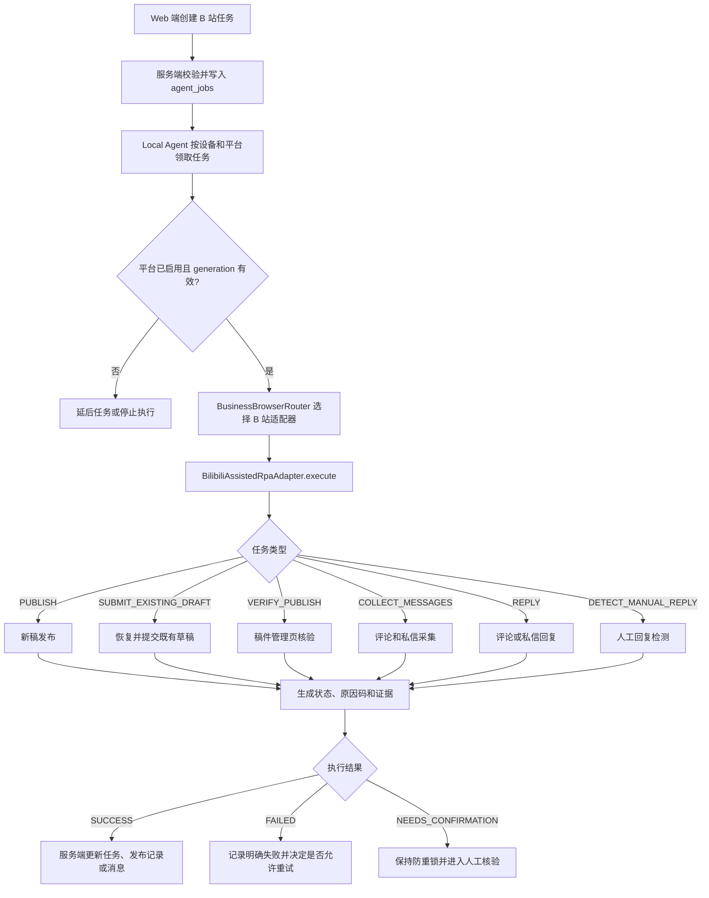
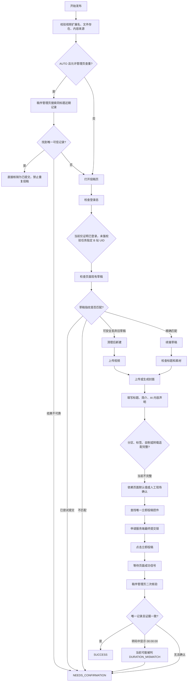
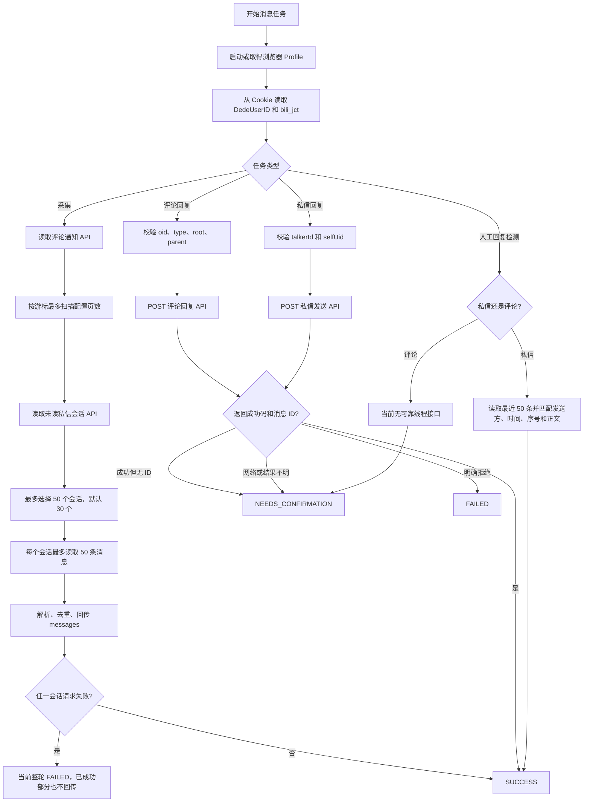
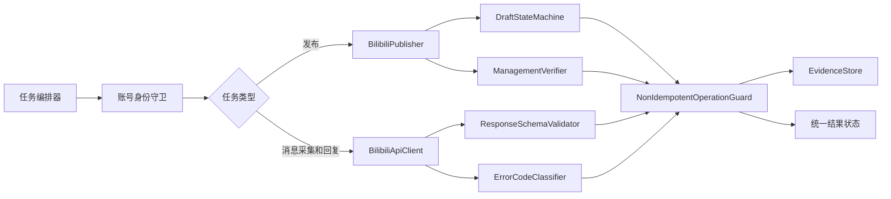

# 系统客观问题评估与 B 站适配器专项分析（V1.0）

- **评估日期**：2026-08-19
- **评估目录**：`D:\code\AI数字运营2`
- **评估方式**：静态代码审查、SQLite 运行记录核对、专项测试与全量测试复核
- **评估原则**：把“代码已实现”“自动化测试已通过”“真实平台已验收”严格区分，不用 mock 测试代替生产可用性结论

---

## 1. 总体结论

**当前系统更接近“具备较完整安全框架的联调/试运行版本”，还不能客观认定为生产可用系统。**

系统并不是完全不可用：它已经具备最终提交锁、草稿指纹、平台停止态、非幂等操作禁止盲目重试、管理页二次核验、精确评论/私信目标字段等较好的安全设计。B 站专项自动化测试也达到 **39/39 通过**。

但最关键的问题不在“能不能自动点击页面”，而在以下三点：

1. **是否能证明当前登录的是真正被任务指定的 B 站账号**；
2. **点击最终投稿/发送后，能否准确区分成功、处理中、失败和结果不确定**；
3. **B 站页面或内部 Web API 变化后，系统能否快速识别、隔离并恢复，而不是整体失效。**

目前这三点都还存在明显缺口。项目自己的文档也明确写明：五个平台尚未完成完整真实运营账号生产验收，不应视为生产可用；真实最终发布、真实评论回复、真实私信回复均未完成验收。

### 1.1 客观成熟度评分

> 评分用于排序风险，不代表绝对测量值。5 分表示已具备可重复验证的生产级证据。

| 维度 | 评分 | 客观判断 | 主要依据 |
|---|---:|---|---|
| 生产验收成熟度 | 1.5 / 5 | 偏低 | 官方验收报告明确“未执行真实平台验收” |
| 功能完整性 | 2.5 / 5 | 中低 | 主链路存在，但 B 站分区、版权类型、标签、评论人工回复检测不完整 |
| 非幂等安全性 | 3.5 / 5 | 中上 | 有提交锁、防重、草稿保护；但 `submitExistingDraft()` 写后异常语义仍有漏洞 |
| 稳定性与恢复能力 | 2.5 / 5 | 中低 | 有降级和人工确认；但 API/DOM 漂移、分页、部分失败、SQLite 并发仍脆弱 |
| 可维护性 | 2.0 / 5 | 偏低 | 多个核心文件超过千行，B 站适配器职责过多 |
| 可观测性 | 2.5 / 5 | 中低 | 有 JSON/截图证据；但状态分类粗、历史绝对路径失效、产物缺少生命周期治理 |
| 自动化测试 | 3.5 / 5 | 中上 | B 站专项 39/39；全量 417/418，但大部分仍是 mock/unit 级验证 |
| 迁移与审计能力 | 1.5 / 5 | 偏低 | 当前目录不是 Git 仓库，历史证据路径仍指向旧工程目录 |

---

## 2. 系统层面问题总表

| 编号 | 严重度 | 问题 | 代码/事实依据 | 实际影响 | 建议 |
|---|---|---|---|---|---|
| SYS-01 | **P0** | 尚未完成真实平台生产验收 | `README.md:59`；`reports/REAL_PLATFORM_ACCEPTANCE.md:5-7` | 不能用现有测试证明真实登录、最终投稿、真实评论/私信发送稳定可用 | 建立五个平台真实账号验收矩阵；每项保留账号、时间、版本、回执和失败复盘 |
| SYS-02 | **P0** | 账号身份验证没有成为所有写操作的硬前置条件 | B 站 `auth()` 只读取登录 Cookie；当前数据库 B 站账号 `platform_user_id` 仍为空 | 浏览器 Profile 被人工切号后，可能在错误账号下投稿或回复 | 所有平台写操作统一执行 `expectedPlatformUserId === actualPlatformUserId`；不一致立即硬阻断 |
| SYS-03 | **P0** | 非幂等操作的“写后异常”语义不完全一致 | `publish()` 有尝试状态保护，但 B 站 `submitExistingDraft()` 没有整体写后异常兜底；Agent 普通异常默认转 `FAILED` | 实际已提交但后续核验异常时，可能被错误标记为失败，后续人工或系统重试造成重复投稿 | 建立统一 `NonIdempotentOperationGuard`，记录授权、请求发出、响应收到、二次核验四个阶段 |
| SYS-04 | **P1** | 状态模型过于粗粒度 | 大量不同情形都落入 `FAILED` 或 `NEEDS_CONFIRMATION` | 运维无法直接区分登录失效、风控、频控、转码中、部分采集成功、平台接口漂移 | 增加 `PENDING_VERIFY`、`PARTIAL_SUCCESS`、`AUTH_EXPIRED`、`RATE_LIMITED`、`RISK_BLOCKED`、`SCHEMA_CHANGED` 等状态/原因码 |
| SYS-05 | **P1** | SQLite 并发和测试隔离仍有脆弱性 | 2026-08-19 全量测试 418 项中 1 项因 `database is locked` 失败；单独重跑通过 | 并发任务或测试可能偶发失败，影响发布、删除、状态更新等关键写入 | 设置 busy timeout/WAL，减少长事务；测试使用独立临时数据库或串行化涉及同一 DB 的用例 |
| SYS-06 | **P1** | 核心模块单体化严重 | `src/server.js`、`agent/rpa-adapters/assisted-platform.js`、`bilibili-assisted.js`、`public/app.js` 均为大文件 | 修改一个平台或一个状态容易牵连其他链路；代码审查、定位和回归成本高 | 按领域拆分：任务编排、账号、提交锁、证据、平台 API、平台 UI、解析器、状态机 |
| SYS-07 | **P1** | 自动化测试通过与真实平台兼容性之间存在证据断层 | B 站专项 39/39，但真实验收报告仍明确未执行真实发布/回复 | 容易产生“测试全绿即生产可用”的错误预期 | 建立三层测试标签：纯函数、模拟浏览器、真实平台只读/写入验收；报告中分开展示 |
| SYS-08 | **P1** | 证据中包含页面截图、消息内容，但看不到明确留存和自动清理机制 | 当前 `logs` 目录约 2,803 个文件，其中约 1,414 个 JSON、1,369 个 PNG | 用户评论、私信和账号页面可能长期留存，带来隐私、磁盘和权限风险 | 设置证据分级、脱敏、加密、访问控制和 7/30/90 天留存策略；定期清理 |
| SYS-09 | **P1** | 持久化绝对路径导致迁移后证据失效 | 当前数据库记录仍指向 `D:\code\Codex项目交接包-2026-07-31\...`，当前工程为 `D:\code\AI数字运营2` | 历史截图和 JSON 在新目录中无法直接打开；草稿恢复也依赖旧路径 | 数据库保存证据 ID/相对路径；由配置解析根目录；迁移时执行路径重写和存在性校验 |
| SYS-10 | **P1** | 对平台 DOM 和内部 Web API 的变化缺少主动漂移监测 | 多个平台适配器依赖硬编码选择器、中文文案、未版本化内部接口 | 平台小改版就可能造成采集、投稿、回复整体失败 | 每日只读探针、响应 schema 校验、选择器健康度、错误码趋势告警、平台能力版本号 |
| SYS-11 | **P1** | 文档描述与实际能力边界不完全一致 | B 站工作流写到分区、自制/原创声明；代码未发现明确分区、标签、版权类型实现 | 使用者会误认为必填项已被系统稳定处理 | 以“已实现/部分实现/需人工/未实现”维护能力矩阵，并由测试自动校验文档声明 |
| SYS-12 | **P2** | 运行产物与源码目录混放，缺少生命周期治理 | 工程内总文件约 16,313 个，`logs` 目录约 2,803 个文件 | 交接包膨胀、扫描变慢、备份困难，敏感证据容易被一并复制 | 将日志、Profile、临时文件迁出源码树；按任务归档；加入清理和容量告警 |
| SYS-13 | **P1** | 当前工作目录不是 Git 仓库 | `git status` 返回 `fatal: not a git repository` | 无法可靠追踪谁改了什么、回滚变更、进行发布版本审计 | 恢复/初始化 Git 历史，设置主分支保护、版本标签、变更审查和可回滚发布包 |
| SYS-14 | **P2** | 浏览器主通道失败后虽然可降级，但降级原因未形成平台健康指标 | 当前 B 站历史 Job 显示 `web_access_cdp` 启动失败后回退 Playwright | 单次任务可能成功，但主通道长期故障不容易从业务结果中被发现 | 将 provider、fallback reason、启动耗时纳入仪表盘和告警，不只写入单个 Job 结果 |

---

## 3. 当前系统已经做得较好的地方

为了保持评价客观，以下设计应保留，不建议在重构中破坏：

| 已有能力 | 客观价值 |
|---|---|
| 最终提交锁 | 降低同一目标被两个 Agent 重复点击投稿的风险 |
| 管理页发布前查重和发布后二次核验 | 比单纯依赖页面“投稿成功”文案更可靠 |
| 草稿指纹与素材 SHA-256 | 能识别错误草稿、错误素材和重复恢复 |
| 平台运行态与 generation 检查 | 平台被停止时可尽快中止后续动作 |
| 非幂等操作原则上禁止盲目自动重试 | 对投稿、评论、私信这类不可安全重复动作是正确策略 |
| B 站评论绑定 `oid/type/root/parent` | 回复目标比只依赖页面顺序或文本匹配更精确 |
| B 站私信绑定 `talkerId/msg_key/msgSeqno` | 能降低串错会话和把旧消息当新消息的风险 |
| 证据 JSON 与截图 | 为人工确认和问题复盘提供基础 |
| B 站专项测试 39/39 | 表明当前纯函数、模拟页面和安全分支覆盖较完整 |

---

## 4. B 站任务总执行流程

### 4.1 流程中的核心判断

B 站适配器不是简单的“打开网页并点击”。它实际上承担了四类职责：

1. **账号会话层**：浏览器 Profile、Cookie、登录态；
2. **发布事务层**：草稿、防重、提交锁、最终投稿、发布核验；
3. **消息 API 层**：评论通知、私信会话、回复发送、人工回复检测；
4. **证据与状态层**：截图、JSON、`SUCCESS/FAILED/NEEDS_CONFIRMATION`。

问题也正是由这些职责集中在同一个适配器中产生：任何一个层面的变化，都可能影响整个 B 站链路。

---

## 5. B 站视频发布流程

### 5.1 这个发布流程最值得关注的地方

- **提交前的安全性较好**：有查重、草稿指纹、唯一按钮检查、提交锁。
- **提交后的确定性仍不足**：B 站转码和管理页数据延迟会制造假阴性。
- **账号身份没有闭环**：登录 Cookie 中已经能拿到 `DedeUserID`，但没有与任务指定账号做强一致性比较。
- **必填项覆盖不完整**：当前主要处理视频、封面、标题、简介和 AI 声明，没有看到稳定的分区、标签、版权类型适配。

---

## 6. B 站评论与私信执行流程

---

## 7. B 站平台适配器专项问题表

| 编号 | 严重度 | 适配器问题 | 具体证据 | 风险/表现 | 建议改法 |
|---|---|---|---|---|---|
| BILI-01 | **P0** | 只确认“已登录”，没有确认“登录的是任务指定账号” | `bilibili-assisted.js:610-637` 只检查 `DedeUserID`、`bili_jct`；当前数据库账号 4 的 `platform_user_id` 为空 | Profile 被人工换号后仍可能投稿、评论或私信，形成错账号事故 | 在每次写操作前读取实际 UID，并与账号表 `platform_user_id` 强比较；首次绑定必须人工确认，之后不匹配硬阻断 |
| BILI-02 | **P0** | 转码中的 `00:00:00` 容易被当成真实时长，造成发布假阴性 | `assessBilibiliManagementRecord()` 在 `bilibili-assisted.js:180-223`；`206-208` 对时长误差超过 3 秒直接 `DURATION_MISMATCH` | 已成功投稿但管理页正在转码时，会被转入人工确认 | 对 `REVIEWING + 00:00:00/转码中` 返回 `PENDING_METADATA`；优先使用精确标题、提交时间、BV 链接和唯一记录作为证据 |
| BILI-03 | **P0** | `submitExistingDraft()` 点击后缺少统一异常保护 | `bilibili-assisted.js:1229-1344` 没有包住最终点击及后续核验的整体 `try/catch`；Agent 在 `local-agent.js:340-369` 将普通异常转为 `FAILED` | 点击可能已经生效，但成功信号、截图或管理页核验抛异常后被标记为失败，存在重复提交风险 | 记录 `submitAuthorized/clickAttempted/requestMayHaveCommitted`；点击后任何非明确拒绝都必须进入 `NEEDS_CONFIRMATION/PENDING_VERIFY` |
| BILI-04 | **P1** | 发布必填字段适配不完整 | 工作流文档要求分区、自制/原创、封面、声明；代码搜索未发现明确分区、标签和版权类型设置；`04-bilibili.md:65` 也注明需现场验证 | 账号默认值变化或 B 站新增必填项时，可能无法投稿或投稿到错误分区/版权类型 | 建立字段适配器：分区 ID、标签、转载来源、自制/转载、AI 声明；提交前读取页面值并形成证据 |
| BILI-05 | **P1** | 回复长度策略重复且互相矛盾 | 公共策略 B 站评论/私信均为 1000/980；适配器评论硬编码 1000、私信硬编码 5000，见 `bilibili-assisted.js:363-385` | 最后一道发送边界可能与上游不同；未来直接调用适配器会绕过统一限制 | 适配器直接调用 `validateReplyTextLength()`，删除 1000/5000 硬编码；统一 Unicode 字符计数 |
| BILI-06 | **P1** | 字符统计使用 `string.length`，与公共 Unicode 计数不一致 | `bilibili-assisted.js:372,384`；公共策略 `platform-reply-policy.js:90-100` | emoji、组合字符可能按 UTF-16 码元重复计数，产生错误拦截或放行 | 全部使用公共 `countUnicodeCharacters()`/grapheme 策略，并加入 emoji 边界测试 |
| BILI-07 | **P1** | 依赖未版本化的 B 站内部 Web API | 文件顶部硬编码评论、会话、消息、回复接口；请求/响应字段直接解析 | 接口字段、鉴权、风控或错误码变化时会突然整体失效 | 拆出 `BilibiliApiClient`；增加 schema 校验、接口能力探测、错误码映射和兼容层版本 |
| BILI-08 | **P1** | DOM 选择器和中文文案硬编码 | 投稿页、封面弹窗、按钮和管理页记录均依赖当前 DOM 与中文文本 | B 站前端改版、灰度、账号差异会导致定位失败或误定位 | 选择器分版本；以可访问角色/稳定属性优先；多证据定位；加入线上只读 selector probe |
| BILI-09 | **P1** | 私信采集一个会话失败会让整轮全部失败 | `collectMessages()` 在 `bilibili-assisted.js:1411-1439` 串行请求会话；总 catch 直接返回 `FAILED` | 已成功采集的评论和其他私信也无法回传，扩大单点失败影响 | 每个会话独立 try/catch；回传成功消息与失败会话列表；支持 `PARTIAL_SUCCESS` |
| BILI-10 | **P1** | 私信分页存在明确上限和漏采可能 | 会话最多 50、默认 30；单会话消息最多 50，见 `1414-1424`；人工回复检测也只取 50 条，见 `1507-1508` | 未读超过 50 条或活跃会话较多时，较早未读消息可能永久漏采；人工回复检测可能假阴性 | 使用游标持续拉取到已处理水位；保存 per-session cursor；明确记录单会话截断而不只记录会话数截断 |
| BILI-11 | **P1** | 评论人工回复不能自动闭环 | `detectManualReply()` 在 `bilibili-assisted.js:1500-1502` 对非私信直接 `NEEDS_CONFIRMATION` | 人工在 B 站评论区回复后，系统无法可靠自动识别并关闭待办 | 接入评论线程只读查询，基于 `oid/root/parent`、账号 UID、时间与正文匹配；无法获取时明确标为功能未实现 |
| BILI-12 | **P1** | API 型操作仍强依赖浏览器/Profile 启动 | `collectMessages()`、`replyToMessage()` 先取得页面；`auth()` 从浏览器 Context 取 Cookie | 即使 API 可用，只要浏览器启动失败，采集/回复也会失败；资源开销更高 | 将 Cookie/授权会话放入加密 session vault；API 任务不强制创建页面，只有需要截图或重新登录时启动浏览器 |
| BILI-13 | **P1** | `attempted=true` 设置过早 | `replyToMessage()` 在 `bilibili-assisted.js:1464` 调用 `apiPost()` 前设置；`apiPost()` 内还会做运行态、鉴权和 Context 检查 | 请求根本没发出也可能被判定为“结果不确定”，制造不必要人工确认 | 拆分 `validated`、`requestDispatched`、`responseReceived`；只有真正开始网络写请求后才设置 `requestMayHaveCommitted` |
| BILI-14 | **P1** | 错误分类不足 | 多数 API 异常被压缩为通用错误或 `apiRejected` | 登录过期、频控、风控、权限不足、参数变化无法被不同方式处置 | 映射 B 站 code/message 到 `AUTH_EXPIRED/RATE_LIMITED/RISK_BLOCKED/PERMISSION_DENIED/SCHEMA_CHANGED` |
| BILI-15 | **P2** | `inspectMessageApi()` 是未接入主链路的诊断代码 | 方法定义在 `bilibili-assisted.js:1346`，未发现调用方 | 维护者可能误以为系统已经进行 API 能力预检，实际没有 | 接入定时健康检查，或删除并由正式 `BilibiliApiHealthProbe` 取代 |
| BILI-16 | **P1** | 草稿身份只绑定内部 `accountId`，没有绑定真实 B 站 UID | 草稿指纹使用内部账号和素材信息；登录真实 UID 没有参与草稿归属校验 | 同一 Profile 被换号后，本地草稿仍可能被当成当前任务草稿续接 | 指纹加入 `platformUserId`，并在恢复、丢弃、提交三个动作前重新校验 UID |
| BILI-17 | **P2** | 适配器职责过多且文件过大 | `bilibili-assisted.js` 同时负责 API、解析、DOM、封面、草稿、核验、采集、回复、证据 | 任意改动都需要大范围回归，难以隔离平台变化 | 拆为 `api-client`、`message-parser`、`publisher`、`draft-state-machine`、`management-verifier`、`evidence-adapter` |

---

## 8. 已发生的 B 站真实运行样本说明

当前 SQLite 数据库按 `payload.platformCode = bilibili` 筛选到两条历史任务：

| Job | 类型 | 最终状态 | 观察到的事实 | 说明 |
|---:|---|---|---|---|
| 4 | `PUBLISH` | `NEEDS_CONFIRMATION` | 已点击“立即投稿”，当时未能在管理页可靠确认 | 系统为防止重复投稿保持锁，这是安全的；但确认灵敏度不足 |
| 6 | `VERIFY_PUBLISH` | `SUCCESS` | 后续在“已通过”找到记录，取得 BV 号 `BV1h6bh67E7H` | 证明 Job 4 的投稿实际成功，初次判断属于假阴性/延迟确认 |

这个样本非常重要，因为它说明：

- 当前适配器**不是不会投稿**；
- 当前更实际的问题是**投稿后的确认模型无法充分适应 B 站转码和管理页延迟**；
- “宁可人工确认也不重复投稿”的方向是正确的，但应通过 `PENDING_VERIFY` 和自动延迟核验减少不必要告警，而不是降低防重安全性。

另外，两条历史记录中的 `evidencePath` 和 `screenshotPath` 都仍指向旧工程目录，说明迁移后的历史证据路径确实已经失去可移植性。

---

## 9. 建议整改顺序

### P0：先阻止高影响业务事故

| 顺序 | 改造项 | 完成标准 |
|---:|---|---|
| 1 | B 站真实 UID 强绑定 | 所有投稿、评论、私信前都能证明实际 UID 等于任务账号 UID；不一致时零写操作 |
| 2 | `submitExistingDraft()` 写后异常保护 | 最终点击后的任何异常都不会被标成可自动重试的普通失败 |
| 3 | 转码期发布核验 | `REVIEWING + 00:00:00` 进入 `PENDING_VERIFY`；延迟核验后可自动转成功 |

### P1：补全平台适配和运维语义

| 顺序 | 改造项 | 完成标准 |
|---:|---|---|
| 4 | 分区、标签、版权类型、声明字段化 | 每个字段可配置、可读取回验、有测试和证据 |
| 5 | API 客户端与错误码分类 | 有 schema 校验、错误码映射、只读健康探针 |
| 6 | 私信分页与部分成功 | 不漏读；单会话失败不拖垮整轮；可回传水位和失败清单 |
| 7 | 回复长度策略统一 | 适配器和服务端只使用一套 Unicode 安全策略 |
| 8 | 状态模型细化 | 运维页面能区分待核验、登录过期、风控、频控、接口漂移、部分成功 |

### P2：降低长期维护成本

| 顺序 | 改造项 | 完成标准 |
|---:|---|---|
| 9 | 模块拆分 | B 站 API、发布 UI、草稿状态机、核验和证据相互独立 |
| 10 | 证据与路径治理 | 相对路径/证据 ID、可迁移、可清理、敏感内容有留存策略 |
| 11 | 恢复版本管理 | 工程进入 Git；每次平台适配变更有版本、审查和可回滚标签 |
| 12 | 真实平台验收 | 真实账号完成发布、评论、私信、人工回复检测和异常场景验收 |

---

## 10. 建议的 B 站适配器目标架构

建议把适配器从“一个 1500 行左右的全能类”改成“编排器 + 小型可测试组件”。核心原则不是追求文件数量，而是让以下边界独立：

- 身份是否正确；
- 请求是否真正发出；
- 平台是否明确接受；
- 是否只是转码/同步中；
- 是否能够安全重试；
- 证据是否可迁移和可追溯。

---

## 11. 测试和事实依据

### 11.1 已执行测试

| 测试 | 结果 | 客观解释 |
|---|---|---|
| `node --test test/platform-bilibili-flow.test.js` | **39/39 通过** | 说明 B 站专项模拟与纯函数逻辑当前通过，不代表真实平台验收完成 |
| `npm test` | **417/418 通过** | 唯一失败为 `test/task-delete.test.js` 的 `database is locked` |
| 单独重跑失败测试 | **2/2 通过** | 说明问题更可能是并发/隔离脆弱性，而不是稳定可复现的任务删除逻辑错误 |

全量测试日志：`D:\code\AI数字运营2\tmp\system-review-npm-test-20260819.log`

### 11.2 关键代码位置

| 范围 | 文件位置 |
|---|---|
| B 站管理页匹配与时长判断 | `agent/rpa-adapters/bilibili-assisted.js:180-223` |
| B 站登录和 Cookie 鉴权 | `agent/rpa-adapters/bilibili-assisted.js:610-637` |
| B 站发布主流程 | `agent/rpa-adapters/bilibili-assisted.js:1079-1227` |
| 提交既有草稿 | `agent/rpa-adapters/bilibili-assisted.js:1229-1344` |
| 评论/私信采集 | `agent/rpa-adapters/bilibili-assisted.js:1371-1440` |
| 评论/私信回复 | `agent/rpa-adapters/bilibili-assisted.js:1443-1490` |
| 人工回复检测 | `agent/rpa-adapters/bilibili-assisted.js:1492-1526` |
| 公共回复长度策略 | `src/services/platform-reply-policy.js:24-27,90-100` |
| Agent 普通异常结果映射 | `agent/local-agent.js:330-370` |
| B 站工作流声明 | `platform-workflows/04-bilibili.md:18,54,65` |
| 生产验收声明 | `README.md:59`；`reports/REAL_PLATFORM_ACCEPTANCE.md:5-7` |

---

## 12. 最终判断

如果只问“这个系统有没有安全意识”，答案是：**有，而且比简单 RPA 脚本明显更完善。**

如果问“现在能否放心作为无人值守的 B 站生产运营系统”，答案是：**还不能。**

最需要优先解决的不是页面美化或继续堆测试数量，而是：

1. **真实账号 UID 强校验**；
2. **最终投稿后的事务状态和转码期核验**；
3. **既有草稿提交路径的写后异常保护**；
4. **B 站分区/版权类型等必填项补全**；
5. **内部 API、DOM 漂移、分页和部分失败的工程化治理**。

完成这些项目并通过真实账号验收后，系统才有资格从“联调/试运行”进入“受控生产运行”。
