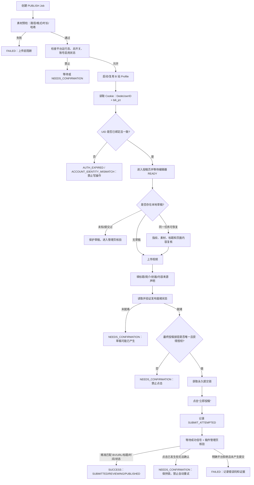
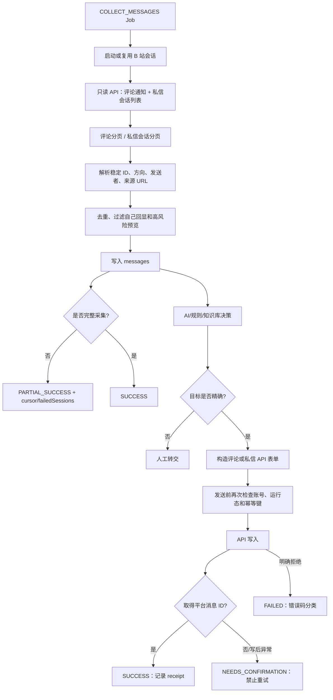

# 系统当前结构与优化建议（V2.0）

> 评估日期：2026-08-20（Asia/Shanghai）
>
> 评估对象：`D:\code\AI数字运营2`
>
> 结论基于当前源码、当前 SQLite 数据、运行日志、安装脚本和全量自动化测试；不把 mock 测试结果等同于真实平台生产可用性。

## 1. 本次复核范围

- 重新扫描 `src/`、`agent/`、`public/`、`test/`、`packaging/`、`docs/` 和 `platform-workflows/`。
- 重新执行 `npm test`：421 个测试全部通过，0 失败，耗时约 28 秒。
- 检查 `data/mvp.db`、近期 `logs/`、真实平台验收报告和安装脚本。
- 重点复核 `agent/rpa-adapters/bilibili-assisted.js` 的登录、投稿、草稿恢复、消息采集和回复链路。

## 2. 当前结构判断

| 层 | 当前情况 | 客观评价 |
|---|---|---|
| Web 服务 | `src/server.js` 约 2719 行 | 路由、业务编排、状态迁移和事务仍过度集中 |
| 数据层 | `src/db.js` 约 871 行，SQLite + WAL + busy timeout + migration | 稳定性已有改善，但所有领域共用单文件写入通道 |
| Local Agent | `agent/local-agent.js` 约 906 行 | 已有心跳、生命周期、主开关、平台运行态和恢复能力 |
| 公共 RPA | `agent/rpa-adapters/assisted-platform.js` 约 4135 行 | 公共能力较强，但职责边界过宽，改动回归成本高 |
| B 站适配器 | `agent/rpa-adapters/bilibili-assisted.js` 约 1532 行 | 已形成 UI 投稿 + API 消息的混合适配器，但仍有关键生产级缺口 |
| 前端 | `public/app.js` 约 1592 行，`styles.css` 约 137 KB | 功能集中在单页，状态与交互复杂度继续上升 |
| 测试 | 421 项全通过，含平台专项和安全/恢复测试 | 自动化回归基础较好，但真实平台验收尚未执行 |
| 打包 | `packaging/staging` 是源码副本并携带模板数据库 | 交付可用，但存在数据泄露、源码漂移和版本同步风险 |

当前运行目录仍有较多产物：`logs/` 约 3888 个文件、`.tmp/` 约 1042 个文件、`backups/` 约 187 个文件。数据库中有 1805 条 Agent Job、43 条消息、12 条问题、23 条知识、606 条知识别名。

## 3. 总体判断

这个系统已经不是“功能很少的 MVP”，而是一个**功能覆盖较广、保护逻辑较多，但架构复杂度已经超过模块化能力的单体系统**。

当前最重要的优化方向已经从“继续增加平台功能”转为：

1. 先确保账号身份、写操作和结果状态不会误判；
2. 再收敛状态模型、事务边界和适配器边界；
3. 然后解决安装包、日志证据和部署同步风险；
4. 最后再扩大真实平台自动化范围。

421/421 测试通过只能说明当前可重复的逻辑和模拟链路没有回归；`reports/REAL_PLATFORM_ACCEPTANCE.md` 明确记录五个平台均尚未完成真实登录、真实发布和真实评论/私信发送验收。

## 4. 系统问题评估表

| 编号 | 优先级 | 问题 | 当前证据 | 影响 | 优化建议 |
|---|---|---|---|---|---|
| SYS-01 | P0 | 账号身份没有形成强制闭环 | B 站账号 `id=4` 的 `platform_user_id`、`identity_source` 仍为空；B 站 `auth()` 只从 Cookie 读取 `DedeUserID` 和 `bili_jct` | 切号或 Profile 被替换时，登录态可能被误当作目标账号 | 登录后必须获取实际 UID/名称，与 `accounts.platform_user_id` 做强一致校验；未绑定时禁止投稿、回复和自动采集 |
| SYS-02 | P0 | 写操作结果状态在不同入口不统一 | `publish()` 有点击后异常保护；`submitExistingDraft()` 在 `D:\code\AI数字运营2\agent\rpa-adapters\bilibili-assisted.js:1229-1344` 仍没有同等级整体 catch | 点击已发生但异常向上抛出，可能落成普通失败，恢复和防重复依赖上层兜底 | 统一 `writeAttempted / writeConfirmed / writeRejected` 状态机；任何最终点击后异常都固定进入 `NEEDS_CONFIRMATION`，永久保留提交锁 |
| SYS-03 | P0 | 安装包携带真实业务数据与固定初始密码 | `packaging/build-installer.ps1` 从当前 `data/mvp.db` 复制模板；`initialize-mvp.ps1`、`.env.example` 和安装验收脚本仍使用 `admin11`；安装说明写明包含历史任务/消息和在线 AI 配置 | 安装包泄露会暴露历史消息、任务、知识库和配置；固定密码容易被忽略修改 | 默认构建空白或脱敏数据库；API Key/Webhook 不进入模板；首次启动强制改密；密钥与数据库分离并使用 DPAPI/凭据管理器 |
| SYS-04 | P0 | 没有真实平台验收闭环 | `reports/REAL_PLATFORM_ACCEPTANCE.md` 明确五平台真实登录、最终发布、评论回复、私信回复均未执行 | 不能证明页面选择器、风控、账号身份和写后回执在真实环境中可靠 | 建立单平台/单账号/单样本验收矩阵；先只读，再人工确认最终点击；每次保存页面、平台 ID、结果和证据 |
| SYS-05 | P1 | 业务状态粒度不足 | 任务主状态仍大量使用 `SUCCESS`、`FAILED`、`NEEDS_CONFIRMATION`，但结果 JSON 已出现 `submissionStatus`、`reviewStatus`、`syncPending` 等细化字段 | 运维无法区分登录过期、限流、风控、结构变化、部分采集和写后不确定 | 增加统一原因码：`PENDING_VERIFY`、`PARTIAL_SUCCESS`、`AUTH_EXPIRED`、`RATE_LIMITED`、`RISK_BLOCKED`、`SCHEMA_CHANGED`、`PLATFORM_UNAVAILABLE` 等 |
| SYS-06 | P1 | 问题阻断与运行态耦合偏重 | `issues`、`runtime_blocks` 已支持 `block_scope`，但平台任务数据仍需持续验证隔离效果 | 一个采集或回复问题可能影响整个账号/平台，降低可用性 | 明确定义 TASK/MESSAGE/ACCOUNT/PLATFORM/GLOBAL 的阻断矩阵；写入自动化测试和管理界面解释 |
| SYS-07 | P1 | SQLite 是所有领域的共享写瓶颈 | server、Local Agent、知识别名 worker、任务、消息、审计共用 `data/mvp.db`；虽已启用 WAL、busy timeout 和 busy retry | 当前测试已稳定，但并发增长时仍可能出现写锁、WAL 增长和备份窗口问题 | 统一事务封装、限制事务时长、checkpoint 后备份；中长期将高频 Job/Event 拆分或迁移 PostgreSQL |
| SYS-08 | P1 | 核心单体文件职责过重 | `server.js`、`db.js`、`assisted-platform.js`、`bilibili-assisted.js`、`public/app.js` 均较大 | 改一处需要跨平台回归，问题定位依赖大量上下文 | 按 route/controller/service/repository 拆分；RPA 拆 BrowserSession、Identity、Publish、Evidence、Message、Reply |
| SYS-09 | P1 | 日志、截图、临时文件和证据缺少系统化留存治理 | 当前 `logs`、`.tmp`、`backups` 数量持续增长；证据中仍有绝对路径 | 隐私泄露、磁盘耗尽、迁移后证据失效 | 使用 evidence_id + 相对路径；内容和截图分级脱敏；配置 7/30/90 天留存与磁盘告警 |
| SYS-10 | P1 | staging 是源码副本，存在部署漂移 | 根目录与 `packaging/staging` 同时保留源码和依赖；当前 B 站历史证据仍指向旧交接目录 | 开发测试通过不等于安装包使用同一份代码 | staging 必须由干净构建生成；构建前清空并校验 hash；纳入 Git 和 CI |
| SYS-11 | P2 | 文档和脚本存在过时路径/描述 | `README.md`、部分 docs 仍使用旧目录 `D:\code\Codex项目交接包-2026-07-31\...`；README 密码还写过 `admin123`，脚本使用 `admin11` | 新人启动、证据定位和迁移操作容易出错 | 统一配置化路径和密码策略；执行文档/脚本/示例的路径与敏感词扫描 |
| SYS-12 | P2 | 可观测性不足以支撑平台级运维 | 有 RPA JSON 和截图，但缺少统一指标：成功率、确认率、回执缺失率、Fallback 率、按错误码统计 | 难以判断是平台变化、浏览器问题还是业务输入问题 | 建立 job_attempt、provider_used、error_code、write_attempted、verification_latency 等指标和告警 |

## 5. B 站适配器专项问题表

| 编号 | 优先级 | B 站问题 | 当前代码/运行证据 | 具体风险 | 建议 |
|---|---|---|---|---|---|
| BILI-01 | P0 | 登录态没有绑定目标 UID | `bilibili-assisted.js:629-637` 读取 `DedeUserID`，但没有与账号表 `platform_user_id` 比较；当前 B 站账号 UID 为空 | Profile 切号后仍可能投稿或回复到错误账号 | `auth()` 返回前执行 `actualUid === expectedUid`；首次绑定必须人工确认并记录证据 |
| BILI-02 | P0 | 既有草稿恢复的写后异常保护不完整 | `submitExistingDraft()` 在 `:1327` 点击后继续等待信号和管理页核验，没有整体 catch | 已点击但核验异常时可能被上层当作 FAILED，后续误重试 | 抽出公共 `safeFinalSubmit()`，点击后任何异常统一转 `NEEDS_CONFIRMATION`，并保留 `SUBMIT_ATTEMPTED` |
| BILI-03 | P1 | `REVIEWING + 00:00:00` 可能被当作时长不匹配 | 管理页匹配逻辑对缺失/零时长仍可能走 `DURATION_MISMATCH` | 视频转码中的稿件被误阻断，造成重复人工处理 | 零时长视为 `PENDING_METADATA`；使用标题、提交时间窗口、BV 链接和状态标签联合核验 |
| BILI-04 | P1 | 投稿字段覆盖不完整 | 当前适配器明确实现了 AI/内容来源声明、标题、简介、封面和上传；未见稳定的分区 ID、标签、自制/转载版权字段流程 | 表单可能提交成功但业务字段不符合运营要求 | 将字段能力显式建模为 `SUPPORTED/OPTIONAL/BLOCKED`；分区、标签、版权声明逐项读取后回写验证 |
| BILI-05 | P1 | API 调用使用内部接口，但缺少兼容和错误分类层 | `msgfeed/reply`、`reply/add`、`get_sessions`、`fetch_session_msgs`、`web_im/send_msg` 为硬编码 URL；目前主要只做 `code` 成功判断 | 平台接口字段或错误码变化时，容易退化为泛化失败 | 增加 response schema 校验、能力探测、版本适配、错误码分类和限流退避 |
| BILI-06 | P1 | API 型任务仍依赖浏览器 Context | `apiGet/apiPost` 先调用 `auth()`，`auth()` 又执行 `ensureContext()`；真实历史 Job 记录曾因 Web Access 启动失败回退 Playwright | 浏览器启动/Profile 锁问题会拖垮本可独立完成的消息采集和回复 | 凭据/API 会话层与 UI 自动化层解耦；API 任务只在需要登录刷新或证据截图时启动页面 |
| BILI-07 | P1 | 私信采集存在固定截断上限 | 未读会话和单会话消息有上限，结果已有 `privateSessionScanTruncated` | 未读量大时漏采，整体仍可能返回 SUCCESS | 引入每会话 cursor、消息水位和截断字段；存在漏采风险时返回 `PARTIAL_SUCCESS` |
| BILI-08 | P1 | 单会话/单 API 失败可能拖垮整轮采集 | `collectMessages()` 整体 try/catch，失败主要返回整体 FAILED | 已成功读取的会话也无法被利用，重试成本高 | 每会话独立 try/catch，返回成功消息 + failedSessions，按会话重试 |
| BILI-09 | P1 | 评论人工回复检测明确仍未闭环 | `detectManualReply()` 对评论返回 `NEEDS_CONFIRMATION`，因为缺少可靠只读评论线程接口 | 产品如果宣称“自动检测人工回复”，会形成能力误解 | 在 UI 标记为“评论需人工复核”；不要把该路径计入自动闭环成功率 |
| BILI-10 | P2 | 回复长度规则有漂移 | 公共策略与适配器的评论/私信上限不完全一致，适配器仍使用 `message.length` | emoji/组合字符和私信长度边界可能不一致 | 适配器只调用统一 Unicode/grapheme 计数和平台策略，不允许硬编码上限 |
| BILI-11 | P2 | `inspectMessageApi()` 更像闲置诊断接口 | 当前方法存在，但未形成主链路健康探针 | 维护者可能误以为 API 能力探测已接入 | 接入只读探针和指标，或删除并减少误导 |

## 6. B 站执行流程

### 6.1 投稿流程

### 6.2 评论/私信采集与回复流程

## 7. 建议整改顺序

### P0（先做，未完成前不建议放开 B 站自动写操作）

1. 账号 UID 强绑定和首次绑定人工确认。
2. 统一最终写操作安全状态机，补齐 `submitExistingDraft()` 写后异常保护。
3. 安装包改为空白/脱敏模板，去除在线密钥，首次启动强制改密。
4. 建立真实平台只读验收和单样本最终点击流程。

### P1（随后做，降低运维和回归成本）

1. 统一错误码和 `PARTIAL_SUCCESS/PENDING_VERIFY` 等状态。
2. 拆分 `server.js`、公共 RPA 基类和 B 站适配器。
3. B 站 API 增加 schema、能力探测、分页水位、单会话隔离和限流分类。
4. 明确 block scope 隔离矩阵。
5. 建立 evidence 留存、脱敏、清理和绝对路径迁移机制。
6. 统一构建来源、staging 生成和 CI 安装后验证。

### P2（稳定运行后做）

1. 统一回复长度策略和 Unicode 计数。
2. 建立平台/provider/回执/核验耗时指标。
3. 补齐 B 站分区、标签、版权声明等运营字段适配。
4. 清理闲置诊断接口、旧备份、旧路径文档和过期脚本。

## 8. 最终结论

当前系统的主要矛盾不是“有没有功能”，而是“功能和保护逻辑已经很多，但身份、状态、证据、部署和平台适配尚未完全收敛”。

B 站并非完全不能工作：当前数据库中有一次真实投稿记录，初次 `PUBLISH` 进入 `NEEDS_CONFIRMATION`，之后 `VERIFY_PUBLISH` 成功找到 BV 号 `BV1h6bh67E7H`。但这恰恰说明系统目前是“能在特定条件下完成，并能通过后续核验兜底”，还不是“可无监督稳定运行”。此外，该次历史记录显示 Web Access 启动失败后使用了 Playwright fallback，说明浏览器 Provider 稳定性也是 B 站链路的现实依赖。

因此，当前最客观的判断是：**系统适合继续做受控人工确认模式和真实验收，不适合在账号身份未强绑定、安装包未脱敏、写后状态未完全统一之前直接扩大自动发布/自动回复权限。**
