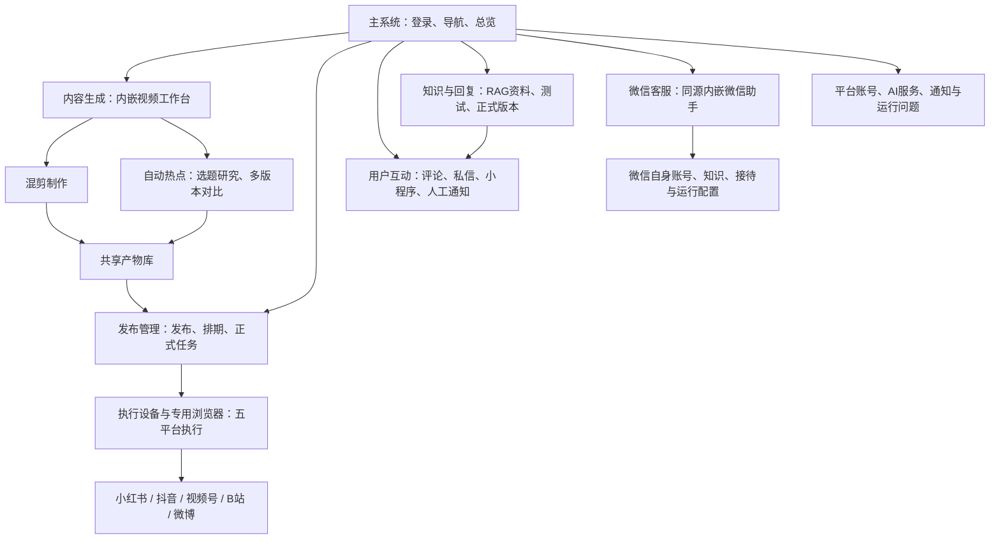
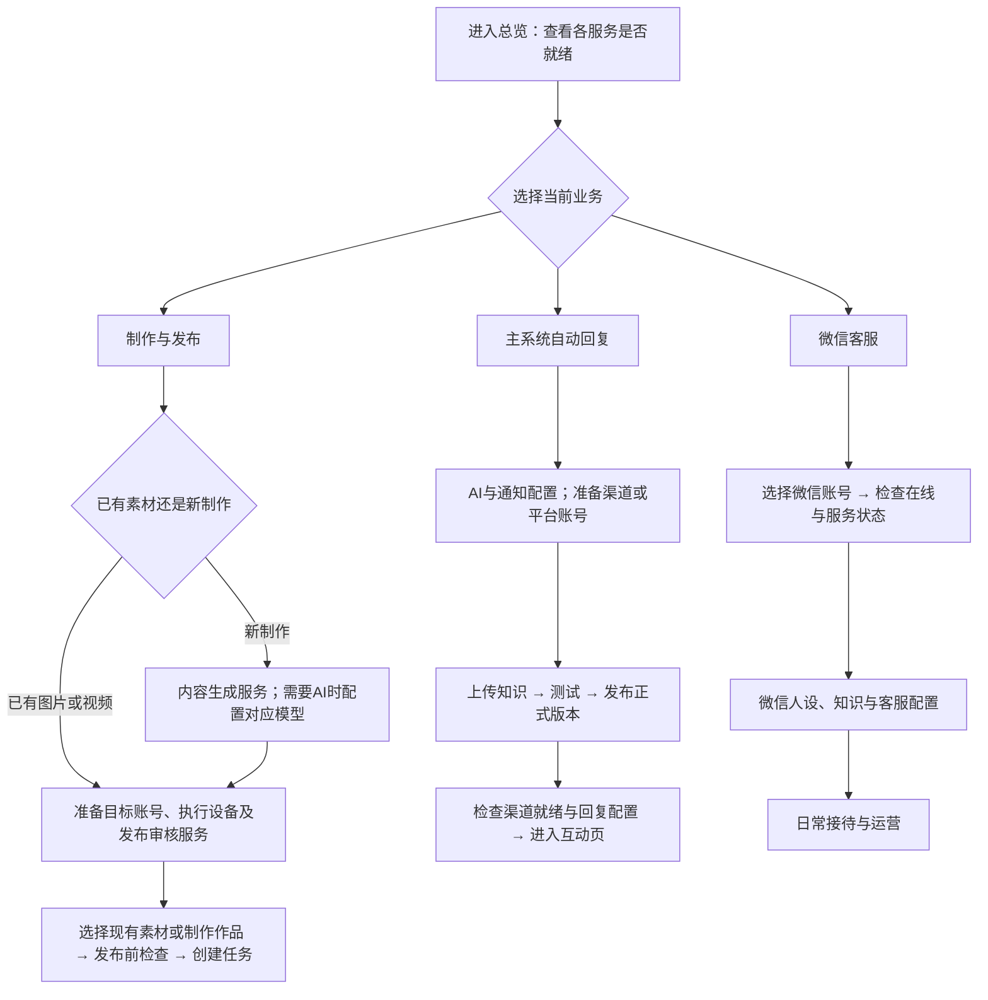
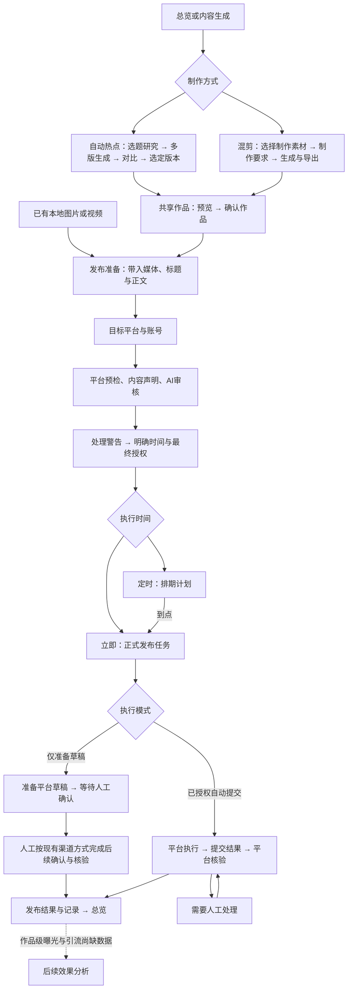
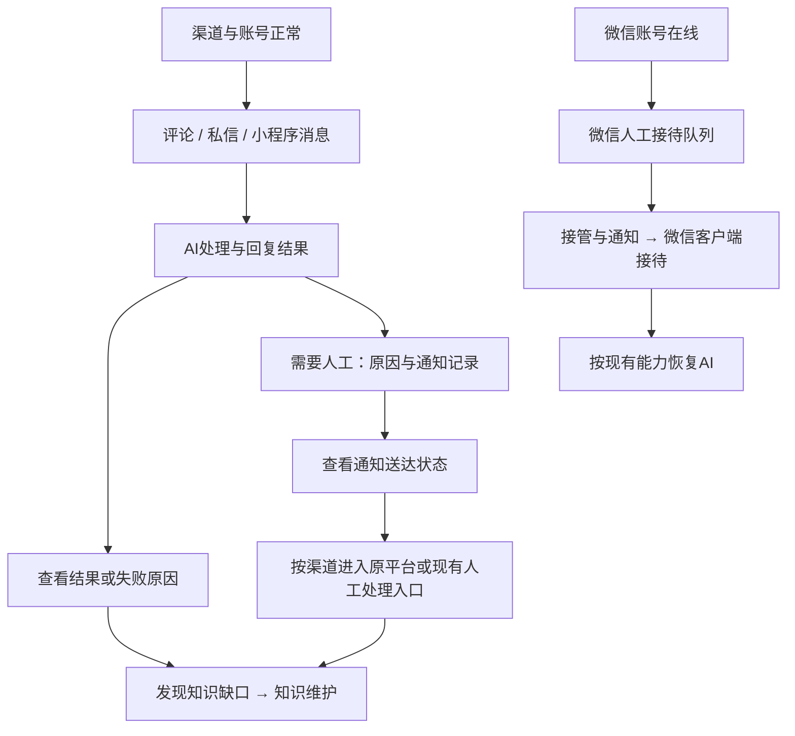
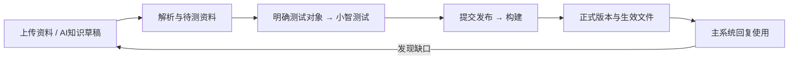
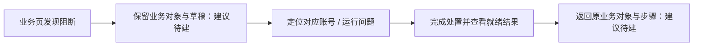

# 智慧驱动：阶段一信息架构与布局评审

日期：2026-11-05　｜　状态：待评审提案　｜　范围：整套系统

## 1. 本阶段交付与结论

本稿完成现行框架梳理、页面信息框图、核心业务链路、模块主次和显隐安排，并给出低保真布局建议。依据为当前工作目录中的实际导航、服务端路由、主系统页面及内嵌引擎源码；另对运行中的总览做了只读核对。运行数据会变化，本稿不把当时的数量、账号在线状态作为固定事实。

建议保留现有八个一级栏目，优先重排栏目内部的信息。整个系统以四条业务线组织：内容制作与发布、咨询处理与人工接待、知识维护与上线、运行配置与异常处理。首页负责提示“现在处理什么”，各业务页负责完成任务，配置与技术信息按需展开。

本阶段不修改正式页面，不定义完整按钮规则、弹窗、校验、重试与状态机，不进行视觉设计。下文“建议”“待建”均为评审方案；草图中的跨页入口也不代表相关能力已经实现。信息结构评审后再进入阶段二。

交付件：

- 本文：现行信息树、建议信息框图、四条业务链、页面布局和显隐矩阵、流程断点及评审项。
- 配套可切换线框：可查看“建议结构 / 现行结构”，并切换各栏目和主要子页。仅用于讨论信息位置，不连接业务接口。

## 2. 当前系统由什么组成



这张图表达业务归属，不表示所有节点共用同一个执行服务或数据库。

### 2.1 必须明确的现行边界

| 对象 | 当前事实 | 页面上应让用户理解什么 |
|---|---|---|
| 内容生成 | 当前主入口实际由视频引擎承载，包含自动热点、混剪和共享产物；旧静态三线路页面不是现行主界面 | 能选择制作方式，能找到成品和制作输入素材 |
| 微信客服 | 已在系统内直接显示助手面板，无需再次登录微信管理后台 | 管理后台登录与微信账号在线状态是两件事 |
| 运行总开关 | 主要控制五平台自动任务及执行设备，不能代表停止微信助手和内容生成服务 | 明确标注作用范围，分别展示各服务状态 |
| 主系统知识 | RAG 文档、测试、正式构建服务于主系统回复链，包括五平台与小程序 | 显示实际适用渠道和生效版本 |
| 转人工说法 | 标准与已启用的 AI 相似说法采用完整句匹配，仅私信生效，评论不直接触发 | 不将这套规则泛化到全部互动渠道 |
| 微信知识 | 微信原生知识及 Agent 配置独立维护，没有与主系统知识自动同步 | 进入微信配置时清楚知道正在维护哪套知识 |
| 人工通知记录 | 记录企微通知送达与重试，不证明人工已接单或已解决 | 不能将“通知成功”显示成“处理完成” |
| 人工回复 | 系统内直接人工发送目前限于能精确定位来源的微博消息；其他平台按现有入口到原平台处理 | 按渠道展示实际可用的处理方式 |
| 微信人工接待 | 面板负责接管状态、通知和恢复 AI，实际在微信客户端接待 | 不画成已具备网页聊天发送能力 |
| 小程序转人工 | 企微确认转人工后不继续采集新正文，面板保留转接前文字 | 不把历史会话面板描述成持续同步的完整客服聊天台 |
| 数据分析 | 有发布结果、账号级实测读数；作品级曝光与引流、报名、到场、入群仍有数据缺口 | 发布成功、账号表现、作品效果分别表达 |

### 2.2 当前导航信息树

```text
工作空间
├─ 运营总览
├─ 内容生成
│  ├─ 自动热点：成片库 / 选题与研究 / 对比任务 / 模型设置
│  ├─ 混剪：成片库 / 视频制作 / 制作素材
│  └─ 素材库：跨来源最终产物
├─ 发布管理
│  ├─ 发布与排期
│  └─ 发布任务
├─ 用户互动
│  ├─ 评论
│  ├─ 私信
│  ├─ 小程序对话
│  └─ 转人工记录
├─ 微信客服
│  └─ 内嵌助手：账号、人工接待、联系人、群发、朋友圈、应答与技术配置
└─ 知识与回复
   ├─ 知识资料：当前为RAG文档工作流
   ├─ 相似问法：导航隐藏，仍使用旧问答数据
   ├─ 转人工说法
   └─ 回复测试（小智）

管理配置
├─ 平台与账号
│  ├─ 平台启停与账号
│  └─ 浏览器控制：导航隐藏
└─ 系统设置
   ├─ 通知与AI服务
   └─ 问题汇总：导航隐藏，首页和平台页有入口
```

隐藏页仍可由深链访问。这些隐藏是现行结构的一部分，不能直接认定为功能缺失。问题在于部分常见处理任务需要借助隐藏页，而用户缺少稳定、清楚的入口。

## 3. 建议的信息框图

一级栏目名称暂时保留，避免本轮同时改变所有人的导航习惯。页面标题采用“一级栏目 / 当前子页”，清楚标识当前位置。

```text
公共区域
├─ 当前栏目 / 当前子页
├─ 当前业务对象：作品、任务、账号或渠道（随页面显示）
├─ 五平台自动任务状态（明确作用域）
└─ 待处理入口：汇集现有运行问题与业务待办，跳回对应处理页〔建议整合〕

运营总览
├─ 现在需要处理什么：业务阻断、账号问题、人工通知待跟进
├─ 常用动作：开始制作 / 创建发布 / 处理咨询
├─ 已有业务实数：任务、发布记录、回复、人工通知
├─ 平台实际读数：来源、时间、周期、覆盖范围
└─ 更多分析：趋势、渠道、活动转化；缺源项目明确待接入

内容生成
├─ 开始制作：自动热点 / 混剪
├─ 作品库：最终产物，按来源、确认状态筛选
└─ 制作素材：输入视频、图片、音乐与公司资产

发布管理
├─ 创建发布：作品文案 → 目标账号 → 发布前检查 → 时间与授权
├─ 排期计划：未到点计划及其对应正式任务〔建议独立视图〕
└─ 发布任务：账号执行结果、核验、人工处理

用户互动
├─ 评论：帖子 → 评论及处理结果
├─ 私信：会话 → 消息及处理结果
├─ 小程序对话：会话 → 历史正文及渠道状态
└─ 人工通知记录：转接原因、通知送达、来源入口

微信客服
├─ 账号与在线状态
├─ 日常操作：人工接待 / 联系人 / 好友群发 / 朋友圈
├─ 应答配置：人设 / 微信知识 / 客服设置
└─ 高级管理：MCP / Skills / OSS / 容器日志 / 设备实例及系统配置

知识与回复
├─ 知识资料：待处理资料 / 当前正式知识
├─ 回复测试：测试对象 / 对话结果 / 对应发布入口
└─ 回复维护：转人工说法；旧相似问法保留辅助入口并标明适用对象

平台与账号
├─ 五平台就绪状态及账号登录
├─ 单平台运行与智能回复配置
└─ 高级维护：浏览器控制、账号技术信息与批量操作

系统设置
├─ AI服务：连接与模型配置
├─ 告警通知：连接、接收与送达
├─ 使用统计与通知历史
└─ 高级日志与维护；问题汇总由公共待处理入口直达
```

“作品库”是对现有最终产物入口的归一命名建议，不是再新建一个库；现有“确认并用于发布”已经存在，应继续复用。排期视图、统一待处理聚合、作品详情关联等标为建议，是否新增页面和数据关系在后续设计中落实。

### 3.1 共同业务对象与命名

| 建议称呼 | 含义 | 与相邻对象的区别 |
|---|---|---|
| 制作素材 | 制作输入的视频、图片、音频、公司资产 | 不等于已经完成的作品 |
| 作品 | 最终视频/图片、配套文案及其选定版本 | 可进入发布准备，不代表任何平台已审核 |
| 选定版本 | 自动热点多路对比后保存的选择 | 不等于共享作品已确认 |
| 已确认作品 | 共享库准入状态，即当前“确认可发布” | 不替代发布预检、AI审核或平台审核 |
| 发布前检查 | 目标平台预检、内容声明与AI审核信息的组合区域 | 不代表最终对外发布授权 |
| 排期计划 | 尚未到执行时间的计划 | 到点后生成正式发布任务 |
| 发布任务 | 一次对外执行及各账号结果 | 不与内容制作会话、对比任务混为一类 |
| 已提交 / 已发布 | 已提交由执行证据确认；已发布需平台可靠核验 | 两者必须分别保留 |
| 人工通知 | 请求人工跟进的通知及送达结果 | 不等同于接单、接待或解决 |
| 正式知识 | 构建成功、正在生效的主系统知识版本 | 不自动包含微信原生知识 |

## 4. 用户整套使用链路

以下是建议展示的任务路径；不把它们全部强制串成一次长向导。首次用户只准备其当前业务需要的依赖，例如单纯发布不必先完成知识上传，使用微信也不必启用五个平台。

### 4.1 首次使用：按业务准备



配置状态应在对应业务入口可见，不要求用户凭经验猜测要先去哪个设置页。必要配置未完成时，信息结构提供明确入口和回到原任务的位置。

### 4.2 日常制作与发布



补充：自动热点作品在正式发布任务创建成功时，有独立的知识入库支线；不等待视频最终发布成功，定时计划在到点创建任务时触发。普通混剪不能直接套用该规则。页面应分别表达发布结果与知识入库结果，避免一个“成功”覆盖两条链。

### 4.3 咨询处理与人工接待



面板不能用通知送达数量推算实际完成人工接待数量。小程序转人工后的数据边界、微博与其他平台的人工发送差异，应在相关渠道的辅助说明中表达。

### 4.4 知识更新与异常修复



这是主系统知识链。旧“相似问法”维护的是另一套问答数据，不作为 RAG 文档上线必经步骤；微信知识另行维护。



保留发布草稿、修复后回到原步骤属于后续实施建议，当前尚没有完整保障。状态变化是否导致重检、如何重检，在阶段二定义。

## 5. 页面布局与信息显隐

统一层级：主线信息负责“完成当前任务”；辅助信息解释“为什么、依据是什么”；异常信息说明“哪里阻断、影响什么、去哪里处理”。异常仅在相关状态下提高优先级；日常技术日志默认收起。

### 5.1 总览与内容生成

| 页面 | 首屏与模块顺序 | 主线操作位置 | 辅助 / 折叠 | 异常与条件出现 |
|---|---|---|---|---|
| 运营总览 | 待处理 → 常用动作 → 业务实数 → 平台实际读数 → 最近发布与建议 → 更多分析 | 顶部待处理直达业务页；制作、发布、咨询入口在其下 | 趋势、渠道、活动转化与完整设备信息折叠；缺源保留说明 | 阻断、登录异常、服务不可用在顶部出现；不伪造待办与完成数量 |
| 内容生成首页 | 开始制作 / 作品库 / 制作素材 → 当前方式主工作区 | 自动热点与混剪方式选择 | 工作流、模型、连接详情收纳到对应制作页 | 当前制作方式不可用时在工作区提示，不把无关平台登录当创作阻断 |
| 自动热点制作 | 选题来源与题目 → 研究/生成区 → 多版本对比 → 选定作品 | 生成一版或多版、选择版本的动作靠近对应区域 | 来源采集配置、模型、研究证据与历史任务折叠 | 采集/生成失败附着在对应步骤，保留已有研究与成片 |
| 混剪制作 | 已选输入素材 → 制作要求与助手 → 生成进度 → 产物 | 选材、提交制作、查看产物 | 专业工作流、工具状态、历史会话辅助显示 | 输入缺失、服务或生成失败在对应工作区出现 |
| 作品库 | 确认状态和来源筛选 → 作品预览列表 → 所选作品信息 | 确认作品、用于发布 | 下载、工作流复用、历史版本放次级位置 | 同步/确认失败与当前作品绑定；关联发布、排期和结果区域为待建 |
| 制作素材 | 内容素材 / 公司资产 → 目录与分类 → 预览和选择 | 用于当前制作 | 路径、映射目录、Slogan等辅助信息 | 目录不可用、权限或文件异常就地出现 |

### 5.2 发布管理

```text
发布管理 / 创建发布
┌──────────────────────────────────────────────────┐
│ 作品与文案 → 目标账号 → 发布前检查 → 时间与授权    │
├────────────────────────────────┬─────────────────┤
│ 主区：当前步骤内容              │ 任务摘要        │
│ 媒体预览、文案或账号等          │ 当前作品 / 账号 │
│                                │ 检查结果与阻断  │
│ 当前阶段的主要操作              │ 下一步所需信息  │
├────────────────────────────────┴─────────────────┤
│ 排期计划 / 最近发布记录：辅助入口，不挤占填写区    │
└──────────────────────────────────────────────────┘
```

| 页面 | 首屏与模块顺序 | 主线 | 辅助 / 折叠 | 异常与条件出现 |
|---|---|---|---|---|
| 创建发布 | 作品文案 → 目标账号 → 发布前检查 → 时间授权 | 当前步骤的填写、检查或创建任务 | 适配说明、详细AI评分、历史记录次级显示 | 登录/格式/审核阻断附着在相关步骤；修复入口需保留上下文〔待建〕 |
| 排期计划〔建议视图〕 | 时间与状态筛选 → 未来计划 → 计划详情与正式任务关联 | 查看计划、取消未执行计划、定位正式任务 | 历史计划收起或筛选查看 | 取消、到点转任务、异常结果分别呈现；不把计划创建当发布成功 |
| 发布任务 | 需处理 / 进行中 / 待核验 / 已完成分组 → 筛选 → 任务列表 → 详情 | 当前状态、各账号结果与下一步 | 投稿锁、尝试次数、草稿证据、日志与删除收进详情/更多 | 人工核验、失败和恢复动作仅对适用任务显示；保留现有安全恢复能力 |

### 5.3 用户互动与微信客服

```text
用户互动 / 当前渠道
┌──────────────────────────────────────────────────┐
│ 账号 / 渠道状态  ·  当前需处理信息  ·  采集设置 ▸ │
├──────────────────┬───────────────────────────────┤
│ 帖子或会话列表    │ 当前消息与处理结果            │
│ 状态 / 最近时间   │ 用户内容 / 回复摘要 / 下一步   │
│                  │ 详细依据 ▸                    │
└──────────────────┴───────────────────────────────┘
```

| 页面 | 首屏与模块顺序 | 主线 | 辅助 / 折叠 | 异常与条件出现 |
|---|---|---|---|---|
| 评论 | 渠道与账号状态 → 帖子列表 → 评论与处理结果 | 处理当前帖子下的评论，按平台能力进入人工操作 | 采集频率、完整通道信息、置信度、知识编号与原因收起 | 来源不明确、发送失败、需要人工就地标注 |
| 私信 | 渠道与账号状态 → 会话列表 → 对话及处理结果 | 处理当前会话 | 采集配置和技术明细折叠；不重复放另一组评论/私信主导航 | 登录、采集或回复异常在受影响会话与账号区域提示 |
| 小程序对话 | 连接摘要 → 会话列表和详情 | 查看会话、现有处理结果与转人工入口 | 正常时连接管理收起 | 首次未接入时展开配置；转人工后显示历史正文的范围 |
| 人工通知记录 | 通知状态筛选 → 用户/原因/送达状态 → 记录详情 | 来源关联入口〔待建〕；不能补造接单和解决按钮 | 长对话、企微返回与重试明细折叠 | 通知失败与重试作为异常；送达不标作已解决 |
| 微信客服 | 账号在线状态 → 日常操作 → 当前队列/工作区 | 人工接待、联系人、群发、朋友圈按现有能力使用 | 人设、原生知识和客服设置移到应答配置；设备实例栏默认收起 | 微信离线与服务不可用分开；登录与接待边界保持可见 |

微信内部建议框图：

```text
账号选择 / 微信在线状态 / 助手服务状态
├─ 日常操作：人工接待 | 联系人 | 好友群发 | 朋友圈
│  └─ 主工作区；人工接待先看队列，再按现有方式到微信客户端处理
├─ 应答配置：人设 | 微信知识库 | 客服设置
└─ 高级管理：MCP | Skills | OSS | 容器日志 | 设备与系统
```

只是重分组建议，不要求重做微信底层管理功能，不假设已实现知识同步或网页人工发送。

### 5.4 知识、账号与设置

| 页面 | 首屏与模块顺序 | 主线 | 辅助 / 折叠 | 异常与条件出现 |
|---|---|---|---|---|
| 知识资料 | 适用范围与当前版本 → 待处理资料 → 当前正式知识 | 上传或创建草稿、查看解析、去测试 | 历史构建、旧文件与维护操作收起 | 解析/构建失败靠近相关资料；未上线和已生效清楚区分 |
| 回复测试 | 测试对象 → 对话测试 → 结果与对应发布入口 | 选择正式版本、待测资料或组合后测试 | 检索依据、调用明细与历史对话次级展示 | 资料失效、服务错误、构建失败对应到当前对象；不把测试完成自动等同上线 |
| 回复维护 | 适用渠道 → 自定义转人工说法与启用情况 | 维护现有规则与说法 | 内置示例折叠；旧相似问法辅助入口标明旧问答数据范围 | 完整句匹配、仅私信生效且不应用于微信的范围说明常驻；冲突或失败就地出现 |
| 平台与账号 | 五平台就绪摘要 → 平台/账号卡 → 当前未就绪原因 | 单平台启停、登录、检查登录 | 智能回复及队列摘要次级显示；账号停用、Profile、批量操作和浏览器控制收起 | 总开关、设备、平台、账号、登录、阻断共同影响的状态明确分层 |
| 系统设置 | AI服务与告警通知状态 → 对应配置 → 使用统计与历史 | 配置必要服务与通知 | 高级模型参数、逐条调用日志和通知详情折叠 | 必要配置缺失时展开对应区；连接正常时只保留摘要 |
| 运行问题 | 影响范围与未解决问题 → 对应对象 → 证据与处理入口 | 定位当前阻断及原任务 | 技术日志、历史问题折叠 | 从总览/公共待处理直达；不新造已自动修复能力 |

### 5.5 公共显隐规则汇总

| 信息 | 默认展示 | 默认折叠 / 次级 | 条件出现 / 不展示 |
|---|---|---|---|
| 当前任务、对象、状态、下一步 | 是 | — | 无对象时展示明确的开始入口 |
| 影响当前操作的阻断 | — | — | 存在时显示在对象与操作附近 |
| 服务/渠道适用范围 | 简短摘要 | 完整说明 | 不把五平台状态套用微信 |
| 资料、作品、任务的历史 | 最近必要记录 | 完整历史 | 无记录时提供起点，不虚构示例数据 |
| 技术证据、日志、设备ID、Profile | — | 是 | 异常处理时可展开 |
| 批量停用、删除等维护操作 | — | 更多/维护区 | 按现有能力和后续权限设计显示 |
| 缺少数据源的分析 | 标明覆盖范围 | 更多分析 | 无源时不画有数值的图、不估算转化率 |
| 微信、平台、小程序的配置 | 当前业务必要摘要 | 日常时收起 | 首次缺少必要配置时展开 |

## 6. 已核实的流程断点与优化优先级

优先级表示用户流程影响，不等同于已经实施，也不代表都要在下一阶段一次完成。

| 优先级 | 现行问题 | 对用户的影响 | 本阶段结构决策 | 后续实施范围 |
|---|---|---|---|---|
| P0 | 发布中跳去修复账号/问题会重建页面并清空部分状态，未见完整表单草稿保存 | 修复后可能重填素材文案，失去当前步骤 | 把发布草稿与返回原步骤列为跨页必要关系 | 草稿保存、恢复、重新检查规则 |
| P1 | 总览首屏大量待接入指标，待办和执行环境靠后 | 不知道今天先做什么、为何不能操作 | 待处理与常用动作优先，缺源分析收纳 | 数据聚合、排序、跳转定位 |
| P1 | “全局”“可执行”存在作用域和语义差异 | 开了开关仍不能运行，或误以为已停止微信 | 区分配置已开启与当前就绪，标出服务范围 | 合成状态与统一文案；非已证明越权执行 |
| P1 | 作品/素材/成片命名重叠，多个选择与确认环节的职责不易区分 | 找错库存，误把准入当审核通过 | 版本选择、作品准入、发布前检查、最终授权分别表达 | 名称迁移与相关入口调整 |
| P1 | 发布预检依赖账号，但账号在另一列后段 | 不易理解前后依赖 | 作品文案 → 账号 → 检查 → 时间授权 | 分步或分区的详细规则 |
| P1 | 排期“查看正式任务”只进入全部任务，未定位ID | 无法确认该计划后续执行结果 | 排期、作品、发布记录指向同一任务详情 | 任务深链及定位 |
| P1 | “转人工记录”混淆通知送达与实际接待 | 误判咨询已处理 | 改善页面身份与状态口径，补充来源关联入口〔待建〕 | 若需人工接单闭环，另定数据模型与业务流程 |
| P1 | 主系统与微信知识独立，旧相似问法也非RAG资料 | 更新后不知道在哪生效 | 常驻适用范围和当前正式版本 | 是否同步知识是单独需求，本轮不承诺 |
| P1 | 账号实测数据被容易理解成作品效果闭环 | 错误归因内容或转化 | 发布结果、账号读数、作品效果分区 | 作品级指标和活动数据接入另评估 |
| P2 | 采集配置、小程序连接、微信设置与技术栏挤压日常工作 | 多次滚动才能处理消息 | 消息/队列优先，已完成配置折叠 | 渠道页面与微信导航分组 |
| P2 | 问题页隐藏，页面身份弱，站内导航用replaceState | 修复和返回路径不稳定 | 常驻待处理入口与清晰当前位置 | 路由历史、上下文与返回规则 |
| P2 | 作品缺少统一展示发布账号、排期与任务关系的详情 | 从作品到后续结果需多处查找 | 作品详情作为连接点〔待建〕 | 版本、materialId、计划与任务关联 |

## 7. 现有入口如何保留

| 现行入口 | 建议归属 | 保留方式 / 边界 |
|---|---|---|
| 运营总览 | 运营总览 | 重排信息；真实指标保留，缺源分析收纳 |
| 内容工作台 / 自动热点 | 内容生成 / 开始制作 / 自动热点 | 保留选题、研究、对比与模型配置能力 |
| 混剪 / 视频制作 | 内容生成 / 开始制作 / 混剪 | 保留助手、工作流、会话、进度与产物 |
| 热点成片库 / 混剪成片库 / 顶部素材库 | 内容生成 / 作品库 | 用来源筛选保留各自视角，复用现有共享产物能力 |
| 制作素材 / 公司资产 | 内容生成 / 制作素材 | 与最终作品清楚区分 |
| 发布与排期 | 发布管理 / 创建发布；排期计划 | 调整模块与入口，保留来源声明、审核、授权能力 |
| 发布任务 | 发布管理 / 发布任务 | 保留核验、人工恢复、草稿续接及证据 |
| 评论 / 私信 | 用户互动 / 对应渠道 | 消息工作区优先，采集控制保留在设置区 |
| 小程序对话 | 用户互动 / 小程序对话 | 接入管理与历史正文范围保留 |
| 转人工记录 | 用户互动 / 人工通知记录〔建议名〕 | 送达信息保留，不改造成虚构的接单系统 |
| 微信客服 / 全部原生功能 | 微信客服 / 日常、应答、高级三组 | 继续系统内免二次后台登录，底层能力全部保留 |
| 知识资料 | 知识与回复 / 知识资料 | 保留上传、草稿、解析、测试、构建与正式版本 |
| 回复测试（小智） | 知识与回复 / 回复测试 | 保留不同测试对象与发布入口 |
| 转人工说法 / 相似问法 | 知识与回复 / 回复维护 | 旧相似问法保持辅助可达，明确数据范围 |
| 平台启停与账号 | 平台与账号 | 保留每平台运行、回复、登录和账号维护 |
| 浏览器控制（隐藏） | 平台与账号 / 高级维护 | 不提升成日常一级导航 |
| 通知与AI服务 | 系统设置 | 配置、成本、调用日志和通知历史保留 |
| 问题汇总（隐藏） | 公共待处理 / 运行问题 | 保留原页能力；从业务异常直达关联对象 |

## 8. 阶段一评审与阶段二交接

建议本次评审只确认以下信息结构：

- 八个一级栏目是否保留，以及“作品库 / 制作素材 / 人工通知记录”的命名是否清楚。
- 总览是否采用“待处理 → 常用动作 → 真实业务信息 → 分析”的顺序。
- 制作、发布、互动、知识四条主线能否找到起点、当前状态和下一步。
- 发布顺序是否采用“作品文案 → 账号 → 检查 → 时间与授权”。
- 微信是否按“日常操作 / 应答配置 / 高级管理”分组，是否清楚标明独立知识与运行范围。
- 上述默认展示、折叠和异常位置是否符合实际工作频率；入口映射是否遗漏已有功能。

阶段二再确定：草稿保存时机、切页与返回、按钮可用条件、检查失效、发布授权、排期取消与任务恢复、人工状态模型、知识发布失败、不同渠道的空态/加载/错误态，以及权限。阶段三再处理颜色、排版、组件外观和动效。

后续验收可使用四个场景走查，但本阶段只审路径完整性：首次只启用一个业务；从作品到发布核验；遇到登录阻断后回原草稿；从咨询发现知识缺口到正式知识生效。微信另走一条独立接待路径，避免被五平台设置误导。

## 9. 主要证据索引

以下行号对应本次工作目录审计时的源码，后续修改可能移动；历史说明仅作背景，冲突时以当前路由和渲染入口为准。

| 证据文件与位置 | 支持的事实 |
|---|---|
| `public/app.js:23,357–382,585–605` | 八栏目、隐藏页、深链与路由映射 |
| `public/app.js:403–420,543–581` | 页面标题、发布状态清理、切页与replaceState |
| `public/app.js:700–715,740–906` | 账号实测口径、总览顺序、待接入项与执行环境 |
| `public/app.js:932–1014,1089,1127` | 发布页模块顺序、账号依赖、作品草稿带入 |
| `public/app.js:1541–1609` | 创建任务、排期及“查看正式任务”处理 |
| `public/app.js:1683–1913` | 发布核验、恢复、任务列表与技术状态 |
| `public/app.js:1939–1985,2312–2360` | 消息操作边界、评论结构、小程序与人工通知页 |
| `public/app.js:2809–2827,2981–3052,3148` | 转人工说法范围、RAG入口与旧相似问法 |
| `public/app.js:3396–3519,3652–3693,3808–3844` | 设置、平台卡、测试与知识发布 |
| `public/app.js:4091`；`public/hot-topic-studio.js:22` | 内容生成主入口 |
| `src/server.js:3892–3915,6233–6237` | 实际内容/微信代理路由，旧静态壳不代表现状 |
| `engines/video-studio/dist/index.html:11–28`；`app.js:127,195–254,320–460` | 现行内容工作台、最终产物与制作素材 |
| `engines/video-studio/dist/app.js:46–65,567`；`public/content-library-picker.js:14` | 现有确认入库、用于发布与跨工作台传递能力 |
| `engines/ai-signal-studio/web/index.html:9–28`；`app.js:197–198` | 热点生成、多版对比和保存选择 |
| `src/server.js:610–635` | 配置状态与总开关执行门控分开，界面语义需统一 |
| `src/server.js:1390–1402,1801–1833,4075–4079` | 热点知识支线、发布结果数据、平台采集能力差异 |
| `wechat-assistant/wechat-robot-admin-frontend/src/robot/EmbeddedWorkbench.tsx:14` | 内嵌工作台与账号选择 |
| `wechat-assistant/wechat-robot-admin-frontend/src/robot/actions/components/RobotDetail.tsx:114,340` | 微信平级tab与常驻技术信息栏 |
| `wechat-assistant/wechat-robot-admin-frontend/src/customer-support/Reception.tsx:26` | 接待边界、配置与队列顺序 |
| `docs/微信助手系统内集成-20261105.md:3–9`；`docs/微信原生客服迁移-20261019.md:13` | 免二次后台登录、开关范围、知识独立 |

本轮验证：三个业务域的只读源码交叉审计；运行总览的导航、模块顺序与数据口径核对。配套线框另做页面切换、折叠、窄屏和脚本检查，结果见下方交接记录。未执行真实发布、发送、知识上线或开关操作。

## 10. 变更与交接记录

- 原因：现有业务能力已跨主系统、视频引擎和微信助手，入口命名、状态范围和跨页路径需要一次整套信息结构评审。
- 影响：本轮只新增评审文档和配套会话草图，未改业务源码、运行配置或真实数据。
- 关键决策：保留八个一级栏目以控制学习成本；任务优先以减少首屏无效信息；按实际服务区分微信与主系统；复用已有共享库和发布能力，待建关系明确标出。
- 验证与局限：当前源码按三个业务域交叉审计，内容发布、互动微信和知识部分另复核；运行总览只读核对。不是全平台实发验收，也没有验证真实接待完成率或作品转化效果。
- 草图实测：现行与建议两种结构各20个视图均可切换；在1056、768、352像素浏览器窗口下逐项检查，两种结构均未发现横向溢出。八个栏目默认入口、对照切换与折叠均通过；脚本语法通过、无重复ID、无业务网络调用，预览未记录脚本错误。主题颜色使用随环境变化的配色，未单独执行深色模式视觉验收。
- 部署/回退：本轮没有部署；正式系统无须回退。评审稿修改保留版本记录即可，不应将草图复制到正式系统直接上线。
- Git状态：本轮文档尚未提交或推送；前次微信集成上传不等于本稿已上传。后续准备Git交付时，按用户约定使用 `docs-as-code-handoff` skill，并与相应代码同批维护文档。
- 未完成项与下一步：评审第8节的结构决策；依据反馈修订信息层级，再进入阶段二。草稿恢复、任务定位、统一作品关系、知识同步与效果数据等均未因本稿自动实现。
