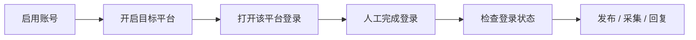
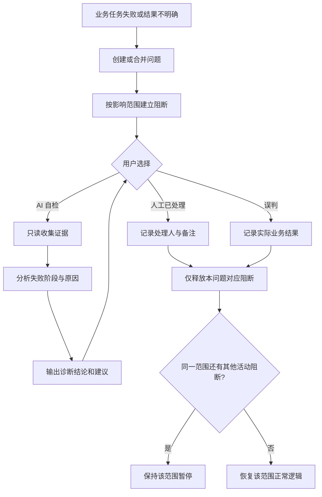

# 天河 AI 数字员工平台
## 页面巡检移除与 AI 问题自检改造执行方案 V0.1

- 编制日期：2026-08-13
- 项目目录：`D:\code\Codex项目交接包-2026-07-31\06_MVP\ai-digital-employee-mvp`
- 文档性质：实施方案，暂不代表代码已经修改完成

---

## 1. 改造背景

现有系统设置了独立的“页面巡检（Smoke Test）”功能：平台运行前或运行过程中，通过 URL、标题、关键文本、控件、selector、DOM 结构和截图与人工确认基线进行对比；发现变化后暂停对应平台，必须经人工确认或技术复测后才能恢复。

该机制的问题是：

1. 五个平台页面并不会在每次启动时发生结构变化，固定巡检收益有限；
2. 首次建立基线、差异确认、技术复测均需要人工操作，增加日常使用成本；
3. 普通用户即使知道页面发生变化，也无法自行修改 RPA 适配器；
4. “先巡检、再发布”的强制门禁延长了正常业务流程；
5. 页面检查能力更适合在真实故障发生后按需调用，而不是每次运行前固定执行。

因此，本次改造将**取消独立页面巡检及其发布门禁**，把底层只读检查能力迁移到“问题汇总”的 **AI 自检** 中，形成“故障发生后按需诊断”的新流程。

---

## 2. 本次目标

### 2.1 业务目标

将正常流程简化为：

```text
启用账号
→ 开启平台
→ 打开登录
→ 人工登录并检查登录状态
→ 直接执行发布、采集或回复
```

发布、采集和回复不再依赖 Smoke Test，不再要求建立页面基线，也不再要求人工确认巡检结果。

### 2.2 故障处理目标

当发布、审核、采集、回复、登录或系统运行失败时，在“问题汇总”中提供：

- **AI 自检**：自动收集现场、分析失败阶段、分类问题并给出建议；
- **人工已处理**：记录人工处理结果，解除该问题产生的阻断；
- **误判**：记录实际业务结果，解除误阻断，并避免重复发布或重复回复。

### 2.3 安全目标

第一阶段 AI 自检必须满足：

- 只读采集，不自动修改代码、配置和定位器；
- 不自动点击“发布”“发送”“确认”等有业务副作用的按钮；
- 不自动重新发布或重新回复；
- 点击提交后结果不明确时，必须进入人工确认，禁止自动重发；
- 只检查当前问题关联的平台、账号和浏览器 Profile，不唤醒其他平台；
- 平台未开启或账号未启用时，不启动该平台浏览器进程；
- 关闭 Web 管理平台或全局运行开关后，AI 自检和相关轮询必须停止或安全取消。

---

## 3. 本次范围

### 3.1 删除或停用的功能

1. 删除左侧“页面巡检”菜单和独立页面；
2. 停止每日/定时 Smoke Test 调度；
3. 停止手动创建 Smoke Test；
4. 移除“Smoke 通过后才能发布”的强制门禁；
5. 移除“建立基线”“确认无变化”“确认页面变化”“技术复测”等人工流程；
6. 清除升级前遗留的 `PAUSED_CHANGE`、`PAUSED_TECH` 平台门禁；
7. 取消因 Smoke Test 异常而自动暂停平台任务流的行为；
8. 停止新建 `RUN_SMOKE_TEST` 任务。

### 3.2 保留并复用的底层能力

以下能力不直接删除，改造成 AI 自检的只读取证组件：

- 页面截图；
- 当前 URL 和标题提取；
- 页面关键文本和结构摘要；
- DOM、控件和定位器匹配检查；
- 浏览器控制台及页面错误信息；
- 原任务执行阶段、Agent 回执和证据路径；
- 页面变化与历史现场的辅助对比；
- 各平台独立浏览器 Profile 和进程隔离能力。

### 3.3 第一阶段明确不做

1. AI 不直接修改 RPA 代码；
2. AI 不直接替换生产定位器；
3. AI 不自动重启系统服务；
4. AI 不自动解除高风险阻断；
5. AI 不自动重新发布、回复或提交审核；
6. AI 不承诺自动修复所有平台页面变化；
7. AI 暂不依赖视觉大模型。若当前模型不支持图片识别，截图只作为人工证据，AI 先分析结构化日志、DOM 摘要和文本证据。

---

## 4. 现有实现与影响范围

### 4.1 数据库

当前 `src/db.js` 包含：

- `smoke_test_baselines`；
- `smoke_test_runs`；
- `platforms.smoke_gate_state`；
- `platforms.smoke_gate_reason`；
- `platforms.smoke_gate_run_id`；
- `platforms.smoke_gate_updated_at`；
- `issues` 基础字段及 `occurrences`、`last_seen_at`、`screenshot_path`、`resolution`、`assignee`、`retryable`。

### 4.2 服务端

当前 `src/server.js` 包含：

- Smoke Test 定时调度；
- `RUN_SMOKE_TEST` 任务创建及回执处理；
- Smoke Gate 暂停和恢复；
- `/api/smoke-tests...` 系列接口；
- 问题创建、关闭和重试接口；
- Agent 任务领取时的 Smoke Gate 过滤。

### 4.3 运行门禁

当前 `src/services/platform-runtime.js` 使用 `smoke_gate_state === 'CLEAR'` 决定普通任务是否允许运行。该判断必须移除，并替换为通用的“问题阻断范围”判断。

### 4.4 Agent 与 RPA 适配器

当前以下文件支持 `RUN_SMOKE_TEST` / `runSmokeTest`：

- `agent/local-agent.js`；
- `agent/rpa-adapters/assisted-platform.js`；
- `agent/rpa-adapters/xiaohongshu-assisted.js`；
- `agent/rpa-adapters/simulated.js`；
- 其他继承通用 assisted adapter 的平台适配器。

这些只读检查代码应先保留并抽取为诊断采集器，避免重复开发和一次性大范围删除。

### 4.5 前端与文档

当前 `public/app.js` 中存在：

- “页面巡检”菜单；
- Smoke Test 列表、详情、截图、人工确认和复测交互；
- 问题列表的“重试”和“关闭问题”按钮。

当前 `README.md`、整体使用说明及 `packaging/create-user-guide.py` 仍将 Smoke Test 作为上线必经步骤，实施后必须同步更新。

---

## 5. 目标业务流程

### 5.1 正常运行流程



要求：

- 不创建 Smoke Test；
- 不等待页面巡检；
- 不要求人工确认页面基线；
- 未开启的平台不轮询、不唤醒、不领取任务；
- 平台关闭时终止对应轮询，并清理该平台按钮启动的浏览器进程。

### 5.2 故障处理流程



---

## 6. 问题状态与诊断状态设计

### 6.1 问题状态

建议统一为：

| 状态 | 含义 | 是否关闭问题 |
|---|---|---:|
| `OPEN` | 待处理 | 否 |
| `DIAGNOSING` | AI 正在自检 | 否 |
| `DIAGNOSED` | AI 已输出结论，待人工处理 | 否 |
| `RESOLVED` | 人工已处理 | 是 |
| `FALSE_POSITIVE` | 已确认误判 | 是 |

兼容策略：历史 `CLOSED` 记录保留；新接口不再写入 `CLOSED`。展示层将历史 `CLOSED` 显示为“历史已关闭”。

### 6.2 诊断任务状态

建议使用：

```text
QUEUED → RUNNING → COMPLETED
                 ↘ FAILED
                 ↘ CANCELLED
```

诊断失败不关闭原问题。原问题恢复为 `OPEN`，并显示诊断失败原因，允许再次发起自检。

### 6.3 状态转换规则

- `OPEN → DIAGNOSING`：用户点击 AI 自检且成功创建任务；
- `DIAGNOSING → DIAGNOSED`：诊断成功；
- `DIAGNOSING → OPEN`：诊断失败或安全取消；
- `OPEN/DIAGNOSED → RESOLVED`：点击人工已处理；
- `OPEN/DIAGNOSED → FALSE_POSITIVE`：点击误判；
- 已关闭问题不能再次启动 AI 自检；
- 诊断过程中人工关闭问题时，待执行诊断取消；正在执行的诊断允许保存证据，但不得重新打开问题。

---

## 7. 阻断范围设计

不能因任意单个问题暂停所有平台。建议新增通用阻断表，以问题为来源进行精确控制。

### 7.1 阻断级别

| 范围 | 示例 | 影响 |
|---|---|---|
| `TASK` | 素材损坏、标题超长、单任务参数错误 | 仅当前任务/发布目标 |
| `ACCOUNT` | 登录过期、账号验证、账号权限不足 | 仅当前账号 |
| `PLATFORM_FEATURE` | 某平台发布按钮定位失效，但采集仍正常 | 仅该平台的指定功能 |
| `PLATFORM` | 平台核心页面流程整体改变 | 仅该平台全部自动任务 |
| `SYSTEM` | Agent、数据库、磁盘或全局网络故障 | 全部自动任务 |

### 7.2 建议阻断键

```text
TASK:publish_target:81
ACCOUNT:23
PLATFORM_FEATURE:douyin:publish
PLATFORM:weibo
SYSTEM:agent
```

### 7.3 释放规则

- “人工已处理”和“误判”只释放当前问题创建的阻断记录；
- 同一账号/平台/任务如仍有其他活动阻断，必须保持暂停；
- 不允许通过一次处理操作把所有平台统一恢复；
- 状态恢复只影响后续任务领取，不自动重放已经执行过的业务动作。

---

## 8. 数据库改造方案

### 8.1 `issues` 增加字段

建议通过 `ensureColumn` 兼容升级：

```text
resolution_type       TEXT
resolved_by           TEXT
resolved_at           TEXT
block_scope           TEXT
block_key             TEXT
diagnosis_status      TEXT
diagnosis_summary     TEXT
latest_diagnosis_id   INTEGER
```

`resolution_type` 可取：

```text
MANUAL_HANDLED
FALSE_POSITIVE
LEGACY_CLOSED
SYSTEM_MIGRATION
```

### 8.2 新增 `issue_diagnoses` 表

建议字段：

```sql
CREATE TABLE IF NOT EXISTS issue_diagnoses (
  id INTEGER PRIMARY KEY AUTOINCREMENT,
  issue_id INTEGER NOT NULL REFERENCES issues(id),
  agent_job_id INTEGER REFERENCES agent_jobs(id),
  mode TEXT NOT NULL DEFAULT 'READ_ONLY',
  status TEXT NOT NULL DEFAULT 'QUEUED',
  category TEXT,
  failed_stage TEXT,
  confidence REAL,
  page_changed INTEGER,
  safe_to_retry INTEGER NOT NULL DEFAULT 0,
  suggested_block_scope TEXT,
  summary TEXT,
  evidence_json TEXT,
  recommendations_json TEXT,
  error_message TEXT,
  requested_by TEXT,
  started_at TEXT,
  completed_at TEXT,
  created_at TEXT NOT NULL,
  updated_at TEXT NOT NULL
);
```

### 8.3 新增 `runtime_blocks` 表

```sql
CREATE TABLE IF NOT EXISTS runtime_blocks (
  id INTEGER PRIMARY KEY AUTOINCREMENT,
  issue_id INTEGER NOT NULL REFERENCES issues(id),
  scope TEXT NOT NULL,
  block_key TEXT NOT NULL,
  feature TEXT,
  reason TEXT NOT NULL,
  status TEXT NOT NULL DEFAULT 'ACTIVE',
  created_at TEXT NOT NULL,
  released_at TEXT,
  released_by TEXT,
  release_reason TEXT
);
```

索引建议：

```text
(issue_id, status)
(scope, block_key, status)
```

### 8.4 Smoke 历史数据迁移

建议新增一次性迁移编号：

```text
2026-08-13-remove-smoke-gate-add-issue-diagnosis-v1
```

迁移内容：

1. 所有平台 `smoke_gate_state` 更新为 `CLEAR`；
2. 清空 `smoke_gate_reason` 和 `smoke_gate_run_id`；
3. 对 `QUEUED`/`RUNNING` 的 `RUN_SMOKE_TEST` Job 标记为 `CANCELLED`；
4. 对未完成的 `smoke_test_runs` 标记为 `CANCELLED`，说明“页面巡检功能已下线”；
5. 将未关闭的 `source='SMOKE_TEST'` 问题改为 `RESOLVED`；
6. `resolution_type='SYSTEM_MIGRATION'`；
7. `resolution='功能升级：原页面巡检门禁已移除'`；
8. 保留 `smoke_test_baselines`、`smoke_test_runs` 和历史截图，不物理删除，避免升级丢失审计数据。

首个版本不删除 `platforms.smoke_gate_*` 字段，先停止读取和写入；后续稳定版本再考虑清理。

---

## 9. API 改造方案

### 9.1 新增接口

#### 发起 AI 自检

```http
POST /api/issues/:id/diagnose
```

请求示例：

```json
{
  "requestedBy": "管理员",
  "mode": "READ_ONLY"
}
```

返回：

```json
{
  "ok": true,
  "diagnosisId": 12,
  "jobId": 305,
  "status": "QUEUED"
}
```

#### 查询诊断历史

```http
GET /api/issues/:id/diagnoses
```

#### 人工已处理

```http
POST /api/issues/:id/manual-resolve
```

请求建议：

```json
{
  "resolvedBy": "管理员",
  "note": "已重新登录并人工核对任务状态",
  "actualOutcome": "UNKNOWN"
}
```

#### 标记误判

```http
POST /api/issues/:id/false-positive
```

请求建议：

```json
{
  "resolvedBy": "管理员",
  "reason": "平台实际已发布成功，回执识别超时",
  "actualOutcome": "PUBLISHED",
  "platformUrl": "",
  "platformPostId": ""
}
```

### 9.2 幂等与并发控制

- 同一问题同一时间只允许一个活动诊断任务；
- Job 幂等键建议：`diagnose-issue:{issueId}:{diagnosisId}`；
- 连续点击 AI 自检返回现有活动任务，不重复创建；
- 人工处理接口只能从未关闭状态转换；
- 释放阻断必须放在数据库事务中；
- 已关闭问题的迟到诊断回执只能保存，不得修改问题为 `DIAGNOSED`；
- API 必须记录处理人、时间、备注和实际业务结果。

### 9.3 旧接口处理

建议：

- 从前端完全移除 `/api/smoke-tests` 调用；
- `POST /api/smoke-tests/run`、`review`、`retest` 暂时返回 HTTP `410 Gone`，防止旧页面或旧脚本继续创建巡检任务；
- 历史查询接口可保留一个版本供审计，但不在普通界面暴露；
- 下一大版本再删除旧 Smoke API 代码。

---

## 10. AI 自检任务设计

### 10.1 新任务类型

```text
DIAGNOSE_ISSUE
```

任务载荷示例：

```json
{
  "issueId": 123,
  "diagnosisId": 12,
  "platformCode": "douyin",
  "accountId": 23,
  "relatedType": "PUBLISH_TARGET",
  "relatedId": "81",
  "feature": "publish",
  "mode": "READ_ONLY"
}
```

### 10.2 诊断执行顺序

1. 读取问题、原任务、原 Agent Job 和原始回执；
2. 分析错误码、失败步骤、重试安全状态和已有证据；
3. 优先执行离线诊断，不启动浏览器；
4. 证据不足时，仅针对关联平台和关联 Profile 执行只读页面检查；
5. 收集 URL、标题、关键文本、DOM 摘要、定位器命中结果、截图及控制台错误；
6. 使用规则引擎生成初步分类；
7. 调用现有 AI 服务对结构化证据进行归纳和建议生成；
8. 服务端校验 AI 输出结构，保存诊断结果；
9. 问题状态改为 `DIAGNOSED`，等待人工处理。

### 10.3 浏览器唤醒边界

只有同时满足以下条件，才允许进行浏览器取证：

- 用户明确点击当前问题的 AI 自检；
- 全局运行开关开启；
- 关联平台已开启；
- 关联账号已启用；
- 关联设备在线；
- 问题中能确定唯一的平台和账号；
- 没有正在关闭 Web/平台的进程清理动作。

不满足时仍可做离线诊断，并在结果中说明“未启动浏览器，现场证据不足”。严禁遍历或轮询其他四个平台。

### 10.4 诊断分类

建议第一阶段分类：

```text
LOGIN_EXPIRED
VERIFY_REQUIRED
NETWORK_ERROR
BROWSER_CRASH
MATERIAL_INVALID
CONTENT_REJECTED
RATE_LIMITED
PERMISSION_DENIED
PLATFORM_ERROR
LOCATOR_MISMATCH
PAGE_CHANGED
TIMEOUT
RESULT_UNCERTAIN
SYSTEM_ERROR
UNKNOWN
```

### 10.5 标准诊断结果

```json
{
  "status": "COMPLETED",
  "category": "LOCATOR_MISMATCH",
  "failedStage": "CLICK_SUBMIT",
  "confidence": 0.82,
  "pageChanged": true,
  "safeToRetry": false,
  "suggestedBlockScope": "PLATFORM_FEATURE",
  "summary": "发布按钮定位器未匹配",
  "evidence": [
    {
      "type": "LOCATOR_CHECK",
      "name": "submitButton",
      "matched": false
    }
  ],
  "recommendations": [
    "技术人员核对发布按钮 DOM",
    "确认平台是否进入新的发布编辑器"
  ]
}
```

### 10.6 服务端二次校验

AI 输出不能直接作为执行命令。服务端必须：

- 校验 JSON Schema；
- 限制分类枚举和置信度范围；
- 忽略 AI 返回的可执行脚本；
- `safeToRetry=false` 优先于任何文字建议；
- 发现提交结果未知时强制归类为 `RESULT_UNCERTAIN`；
- 不因 AI 建议自动释放阻断或创建发布任务。

---

## 11. 三个按钮的前端交互

### 11.1 AI 自检

显示条件：问题状态为 `OPEN` 或 `DIAGNOSED`。

交互：

1. 点击后显示“正在收集证据”；
2. 按钮禁用，防止重复点击；
3. 问题卡显示诊断阶段、开始时间和运行状态；
4. 完成后展示：失败阶段、问题分类、置信度、是否页面变化、是否可安全重试、证据和建议；
5. AI 结论下方必须标注“诊断建议，不代表已自动修复”。

### 11.2 人工已处理

点击后弹出处理窗口，至少填写：

- 处理人；
- 处理说明；
- 实际结果：未执行、已失败、已成功、不确定。

处理后：

- 问题改为 `RESOLVED`；
- 释放该问题对应阻断；
- 不自动重新发布或回复；
- 原任务保留完整历史。

### 11.3 误判

点击后弹出窗口，至少填写：

- 误判原因；
- 处理人；
- 实际业务结果。

若发布实际成功：

- 将目标任务标记为“人工确认成功”；
- 可选记录平台内容 ID、URL 或截图；
- 锁定原提交，禁止重新发布。

若实际未发布：

- 只关闭误判问题；
- 是否重试由用户另行发起，不能由“误判”按钮隐式重试。

### 11.4 旧按钮调整

- 原“关闭问题”替换为“人工已处理”和“误判”；
- 原“重试”不与上述两个按钮绑定；
- 只有现有安全校验确认可重试时才显示“安全重试”；
- 发布结果未知、回复结果未知时不显示自动重试入口。

---

## 12. 发布幂等与业务安全

### 12.1 失败分级

| 情况 | 处理方式 |
|---|---|
| 点击发布前明确失败 | 可标记为候选安全重试，但仍需用户确认 |
| 已点击发布且明确失败 | 根据平台回执决定，不直接重试 |
| 已点击发布但结果未知 | 进入 `NEEDS_CONFIRMATION`，禁止自动重发 |
| 平台明确发布成功 | 写入平台内容 ID/URL，锁定提交 |
| AI 无法判断 | `RESULT_UNCERTAIN`，交人工核对 |

### 12.2 人工操作后的原则

- “人工已处理”默认终结原问题，不自动重放原任务；
- “误判且实际成功”必须将原业务记录修正为成功并保持提交锁；
- 人工确认未发布后，如需再次发布，应通过显式“创建重试任务”完成；
- 新重试任务继续使用现有 `idempotency_key`、`submit_lock` 和 `retry_of_task_id` 安全机制。

---

## 13. 文件级修改清单

### 13.1 服务端

#### `src/db.js`

- 新增问题诊断字段；
- 新增 `issue_diagnoses`、`runtime_blocks` 表和索引；
- 新增 Smoke Gate 移除迁移；
- 保留历史 Smoke 表；
- 增加旧 `CLOSED` 状态兼容逻辑。

#### `src/server.js`

- 停止 Smoke 调度和 Smoke Job 创建；
- 禁用旧 Smoke 写接口；
- 移除任务领取 SQL 中的 `smoke_gate_state` 限制；
- 新增 AI 自检、人工已处理、误判接口；
- 新增 `DIAGNOSE_ISSUE` Job 创建和回执处理；
- 新增按任务/账号/平台功能/平台/系统判断阻断的逻辑；
- 释放阻断与状态更新使用事务；
- 保留现有发布提交锁和结果未知保护。

#### `src/services/platform-runtime.js`

- 删除 Smoke Gate 对 `task_execution_state` 的影响；
- 接入通用 `runtime_blocks` 聚合结果；
- 返回明确的 `task_blocked_reason`、`block_scope` 和 `active_block_count`。

#### 建议新增 `src/services/runtime-blocks.js`

- 创建阻断；
- 查询活动阻断；
- 判断任务是否允许执行；
- 释放指定问题阻断；
- 统计同范围剩余阻断。

#### 建议新增 `src/services/issue-diagnosis.js`

- 问题上下文解析；
- 分类规则；
- AI 输入脱敏与裁剪；
- AI 输出 Schema 校验；
- 诊断结果归一化；
- 安全重试判定。

#### `src/config.js`

删除或停止使用：

```text
smokeTestEnabled
smokeTestScheduleHour
smokeTestSchedulerIntervalMs
```

保留或迁移：

```text
smokeTestPageSettleMs       → issueDiagnosisPageSettleMs
smokeTestScreenshotDir      → issueDiagnosisEvidenceDir
```

新增建议：

```text
ISSUE_DIAGNOSIS_ENABLED=true
ISSUE_DIAGNOSIS_BROWSER_READONLY=true
ISSUE_DIAGNOSIS_TIMEOUT_MS=120000
ISSUE_DIAGNOSIS_PAGE_SETTLE_MS=2000
ISSUE_DIAGNOSIS_EVIDENCE_DIR=./logs/issue-diagnosis
```

### 13.2 Agent

#### `agent/local-agent.js`

- 支持 `DIAGNOSE_ISSUE` 的执行和取消语义；
- 平台关闭、Web 关闭或全局暂停时安全中止；
- 诊断执行期间不得跨平台切换；
- 进程清理必须只针对关联 Profile。

#### `agent/rpa-adapters/assisted-platform.js`

- 将 `runSmokeTest` 中通用只读采集能力抽成 `collectDiagnosticEvidence`；
- 增加定位器逐项检查和失败阶段记录；
- 禁止写操作和业务提交；
- 返回统一诊断证据结构。

#### `agent/rpa-adapters/xiaohongshu-assisted.js`

- 接入统一 `DIAGNOSE_ISSUE`；
- 保留小红书专用页面和定位器检查；
- 不影响现有发布、审核、采集和回复逻辑。

#### `agent/rpa-adapters/simulated.js`

- 增加诊断模拟结果，用于自动化测试；
- 覆盖页面变化、登录失效、定位失败、网络异常和结果未知。

#### 其他平台适配器

- 复用 assisted adapter 的通用诊断入口；
- 平台有特殊流程时仅增加平台差异数据，不复制整套诊断框架。

### 13.3 前端

#### `public/app.js`

- 删除 `navItems` 中的 `smoke` 菜单；
- 删除 `renderSmokeTests` 及相关按钮和定时刷新；
- 从页面映射及状态中删除 `smokeSelectedId`；
- 重构 `renderIssues`，增加三类操作；
- 增加诊断详情、证据列表和建议展示；
- 增加人工处理/误判弹窗及实际结果选择；
- 状态显示增加 `DIAGNOSING`、`DIAGNOSED`、`RESOLVED`、`FALSE_POSITIVE`。

#### `public/styles.css`

- 删除仅供 Smoke 独立页面使用的样式；
- 新增诊断进度、结论、证据和阻断范围样式；
- 保证问题卡在较长诊断内容下仍可阅读。

### 13.4 配置、启动和打包

#### `.env.example`、`initialize-mvp.ps1`

- 删除定时 Smoke 配置；
- 创建 `logs/issue-diagnosis` 目录；
- 写入 AI 自检只读配置；
- 不更改固定管理端密码 `admin123` 的既定要求。

#### `packaging/create-user-guide.py`

- 删除“页面巡检”章节；
- 删除“上线前必须 Smoke Test”的描述；
- 新增“问题汇总与 AI 自检”章节；
- 说明人工已处理、误判及禁止重复发布规则。

#### `README.md` 和 `docs/天河AI数字员工平台-整体项目使用说明-V0.1.0.md`

- 同步新正常流程；
- 同步 AI 自检边界；
- 更新运行门禁和故障恢复说明；
- 更新最终回归覆盖项。

---

## 14. 分阶段实施步骤

### 阶段 A：冻结与备份

1. 备份当前源码；
2. 备份 `data/mvp.db`；
3. 记录现有安装包校验值；
4. 运行当前完整自动化测试，记录实际基线；
5. 保存现有 Smoke 表数据量和未关闭问题数量。

交付物：升级前基线报告和可回滚备份。

### 阶段 B：移除 Smoke 强制流程

1. 删除前端“页面巡检”入口；
2. 停止自动调度；
3. 禁用手动 Smoke 写接口；
4. 取消 Agent 领取普通任务时的 Smoke Gate 过滤；
5. 数据迁移清除旧 Smoke Gate；
6. 取消未执行的 Smoke Job；
7. 历史 Smoke 数据只读保留；
8. 更新基础文案。

阶段验收：未执行页面巡检时，已开启、已登录的平台可以正常发布、采集和回复。

### 阶段 C：问题模型与精确阻断

1. 扩展 `issues`；
2. 新增 `runtime_blocks`；
3. 建立任务、账号、平台功能、平台和系统五级阻断；
4. 修改平台运行状态和 Agent 领取逻辑；
5. 实现“人工已处理”和“误判”；
6. 验证只释放当前问题的阻断；
7. 验证同范围多个问题不会被误恢复。

阶段验收：人工处理一个任务级问题不会恢复仍有故障的账号或平台。

### 阶段 D：AI 自检 V1

1. 新增 `issue_diagnoses`；
2. 新增 `DIAGNOSE_ISSUE`；
3. 接入原始任务、回执和日志的离线分析；
4. 抽取 Smoke 只读采集能力；
5. 实现关联平台的定向浏览器取证；
6. 实现规则分类和 AI 总结；
7. 前端展示诊断进度、证据和建议；
8. 完成并发、超时、取消和迟到回执保护。

阶段验收：AI 自检能定位主要失败阶段，但不会发布、回复、修改代码或自动恢复任务。

### 阶段 E：测试、文档与重新打包

1. 完整自动化回归；
2. 五个平台逐一做隔离测试；
3. 验证未开启平台不被唤醒；
4. 验证 Web 关闭联动停止轮询和进程；
5. 更新 Markdown、DOCX、PDF 使用说明；
6. 将知识库 Excel、数据库迁移包、使用说明和卸载程序一并纳入交付压缩包；
7. 构建新安装包；
8. 在全新目录执行安装、启动、停止、卸载和数据库迁移验证；
9. 生成最终文件清单与 SHA-256 校验值。

---

## 15. 测试计划

### 15.1 Smoke 移除测试

- 启动系统后不自动创建 `RUN_SMOKE_TEST`；
- 平台开启后不自动进入页面巡检；
- 没有 Smoke 基线也可以创建并执行任务；
- 历史 `PAUSED_CHANGE`、`PAUSED_TECH` 升级后不再阻断；
- 旧 Smoke 写接口不能创建任务；
- 历史数据仍可从数据库审计。

### 15.2 AI 自检测试

- 同一问题重复点击只产生一个活动诊断；
- AI 自检只处理关联平台；
- 平台关闭时不启动浏览器；
- 账号停用时不启动浏览器；
- Web 关闭时诊断安全取消；
- 诊断超时后问题恢复为 `OPEN`；
- AI 返回非法 JSON 时不影响主流程；
- AI 服务不可用时仍保留规则诊断和已有证据；
- 诊断结果不能直接触发发布或回复。

### 15.3 问题恢复测试

- 人工已处理后只释放当前问题阻断；
- 误判后记录原因和处理人；
- 同范围有两个活动阻断时，处理一个后仍保持暂停；
- 发布实际成功的误判会锁定原提交；
- 发布结果未知时不能自动重试；
- 已关闭问题的迟到诊断回执不会重新打开问题。

### 15.4 平台隔离测试

五个平台分别验证：

- 只开启单个平台时，其他平台无轮询、无新 Profile、无 Chrome 进程；
- AI 自检只使用目标平台 Profile；
- 关闭单个平台只结束该平台进程；
- 关闭 Web 管理平台结束全部受管 Agent/平台进程；
- 一个平台注册/登录/定位故障不阻塞其他平台。

### 15.5 回归测试

以现有完整自动化测试作为升级前基线。实施后：

- 将 `test/smoke-test.test.js` 改造为“Smoke 下线兼容 + AI 诊断”测试；
- 更新 `test/runtime-gates.test.js`；
- 更新 `test/runtime-recovery.test.js`；
- 增加 `test/issue-diagnosis.test.js`；
- 增加 `test/issue-resolution.test.js`；
- 保留五平台发布、回复、登录轮询、安全锁和数据库测试；
- 要求所有历史非 Smoke 功能测试通过，新测试全部通过，且不得通过删除关键断言制造“全绿”。

---

## 16. 验收标准

### 16.1 功能验收

- [ ] 左侧菜单不再显示“页面巡检”；
- [ ] 启动平台不再要求 Smoke Test；
- [ ] 发布不再被 Smoke Gate 阻断；
- [ ] 系统不再创建定时 Smoke Job；
- [ ] 问题列表显示“AI 自检”“人工已处理”“误判”；
- [ ] AI 自检能输出结构化诊断结论；
- [ ] 人工已处理和误判能正确恢复对应范围；
- [ ] 历史 Smoke 数据未丢失；
- [ ] 五个平台仍保持完全隔离。

### 16.2 安全验收

- [ ] AI 自检期间没有发布、发送、回复、删除或修改动作；
- [ ] 发布结果未知时不存在自动重发；
- [ ] 误判且实际已发布时不会重复发布；
- [ ] 平台未开启时不会被 AI 自检或轮询唤醒；
- [ ] 关闭平台或 Web 后相关进程被清理；
- [ ] 同范围存在多个问题时不会误恢复；
- [ ] AI 输出不能直接作为本地脚本执行。

### 16.3 交付验收

- [ ] 自动化测试全部通过；
- [ ] 五平台隔离测试全部通过；
- [ ] 新安装验证通过；
- [ ] 旧数据库升级验证通过；
- [ ] 安装、启动、停止、卸载功能通过；
- [ ] 使用说明已更新；
- [ ] 知识库 Excel 和数据库迁移文件已放入最终压缩包；
- [ ] 最终包不包含临时文件、调试证据、旧备份和其他无关内容；
- [ ] 提供安装包、完整交付 ZIP、文件清单及 SHA-256。

---

## 17. 风险与控制措施

| 风险 | 影响 | 控制措施 |
|---|---|---|
| 取消 Smoke 后页面变化只能在执行时发现 | 单次任务失败 | 失败立即进入问题汇总，按需 AI 自检；保留只读取证能力 |
| AI 错误判断可安全重试 | 重复发布/回复 | 服务端强制安全规则优先，AI 不能直接创建重试 |
| 多问题共享同一阻断范围 | 提前恢复故障范围 | 使用独立 `runtime_blocks`，仅在无其他活动阻断时恢复 |
| 迁移误清除正常门禁 | 影响运行控制 | 只清 Smoke Gate，不修改账号、平台和全局开关 |
| 诊断唤醒错误平台 | 账号隔离破坏 | 任务必须包含唯一平台/账号/Profile，Agent 执行前二次校验 |
| AI 服务不可用 | 诊断失败 | 规则分析与证据采集独立运行；问题保持 `OPEN` |
| 历史客户端调用 Smoke API | 重新产生旧任务 | 写接口返回 `410 Gone`，服务端不再调度 |
| 旧数据库升级失败 | 系统无法启动 | 事务迁移、升级前备份、迁移编号幂等、失败回滚 |

---

## 18. 回滚方案

1. 实施前备份源码、数据库和当前交付包；
2. 所有数据库迁移在事务中执行；
3. 第一版本不删除 Smoke 表和平台 Smoke 字段；
4. 若升级失败，停止新程序并恢复旧程序目录和 `mvp.db`；
5. 若仅 AI 自检异常，可通过 `ISSUE_DIAGNOSIS_ENABLED=false` 临时关闭 AI 自检，不影响正常发布流程；
6. 若通用阻断逻辑异常，先暂停全局运行，修复阻断记录后再恢复；
7. 回滚时不得自动恢复未确认的发布或回复任务。

---

## 19. 建议优先级与工作量

| 优先级 | 工作项 | 建议工作量 |
|---|---|---:|
| P0 | 移除 Smoke 菜单、调度和门禁，完成数据迁移 | 1–1.5 人日 |
| P0 | 问题状态、精确阻断、人工已处理、误判 | 1.5–2 人日 |
| P1 | AI 自检任务、只读取证、规则分类和 AI 总结 | 2.5–4 人日 |
| P1 | 自动化测试、五平台隔离测试和安全验证 | 2–3 人日 |
| P1 | 文档、安装包、数据库迁移包和最终压缩包 | 1–1.5 人日 |

合计建议：约 **8–12 人日**。实际工作量取决于五个平台真实页面联调次数、AI 接口是否支持所需输入，以及定位器检查结果的标准化程度。

---

## 20. 推荐实施结论

本次改造建议分两次提交、一次统一交付：

1. **第一次提交：**移除 Smoke 强制流程，完成问题状态和精确阻断基础；
2. **第二次提交：**接入 AI 自检 V1，只负责定位问题和给出建议；
3. **统一交付：**完成五平台隔离回归后，再更新安装包、使用说明、知识库 Excel、数据库迁移文件和最终压缩包。

该方案能减少日常人工巡检工作，同时保留原有页面取证能力，并把它放在真实故障发生后按需使用。第一阶段严格坚持“AI 只诊断、不自动修复、不自动重发”，可以在不增加重复发布风险的前提下，为后续 AI 自动修复和受控定位器更新打下基础。
